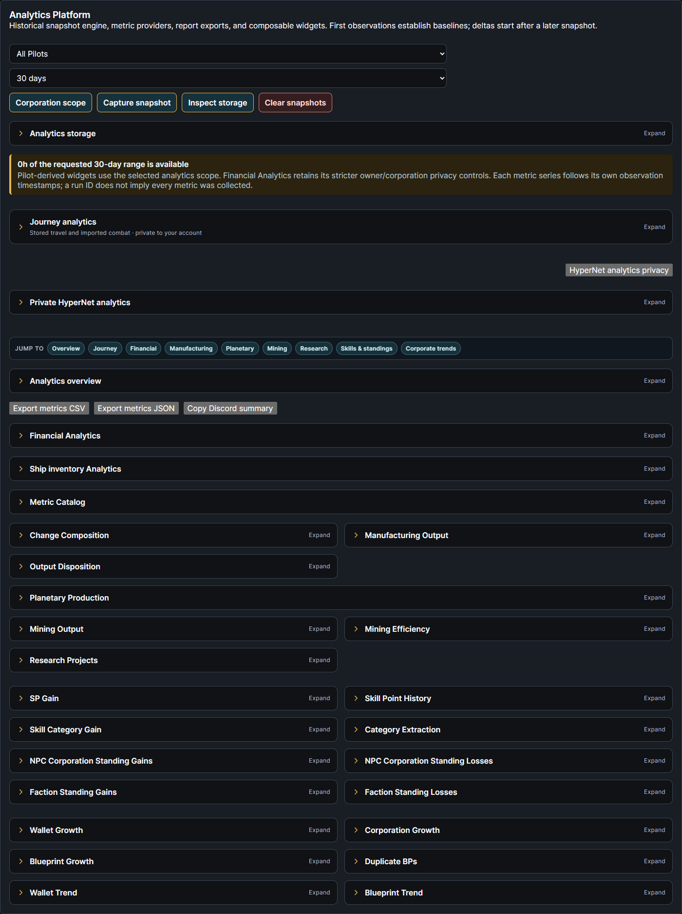
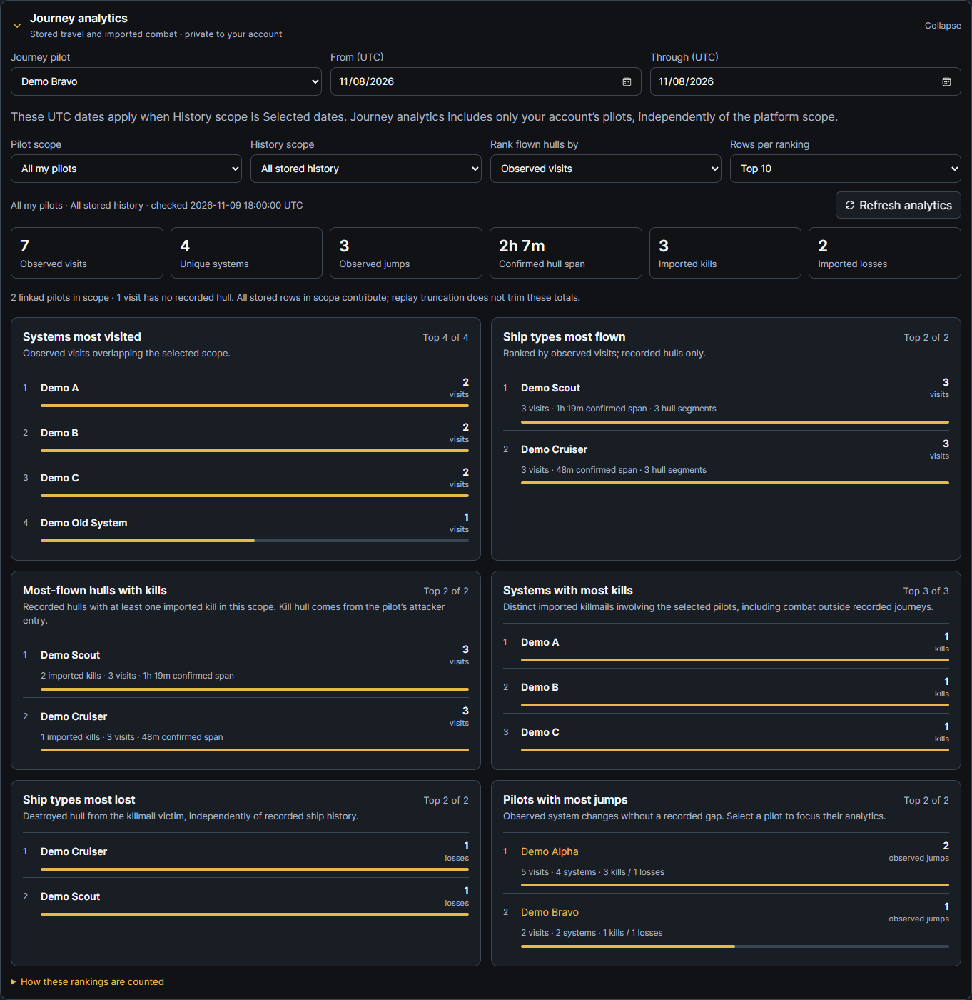

# Expandable analytics panes

Unreleased EQM 2.4.0 frontend follow-up. Analytics results throughout EQM now use expandable panes that start **collapsed** when their view mounts. Select a pane heading, or focus it and press Enter/Space, to expand or collapse it. Dates, scope filters, exports, privacy controls and operational actions remain available in their existing locations. Coverage/error notices stay visible.

## Covered views

| View | Expandable result groups |
| --- | --- |
| Analytics Platform | Storage controls, overview, Financial Analytics, ship inventory, metric catalog, change composition, manufacturing/disposition, planetary, mining/efficiency, research, skills/standings, corporation/wallet/blueprint growth, duplicate blueprints and trends. |
| Journey analytics | Available both on Analytics and on the Journey page, collapsed by default in both locations. |
| Bounties | Summary, bounty/tax chart, leaderboard and traceable ledger. |
| Killboard | Summary, timeline, hull/opponent/geography rankings, streaks, wingmates and recent records. |
| SRP Analytics | Summary, loss/ISK charts and doctrine/ship/class/status/operation breakdowns. |
| Event Analytics | Summary, events by type, registration/attendance and activity chart. |
| HyperNet | Existing private analytics result group. Its opt-in privacy controls remain accessible separately. |

The shared pane mounts its result body on first expansion. Most widgets retain that body while hidden, preserving choices made inside the pane. This is a presentation change: existing parent pages can still read their aggregate data while panes are closed. It does not start ESI collection or change data retention. Page/category links keep their original anchors; following an explicit category link opens its target pane, including when using the same link again.

## Journey on Analytics

Expand **Journey analytics** on the main Analytics page for the same six account-private rankings available on the Journey page. Choose a linked pilot and optional UTC From/Through dates in that pane. Select **Selected dates (UTC)** under History scope to apply those dates; the Through date includes that whole UTC day. All stored history remains the default.

Journey's pilot/date choices are independent of the platform's broader pilot/corporation scope and reporting period. Hosts/Admins still see only their own Journey history. The main Analytics page requires its existing Analytics permission; the Journey pane is shown only when the viewer also has Navigation access. The existing Journey API independently enforces Navigation and current character ownership. Combat still uses its existing additional report permissions. Selecting a pilot from the Journey leaderboard focuses that pane's pilot scope; on the Journey page it also selects the map pilot.

Journey's result/metadata children unmount when collapsed, stopping the result polling and aborting pending reads. It sends no Journey request before first expansion. The selected pilot/date/sort scope is retained in the parent while collapsed. Opening the pane again reloads the linked-pilot list and results. No tracking or consent is enabled by expanding it.

Matching frontend rollout is required. This follow-up changes no backend route, permission, database schema, ESI scope, application version or native engine.

## Verification

Actual affected React views and shared API/styles were rendered in headless Edge at 1440px and 390px with fabricated accounts/history. Journey, main financial/planetary/ship analytics, Bounties, SRP, Events and HyperNet used real read-only API serializers against isolated SQLite. Killboard used fixed local read fixtures to disable its automatic synchronization path. One fake HyperNet participation and fake opt-in preferences made its private result pane available. No production data, live SSO, external ESI or synchronization was used.

Browser checks verified all default-closed groups, expansion, keyboard activation, anchor navigation, retained controls, both Journey placements, standalone pilot/date scope, Navigation-denied hiding, available HyperNet privacy controls and mobile overflow. Existing 29 Journey frontend tests, TypeScript and production Vite build passed. No backend implementation changed.
