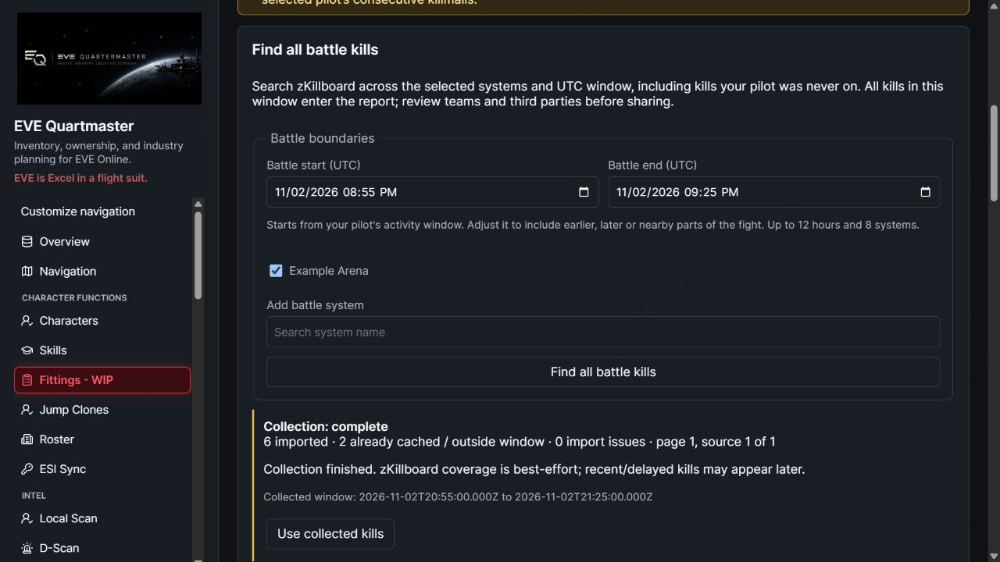
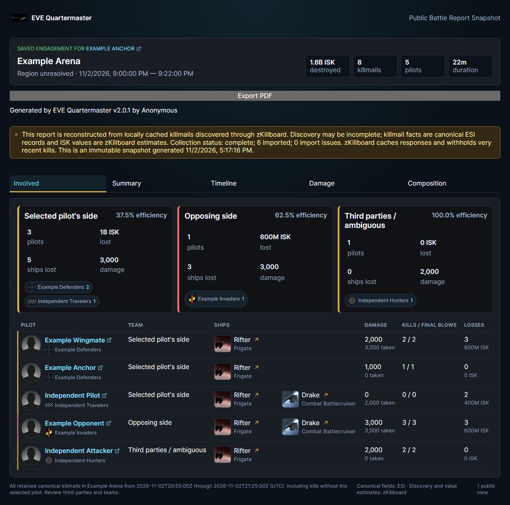
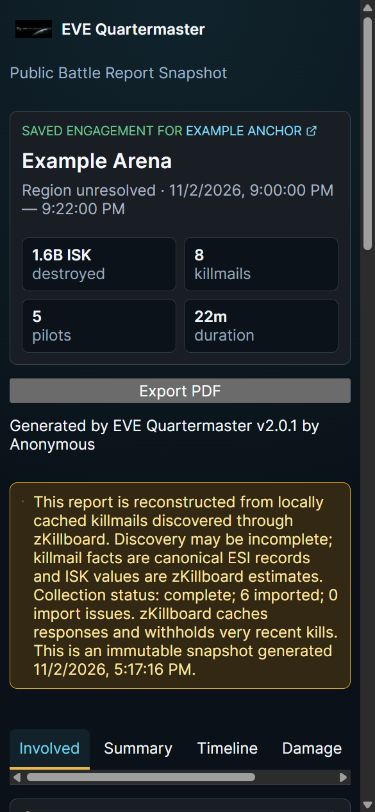

# Full-battle discovery

Select a tracked pilot and a retained battle in **Fleet & Community → Battle Reports**, then use **Find all battle kills**. The pilot locates the battle; system-wide discovery is independent of whether that pilot appeared on each killmail.

The editor starts with the pilot activity cluster plus the grouping gap. Adjust the **UTC** start/end, select the battle systems, and add nearby systems by name. Explicit collection windows support at most **12 hours and 8 systems** and must include the selected anchor event. This lets a long fight extend beyond your own first/last killmail. The original cached, affiliation-connected report remains available before collection.

Collection runs in the background with visible progress. It queries the documented zKillboard `solarSystemID` feed with an hour-rounded recent lookback, or year/month filters for historical battles. It pages until an empty page; an already-cached page never ends discovery. It deduplicates IDs and fetches missing canonical records from public ESI by ID/hash. Only canonical records matching the chosen system and UTC window are imported. Existing canonical rows are reused, with refreshed zKill value estimates. Neither private character scopes nor automatic character enrollment is needed.

**Use collected kills** rebuilds from every retained canonical killmail in those systems and window, including kills with no selected-pilot or affiliation connection. This can include simultaneous unrelated skirmishes: review **Third parties / ambiguous** and **Edit teams** before sharing. Pilot and corporation/alliance team edits preserve the expanded scope. Public/private snapshots freeze the scope, coverage status and classifications; their PDF includes the grouping window and coverage warning. Existing snapshots remain unchanged.

## Progress, limits and recovery

- Jobs retain their system target and page cursor in the existing `KillboardSyncRun` store. Resume paused/failed collections, including after an interrupted process; a stale running lease becomes resumable after two minutes. Only the creator can inspect/control a battle job, and current Battle Reports and selected-pilot access are rechecked after network waits. Cancel and permission loss prevent late imports. Ordinary Killboard sync does not manage these jobs.
- zKillboard calls are paced and retried for rate limits. No database session/transaction is retained while waiting for discovery or canonical HTTP responses. Existing canonical kills are idempotent across repeated pages and resumes.
- Collection is bounded to 100 pages per query target, 20,000 imported/updated records and a 15-minute execution budget. Time-budget pauses retain the cursor; source limits and canonical failures are marked **partial**, never silently reported as complete. Narrow the window or refresh later if necessary. A 32 MiB decoded-page bound protects against oversized upstream responses.
- A finished collection means the requested search ran to its available end, **not guaranteed knowledge of every real loss**. zKillboard withholds kills under five minutes old, caches API responses, and cannot provide unreported/delayed killmails. Refresh later as more become public. No live-feed completeness or live load benchmark is claimed.

## Deployment and engines

No schema migration, extra OAuth scope or version bump is introduced. Deploy matching backend/frontend. Rust receives the full-window flag; older native output that drops candidate kill IDs is rejected and falls back to Python. The new native contract test is included, but a Rust toolchain/Linux test binary was unavailable in this Windows verification environment. Python integration and native-fallback checks pass.

Verified against the [current zKillboard API documentation](https://zkillboard.com/api/docs/) on November 2, 2026. The deprecated startTime/endTime, before/after kill-ID and limit filters are not used.

## Development captures

Actual built UI/API, isolated SQLite, fictional pilots and mocked public discovery/ESI. A report with two cached kills grew to eight, including two independently affiliated kills; team edits, private saving, public snapshots and mobile containment were checked. No production account or live battle data was used.

