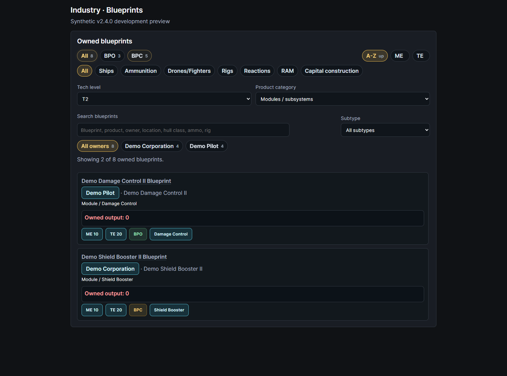

# Blueprint tech and product filters

In **Industry → Blueprints**, use **Tech level** to select **All tech levels**, **T2**, or **T3**. Use **Product category** to narrow the same owned-blueprint list to **Ships** or **Modules / subsystems**. For example, choose T2 + Ships for owned T2 hull blueprints, or T3 + Modules / subsystems for subsystem blueprints.

These selections combine with BPO/BPC, owner, family, subtype and text search. The result count shows matching blueprint instances against the total visible holdings. Choose All tech levels / All products to remove the corresponding restriction. Changing tech level clears the subtype; changing product category clears the family and subtype, so an old hull-class selection does not silently exclude the newly selected modules. Other selections remain active.

Tech level comes from the manufactured product's imported SDE Dogma `techLevel` attribute (422). Ship products use SDE category 6; Modules / subsystems includes category 7 (modules, including rigs) and category 32 (subsystems). Ammunition, drones and other products remain accessible under All products and the existing family filters. Missing product/tech metadata stays visible under All; names and Roman-numeral suffixes are never used to guess tech level. Import the applicable SDE Dogma data if known T2/T3 blueprints are absent from these filtered views.

Blueprints temporarily represented by active research jobs receive the same manufactured-product metadata. Existing ownership visibility remains in force.

**Export current filter** applies these selections to both CSV and JSON. **Export all** includes all authorized blueprints independently of the controls. Downloads add the nullable `product_tech_level` field; empty CSV exports retain the same header. Existing privacy settings and inventory schema identifiers remain in force.

## Development preview and validation

Unreleased v2.4.0 feature; requires matching backend/frontend builds. No migration or new ESI scope. Screenshots show the actual React blueprint browser with fabricated holdings in an isolated preview, rather than a live account. [All screenshots and capture receipt](screenshots.md#blueprint-tech-filters).

Frontend tests: `node --test --experimental-strip-types tests/blueprintFilters.test.ts` from `frontend`. Backend regressions include `tests/test_blueprint_tech_filters.py`, `test_blueprint_export_locations.py`, `test_blueprint_library_research_shadow.py`, `test_blueprint_hover.py` and `test_blueprint_shadow_inventory.py`.
