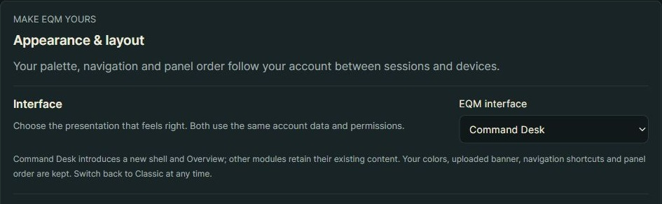
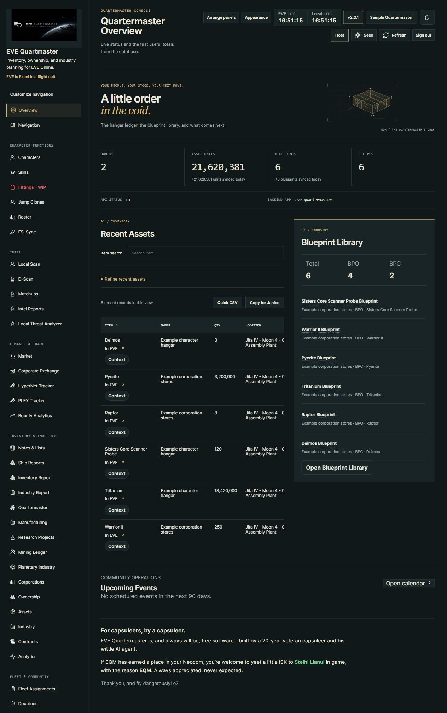
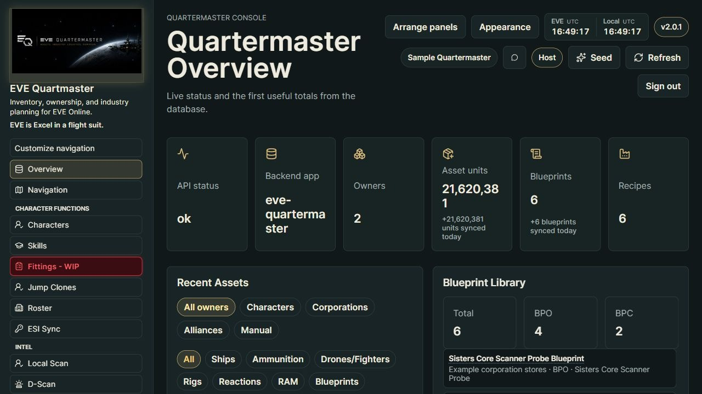
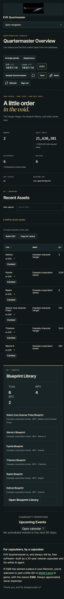

# Command Desk and EQM-Classic

First integration in the **unreleased 2.0.1 working tree**. Choose **Appearance → Interface → EQM-Classic / Command Desk**. The page-header Appearance button opens these settings for every signed-in account. Selection saves immediately to the account and follows it across sessions/devices. Missing, reset or unrecognized interface values resolve to Classic. Existing accounts are not enrolled automatically.

## What changes

Command Desk introduces the new shell and Overview: restrained navigation and controls, original orbital cargo-yard vector art, open stock totals, connection metadata kept distinct, a ruled recent-assets area and a separate blueprint surface. A mobile navigation disclosure retains the full customizable menu. The page scrolls normally; the six recent rows and blueprint preview no longer require their own vertical scrolling frame. Wide tables remain horizontally scrollable.

Classic retains its current presentation. Both use the same queries, components, actions and authorization. Color presets/custom colors, personal/site banners, shortcuts, navigation groups and saved panel positions are independent of interface choice. Weathered brass is an additional optional color preset; selecting an interface never changes a palette.

The recent-assets view retains sorting, owner/category/subtype/location/flag/search filters, exports and context actions. Command Desk keeps Item search visible and puts the remaining filters behind **Refine recent assets**; active filters are indicated. Classic keeps all filter controls visible. The overview explicitly labels the recent-record slice; totals remain the existing API summary, not counts of the six displayed rows. Blueprint preview/actions and the calendar/support sections are reused.

## Scope and rollout

Only the shell and Overview are redesigned in this first slice. Intel, Industry and all other modules retain their existing functional content inside the chosen shell. The [three visual studies](design/command-desk/README.md) remain independent sample-data prototypes; the Intel dossier and Industry manifest studies are not shipped as functional replacements.

Anonymous public reports, login and password recovery keep their existing presentation. The new interface class is attached only to the authenticated app shell, not globally to the document. Public report design will be decided separately. No ESI scope, data enrollment, module grant or public exposure is introduced.

There is **no new database migration**: `interface` is an optional validated key in the existing `UserAppearance.preferences` JSON (which requires the existing 0095 appearance schema). API accepts `classic`, `command_desk`, or null to remove the preference; unknown values return422. Existing optimistic revision checking prevents overwriting concurrent changes. Deploy matching API/frontend when separately authorized; current work is not deployed or pushed.

Stable regions/IDs are retained: `overview`, `overview-inventory`, `overview-1`, `overview-2`, `overview-3`, `recent-assets`, `blueprint-library` and the existing support child key. Arrangement controls use the same stored layout order in either interface. Navigation still uses `CustomNavigation`; the mobile disclosure does not replace it with a fixed menu.

## Verification

60 backend appearance and account-role tests pass, including interface persistence/isolation, invalid values, null/reset, revision conflicts, palette/banner/navigation/layout preservation, unchanged permissions across roles and actual read-only Quartermaster authorization. Final production TSC/Vite build passes with the existing bundle-size advisory. No additional dependency or migration.

Actual browser checks use the production build and real auth, preferences and inventory APIs against isolated synthetic SQLite. Verified missing/second-account Classic default, Command Desk persistence on reload, independent Weathered brass/Daylight palettes, item filtering, advanced-filter disclosure, panel movement retained across switch/reload, mobile navigation and page scrolling. At320px the document client/scroll widths are both305px even with filters open;390px has no document overflow. Synthetic preview omits unrelated staff SDE/database routes; their panels can report Not Found. No live SSO, private ESI, production account changes or game actions were tested.

## Near-black Dark Mode variant (unreleased 2.4.0)

Choose **Dark Mode** under Appearance for this layout with near-black surfaces, soft gray text and muted blue links. The same navigation, Overview and panel arrangements are used. [Palette behavior, overlay fixes and previews](dark-mode-and-palette.md).
