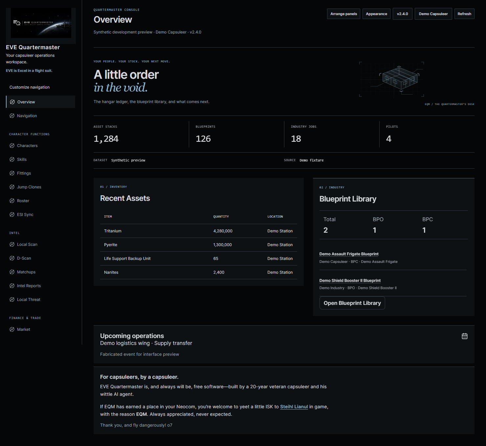
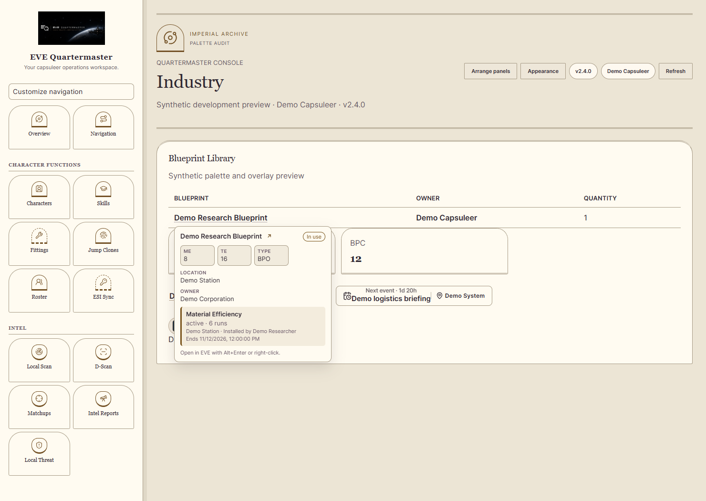

# Dark Mode and palette consistency

Unreleased v2.4.0 update. **Appearance → Interface** now offers seven interfaces, including **Dark Mode**. It reuses Command Desk's left navigation, compact Overview and mobile navigation, with near-black backgrounds, soft gray text and muted blue links. Existing navigation shortcuts, banners and panel arrangements remain saved.

Choose **Apply layout & colors** on the Dark Mode card for its complete palette. **Layout only** keeps your existing palette. Reset colors retains the selected interface and restores its default palette; for Dark Mode that means near-black surfaces and gray/blue text. Missing or unknown interface choices continue to fall back to Classic.

## Consistent overlays and table actions

Blueprint tooltips previously used a fixed dark background while inheriting some light-theme text colors. Shared root-level surface, inset, status and shadow tokens now reach overlays mounted directly under the document body as well as content within the app shell.

- Blueprint tooltips use the active panel/text/border colors, including ME/TE fields, owner/location, status and research-job metadata. Warning/success colors have separate readable light/dark tones. Status-badge styling applies only to the badge, keeping the blueprint title readable.
- Skill dogma, character summaries, implant details, next-event popovers, the in-game-link dialog and inbox surfaces use the active palette. Their inner fields and action buttons follow the same palette.
- Inline table/filter labels remain transparent, removing the opaque pale patches behind names. Support links, active blueprint filters and semantic owned/missing labels follow palette/status tokens.
- Blueprint interaction help appears inside the themed tooltip and as an accessible description. The duplicate browser-native title tooltip shown in the reported screenshot is removed from that target. Other browser-native tooltips remain controlled by the browser/OS.

This corrects shared surfaces and the inspected overlay families. It is not a claim that every specialized page, chart, third-party image or browser-native control has undergone a complete color redesign. Risk/status meanings, permission checks and underlying data/actions are retained.

## Verification and rollout

74 appearance API tests and 15 frontend appearance/navigation tests pass. TypeScript and the production build pass, with the existing large-chunk advisory. Real-browser checks cover all **eleven built-in palettes**: six standard palettes, four space-edition palettes and Dark Mode. Across each palette, actual blueprint, skill, character, implant, event and EVE-link overlays have opaque backgrounds matching the selected panel color. Measured primary text contrast is at least **4.5:1**, and sampled secondary labels at least **3:1**. Custom user colors remain subject to the existing palette validator; the measurements cover the built-in palettes and sampled rendered states.

The actual Dark Mode card, reset/reload behavior, seventh interface choice, Command Desk Overview/navigation and 390px Industry layout are browser-verified. No page errors or horizontal page overflow were observed. The synthetic shell uses the real appearance API/disposable SQLite and actual UI components, with fabricated holdings, pilots, research metadata, skill/implant details and events. EVE-link preview reads use local fixtures; no draft/send action, real account, production database, SSO or ESI request was made. No PostgreSQL or full production-App verification is claimed.

Deploy matching frontend/API builds so the API accepts `dark_mode`. No new migration, ESI scope, version bump or collection change is required. [Complete previews](screenshots.md#dark-mode-and-palette-consistency) · [Capture provenance](../static/ss/v2.4.0/capture-receipt.json).

