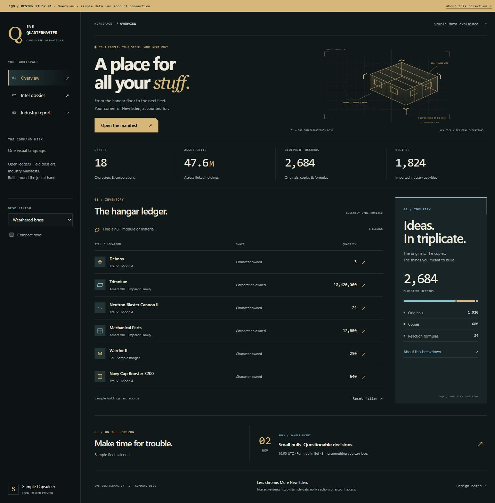
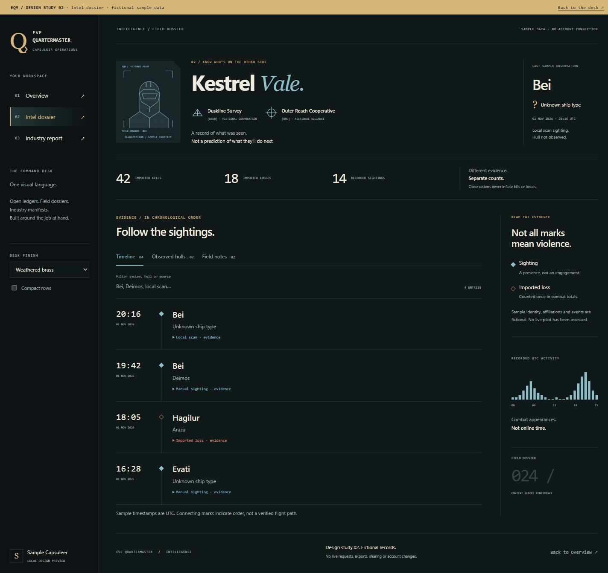
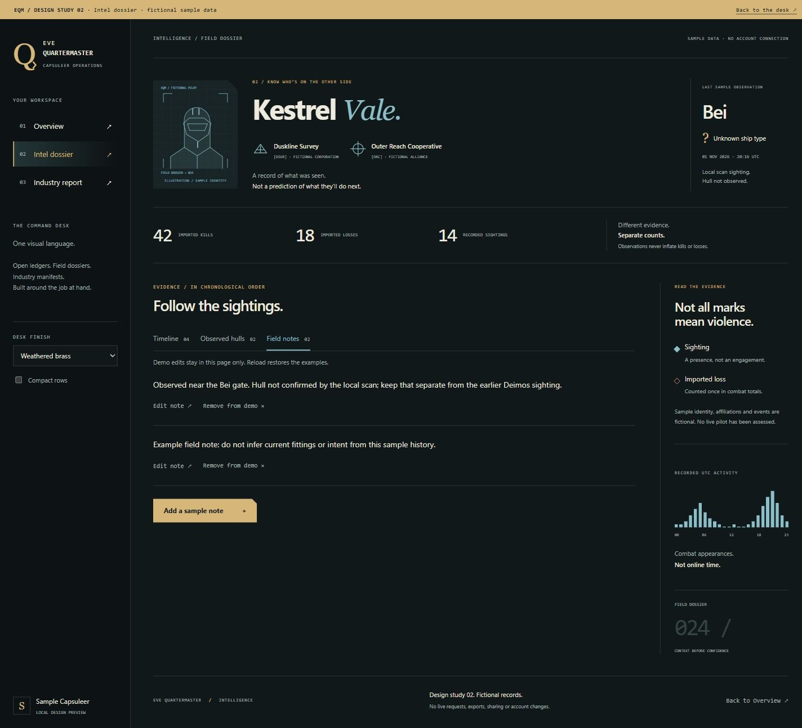
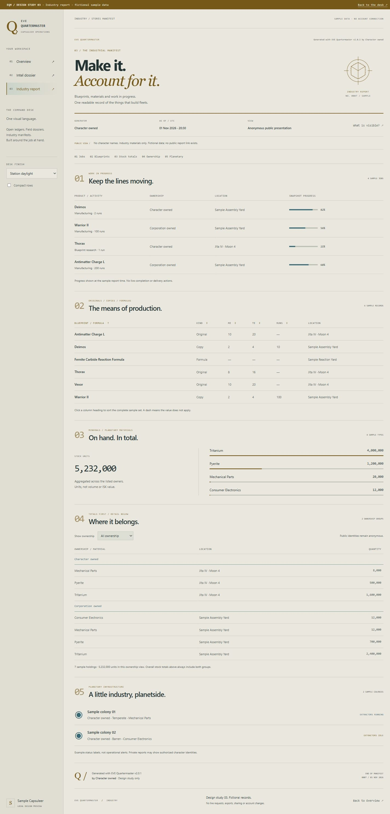
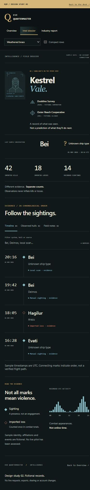
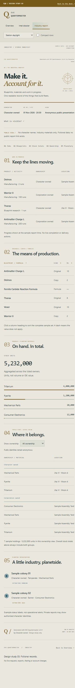

# EQM command desk — three visual studies

**Standalone prototypes, not released interfaces.** Open `index.html`, `intel.html` or `industry.html` directly in a browser, with all sibling files present. No install or build is required. The preview at localhost:8772 is served locally when the development server is running.

The three pages use fictional data and no external assets, fonts, APIs or account connection. All art is original inline SVG. Palette and compact-row choices carry between these study pages in this tab's session storage only; they do not touch EQM preferences. Notes exist only in page memory and reset on reload. There are no real sync, export, sharing, mail, ESI or other game actions.

## One language, three jobs

- **Overview:** the quartermaster's desk. Brass, open totals, a ruled hangar ledger, distinct blue industry surface and original cargo-yard drawing. The second pass reduces the introductory artwork and type so useful records appear sooner.
- **Intel:** a field dossier. Original fictional pilot illustration and organization emblems, identity and last observation, separate combat/sighting totals, evidence timeline, observed-hull view and editable sample field notes. Sighting versus loss uses both shape and text. Connections indicate chronology, not a verified route. Activity bars mean fictional combat appearances, not online time or inferred intent.
- **Industry:** a numbered stores manifest. Jobs first, then blueprints/formulas, overall stock, anonymous ownership detail and planetary infrastructure. The generator/version appears at the top and bottom. Blueprint headings sort the sample set; overall stock reconciles to listed ownership quantities. No fictional character names appear in the public presentation.

These explore compositions, not additional feature requirements. No fake telemetry, threat scores or backend status is presented as real. The small Overview/hull glyphs are placeholders; real EQM should keep CCP's recognizable hull/module icons. Real dossiers should use existing CCP pilot and organization images. The vector assets demonstrate a consistent framing and original decorative language.

## Try it

Use the three navigation links. Choose Weathered brass, Cold blue or Station daylight; those choices now remain available on phones as well. Toggle Compact rows. On Overview, filter the manifest and open sample item details. On Intel, filter evidence or expand its source details, switch tabs (including arrow-key navigation), and add/edit/remove local sample notes. On Industry, sort blueprint name/kind/ME/TE/runs, filter ownership, jump between numbered sections and inspect the public-view explanation.

The designs work at desktop and phone widths. Tables remain semantic tables, with keyboard-focusable, locally scrollable overflow regions. Native dialogs support Escape. Full app keyboard, contrast, zoom, loading and permission-state review remains necessary before integration. Print CSS is exploratory; this is not a working EQM PDF export.

## First real integration

The optional interface selector, shell and Overview now have a separate [application implementation](../../command-desk.md) in the unreleased working tree. The pages in this directory remain standalone studies. Intel and Industry are not yet adapted.

## Required Classic switch

User requirement, November 1, 2026: retain **EQM-Classic** when implementing the new interface. Plan an account-persisted Appearance > Interface selector with `EQM-Classic` and `Command Desk`. This is independent of color palette and branding; switching must preserve account data, permissions, navigation shortcuts and saved panel arrangements. Default existing accounts to Classic until they opt in. Both interfaces use shared data/actions and receive feature fixes; do not maintain separate application forks. For sections not yet redesigned, Command Desk can render the existing module inside its new shell. Do not expose unfinished alternatives as complete replacements. Anonymous public-report styling needs an explicit policy separate from the signed-in viewer's personal preference.

First implementation slice: preference/schema/API support and validation; Classic/current presentation as fallback; opt-in shared shell and real-data Overview; verify preference persistence, Classic parity, themes/branding, saved navigation/layouts and permission-scoped data. Follow with Intel and Industry, retaining their existing features. The user subsequently authorized the first implementation slice; see the integration guide above for its completed scope.
## Integration constraints

1. Extract Overview from `frontend/src/main.tsx` while retaining `LayoutRegion` region names and panel IDs (`overview`, `overview-inventory`, `overview-1/2/3`, `recent-assets`, `blueprint-library`, `overview-support`). Saved arrangements must survive.
2. Map the visual tokens to existing `--eqm-*` preferences. Preserve uploaded branding, full custom navigation, shortcuts, role filtering, light mode and drag controls. Never substitute this study's three-link navigation for the real menu.
3. Keep existing event/asset/blueprint actions. The composition of the blueprint library requires a complete authorized aggregate, not a loaded page or guessed total. Distinguish records, quantities and runs.
4. Retain the full Intel feature set and authorization model. Do not mistake these fabricated visual examples for live public evidence or new collection. Keep sightings separate from kills/losses, unknown hulls unknown and source provenance explicit. Real notes retain their server-side edit/delete permissions.
5. Preserve Industry privacy and all existing report fields/actions, sortable columns, pagination, expiration/deletion and public/private scopes. Public reports must not include personal modules, fitted ship contents or unselected private cans. A visual redesign must not widen access. Public stock remains anonymous. Real dynamic reports query authorized stock, not these fixtures.
6. Check all real loading/error/empty/long-name/high-volume states, keyboard access, contrast and saved layouts before adoption. Journey sharing remains shelved and outside this work.

## Verification and captures

Base source commit `45cc1cabca3293046ec6186ed2598589f777603b`, application version 2.0.1 unchanged. November 1, 2026. Original app sources and backend are untouched; JS syntax, local links/anchors/unique IDs and browser interactions were checked instead of unrelated app/backend tests.

Verified evidence filter yields one Deimos entry; observed hulls and keyboard-switched notes; note edit/add/remove; numeric runs 10/100 ascending and 100/10 descending with missing values last; filtered character ownership 2,108,000 while the overall 5,232,000 remains unchanged; dialogs and Escape; palette continuity. At the 390px phone breakpoint, each document's client and scroll width are both 375px. Report tables are 630px inside 335px overflow regions. Desktop 1440px has no page overflow. Browser console errors were empty. Temporary viewport restored.

Actual captures and provenance are in `static/ss/design-studies/command-desk/capture-receipt.json`. Phase-01 captures are retained; current second-pass examples follow. No release or deployment is implied.

