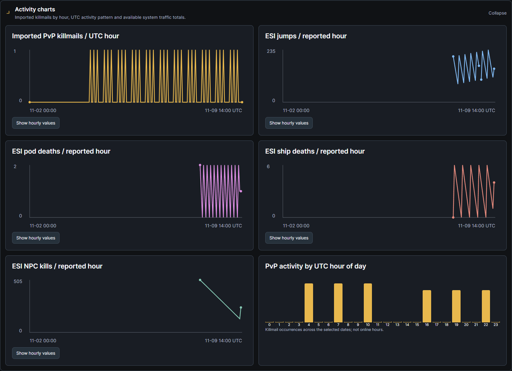
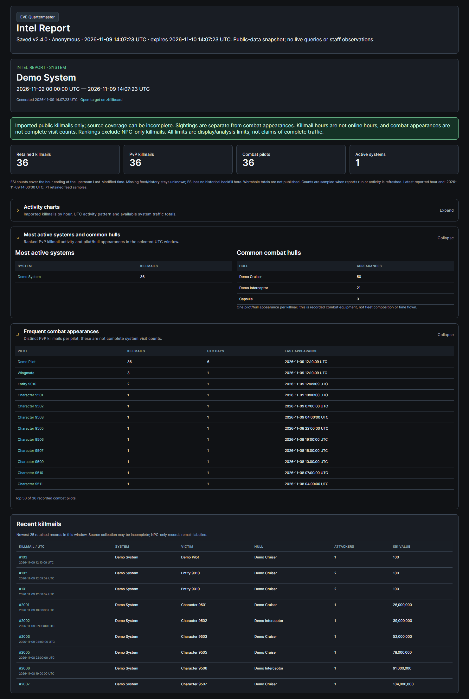

# Intel report builder and share links

**Unreleased EQM v2.4.0.** The module is **Intel Reports** for systems, characters, corporations and alliances. Open **Intel → Intel Reports → Run / share a report**. The separate **Saved dossiers and notes** tab preserves the existing affiliation tree, priority flags, staff notes, collections and authorized ESI workflow.

## Run a report

Choose **Target type**, enter a name, press **Find target**, choose the intended result, then **Run report**. System lookup uses imported SDE names. Character/corporation/alliance lookup combines cached public identities with a bounded exact public ESI name lookup. Resolving a public target does not enroll it or grant SSO access. Direct dossier links remain authenticated; **Run / share combat report** on a dossier opens this builder for its target.

Choose **From / Through (UTC)**, up to 90 days. Through is inclusive in the UI. The backend uses an exclusive end and clamps the current-day window to generation time. The displayed target/date window governs refresh and snapshot creation; editing a draft selection does not silently change an already displayed report. Reopen a saved snapshot to inspect its frozen evidence, or run a new report for current retained data.

All four target types show retained killmail/PvP/pilot/system counts, most active systems, common combat hulls, frequent combat appearances, activity by UTC hour of day, an hourly imported-killmail graph and the newest 25 retained killmails. Recent records link to zKill and show system, victim/hull, attacker count, estimated value when available and NPC-only status. Rankings and charts start in expandable panes **collapsed by default**, consistent with other analytics views. Each time-series graph has an accessible hourly-values table.

Combat appearances count distinct pilot/killmail pairs. Hull appearances count distinct pilot/hull/killmail combinations; duplicate attacker rows cannot inflate one pilot in the same hull. Corporation/alliance scope uses affiliation recorded on each killmail, rather than current member identity. Common hulls describe combat appearances, not ships flown continuously or a complete fleet. UTC activity counts combat events, not online hours. NPC-only killmails remain labelled in recent evidence and totals but do not enter PvP rankings/charts.

The analysis reuses canonical killmails and cached public names/types already in EQM. It uses the existing 10,000-killmail / 250,000-attacker evidence budget, excluding whole unfilled attacker batches; the response discloses caps. Rank displays are top 50. No record or a zero imported count proves complete traffic, safety or inactivity.

## System visitors and hourly totals

System reports add **Internal sighting frequency**, separate from public combat appearances. This counts stored Local Scan and manual Intel observations, distinct UTC days, observations per day across the report window, last seen and known manual-sighting hulls. Repeated scans can describe the same stay; these are observations, not verified arrivals or distinct visits. Local Scan hulls remain unknown. Public/shared scan observations and the viewer's own private scan observations are filtered **before** counts/rankings. Other users' private scans, all Journey history and note text are not read. Deleting a dossier continues to remove its manual sightings while independent scan observations retain their original lifecycle.

System-only charts additionally show ESI jumps, ship deaths, pod deaths and NPC kills per **reported hour**. Running a system report or choosing **Refresh ESI activity** checks the existing public ESI cache and stores valid selected-system samples. Each feed retains its own upstream `Last-Modified` hour end, independently from its request time; the exact end appears in the hourly-values table. Chart buckets identify the interval's starting UTC hour. A failed, stale, missing or unsupported feed remains unknown. A successful supported feed that omits a system supplies a genuine zero for that published hour. Wormhole totals are not published and are not fabricated as zeros.

These charts use available retained reported-hour samples. They are collected on demand when system reports run/activity is refreshed, not by a new always-running watcher. ESI does not backfill historical hours here; gaps remain visible. Imported killmail timelines and ESI totals are separate sources and need not match. Entity reports do not attribute anonymous system jump totals to a specific pilot or organization.

## Pull recent zKill evidence

**Pull recent zKill killmails** explicitly requests the newest source page for the displayed system/character/corporation/alliance. It verifies at most 25 distinct references through public ESI when canonical evidence is not already stored, reuses shared killmails and resolves bounded public participant/hull metadata. It does not enroll pilots or duplicate canonical records. Source scope/ID mismatches and malformed canonical payloads do not import. Partial failures are visible and retained evidence is kept.

Successful/partial pulls are shared-cached for one hour, following [zKill request/cache guidance](https://zkillboard.com/api/docs/). Requests use descriptive user agents, compression, pacing and bounded concurrency. Failed pulls back off for at least a minute and respect a longer source retry delay. Database leases fence concurrent/expired requests, and current Intel permissions are rechecked after network waits. No private EVE token is supplied to public sources.

This button pulls recent evidence, independently of report dates; older windows still show only retained records inside their selected dates. It is not a full 90-day history import. The existing dossier **Collect public history** workflow remains available for deeper collection. zKill coverage and API delay mean a successful pull is not a complete or real-time record of a system or entity.

## Save privately or share publicly

Under **Save / share this report**, choose retention and **Save private snapshot**, or explicitly check **Public share link** and choose **Create public snapshot**. Defaults are **Private**, **Anonymous creator**, and **24h**. Retention supports 30m, 1h, 2h, 12h, 24h, 3/7/30 days or permanent until revoked. Named attribution uses only an eligible owned main character; it never falls back to the account/login/email name.

Snapshots are immutable server-built public-data projections. They contain the selected target/window, public combat rankings, charts, retained ESI system totals, recent killmails, coverage and generation metadata. They never copy the staff response, accept a browser-supplied report, or include notes, priority flags, Local Scan/manual sighting counts/hulls/locations, private scans, Journey data, authorized private ESI enrichment or the author's account identity. Even a manual-only system/hull cannot leak into a share through a merged staff summary.

The public fragment is **`#intel-report/{token}`**, with an unguessable bearer token. It requires no login and displays a fixed snapshot; public viewing performs no collection, name lookup or live report generation. Public responses disable caching/referrers and request no indexing. The viewer revalidates access every minute and removes a report when access fails. Expiry is enforced server-side; private, expired, deleted, invalid or wrong-kind tokens return the same unavailable response. Snapshot times normalize to UTC on both write/read, including SQLite-backed previews.

**My saved Intel snapshots** lists only the current account's active snapshots, paged 25 at a time. **Open snapshot** retrieves the frozen data. **Revoke / delete → Confirm revoke** removes a snapshot and immediately invalidates its public link on the server; **Keep snapshot** cancels. Other accounts cannot manage it. This deletes the snapshot, not the underlying dossier or shared evidence. The existing report cleanup handles expired `report_kind=intel` records. Public links do not grant access to authenticated dossiers or other snapshots.

## Authorization, storage and rollout

Report building, refresh, snapshot creation/history/revocation use the existing Intel Reports section and Intel Analyst/Officer/Recruiter authorization boundary. Mutation routes independently honor read-only restrictions. Snapshot creation and revocation/public refreshes are audited without note bodies or bearer tokens. Public reads are isolated routes returning only already-saved public snapshots. No new permission section, ESI scope, collection opt-in or account-private Journey sharing is introduced.

Migration **0109_intel_activity** follows **0108_intel_subject_browser** and adds `intel_activity_samples` with independent feed timestamps and nullable counts. Existing `LocalScanReport` storage hosts `report_kind=intel` snapshots, preserving typed token/privacy/retention boundaries; shared public cache rows hold target identities and refresh leases. Existing canonical killboard storage remains shared. Deploy matching backend/frontend and run the normal migration chain through 0109. No live migration, release, tag, APK or deployment is performed by this implementation.

API prefix: `/intel-reports`. Authenticated routes: `POST /resolve`, `GET /report`, `POST /refresh`, `POST /activity`, `POST/GET /snapshots`, `GET/DELETE /snapshots/{token}`. Anonymous read: `GET /public/{token}`. Body targets are server-validated `kind`/`eve_id`; snapshot writes additionally specify timezone-aware window, strict privacy/anonymous Booleans and retention.

Validation covers all four scopes, bounded pulls/caches/leases/partial failures, current-permission rechecks, de-duplicated appearances, unknown hourly feeds, UTC timestamps, independent feed idempotency, snapshot immutability/privacy/expiry/revocation/ownership/token-kind checks, role denial and migration roundtrip. The existing dossier/scan/note/membership suites remain passing. Real Edge browser checks cover report controls, all four targets, charts, sightings versus combat, private/public creation, anonymous sharing through the full EQM app entry point, revocation, legacy dossier navigation and 390px mobile without overflow. Fixtures are synthetic; no live ESI/zKill or production records are used. SQLite does not emulate PostgreSQL lease interleavings.

