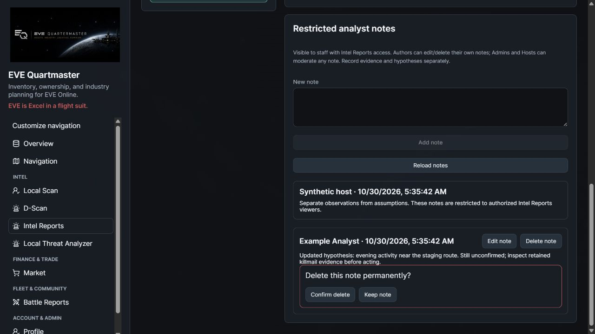
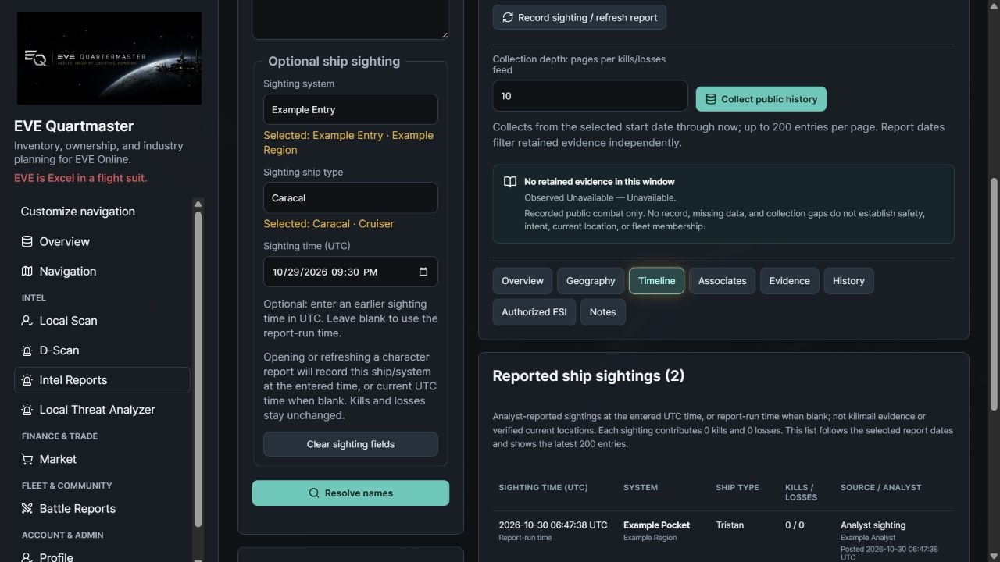
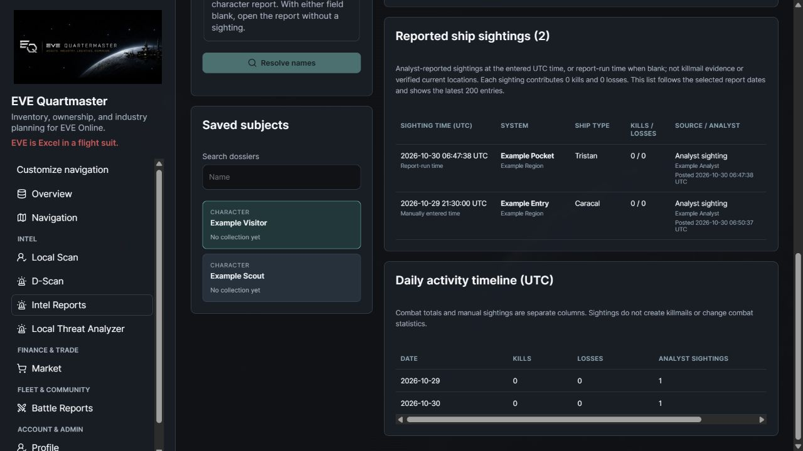

# Intel Reports

Intel Reports is a restricted staff workspace for investigating EVE characters, corporations, and alliances without enrolling outside characters into EQM. Open **Intel → Intel Reports**. Paste one name or zKill entity URL per line, resolve the names, and choose the intended match if the same name identifies more than one entity. Saved dossiers and `#intel/{id}` links still require authentication and Intel Reports access.

## First version

- Public ESI identity, current character affiliation, character employment history, corporation alliance history, and public alliance member corporations.
- zKill discovery for kills and losses, with canonical public ESI killmails stored once in the existing killboard tables.
- Selectable UTC date ranges; observed PvP kills/losses, ships, systems, regions, UTC hours, and daily activity.
- Repeated co-attacker characters, corporations, and alliances, including shared kill counts, distinct days, estimated engagements, and sampled source links. Historical affiliation comes from each killmail.
- zKill character indicators: LOGI, BLOPS, CAPITAL, SUPER, TITAN, CYNO, AWOX, ALLIANCE AWOX, FACTION AWOX, GANKER, FC and BAIT when upstream fields support them. ROOKIE is separately identified as EQM applying zKill's presentation rule to its public counters and birthday.
- Subject-specific smartbomb evidence: confirmed kills, percentage of observed PvP kills, and weapon metadata coverage. A local **Frequent Smartbomber** indicator requires at least five confirmed kills and at least 20% of observed kills in the selected report window.
- Change-only public profile/badge observations, collection history, and restricted analyst notes.
- A separate, permission-checked Authorized ESI tab for available cached skills/SP, queue, saved fitting templates, and applicant verification. Authorized refresh reuses EQM's existing sync services.

The module presents evidence for a human review. Shared attacker appearances do not prove shared fleet membership, identity, intent, or a formal coalition. Recorded combat locations are not current locations or verified home systems. Missing evidence is unknown, not a safety finding.

## Collection and coverage

**Collect public history** starts a durable database job from the chosen start date through the current time. The report end date filters retained evidence independently. The default collection depth is ten pages per kills/losses feed, with an explicit range of 1–100 pages and up to 200 entries per zKill page. The queue permits one active job per subject and at most 100 active jobs overall.

Jobs checkpoint their feed/page, retain progress across page failures, and use database leases so another backend process can recover expired work. Cancelling prevents new writes after ownership is lost. Automatic retries respect upstream backoff and stop after three consecutive failures at a checkpoint; interrupted jobs can resume. A finished page-limited job is **partial**, and a new, deeper collection can extend its retained history. A completed fetch is not a claim that zKill contains every killmail.

The backend lifespan runs the collector. No external scheduler or new user automation is required. zKill requests have a descriptive user agent and gzip support and are spaced within each backend process. Page discovery references and compact zKill flags are cached for an hour; statistics for ten minutes, public character identity for an hour, and other identity for a day. Metadata fallbacks are cached for thirty days. Multiple backend processes share database leases and the page cache, but the outbound pacing gate is process-local; large deployments should use a shared upstream limiter.

Reports analyze the newest 10,000 retained killmails within the requested window, with a 250,000-attacker budget. Whole unfilled batches are excluded rather than analyzing incomplete participant lists. Caps and observed coverage are disclosed. Responses contain the top 50 associates per entity kind, top 100 ships/systems, the 200 newest evidence records, up to ten recent evidence links per ranking, the latest 20 collection attempts, and the latest 30 public change observations. Metadata lookup is bounded per collection: 150 types, 50 systems, and 900 names; unresolved IDs remain visible. Large corp/alliance reports may need deeper collection and subsequent metadata passes.

NPC-only killmails remain identifiable in evidence but do not contribute to the PvP summaries. Smartbomb detection uses the subject's own recorded attacker weapon, classified by SDE group 72; another attacker's weapon cannot tag the subject. An attacker row records one weapon and is not a full weapon-use history. Saved fitting templates do not prove what a pilot flew.

Badges retain zKill's own rolling windows and do not change with EQM's report dates. Ship-role appearances use 90 days; cyno and other character indicators use their documented yearly windows. CYNO means a fitted cyno was lost, not that it was lit. Badge semantics follow the [zKill FAQ](https://zkillboard.com/information/faq/) and its [public badge presentation source](https://github.com/zKillboard/zKillboard/blob/master/templates/components/info_top_image.pug). Transport behavior follows the [zKill API documentation](https://zkillboard.com/api/docs/). Unknown future indicator fields are not guessed.

## Authorization boundary

Intel Reports requires section permission `intel_reports` and an Intel Analyst base role, Officer-or-higher role, or Recruiter capability. Its default section roles are Admin, Director, Officer, and Intel Analyst; existing host behavior remains in force. Combined roles and custom roles based on Intel Analyst are honored. A member recruiter also needs an explicit Intel Reports section grant. Applicants and anonymous/deleted users cannot enter the workspace. Analyst notes and dossier URLs are staff-only.

The public adapter never receives an EVE access token. Tracking an outsider creates an `IntelSubject`, not an `EveCharacter` enrollment. Killmail hash discovery enables the public ESI killmail read without the subject's SSO consent.

Private enrichment is evaluated for every request and never written into public subject data, observations, collection jobs, or public report responses. It requires a currently owned EQM character, an unrevoked token belonging to its current owner, sync enabled, and the relevant grants. Regular access follows existing character-detail and dataset section permissions; it does not give an officer access to another officer's private data. Recruiter access requires an eligible application and verified/stale linked-character verification; its scopes are intersected with recorded applicant consent. Withdrawn/declined applications do not provide recruiter access. Revocation, ownership changes, opt-out, and missing scopes block enrichment. Successful private reads/refreshes are audited without copying private payloads. Responses are `Cache-Control: private, no-store`.

This first increment exposes only skills/SP, queue, saved fitting metadata, and verification status where authorized. It does not yet include private wallets, transactions, assets, contracts, contacts, mail, or complete application answers. Applicant-only sync may provide total SP without a detailed cached skill list. An authorized but never collected dataset is labelled separately from a collected empty dataset. No additional ESI scope is silently requested.

## Storage and Alliance Auth portability

Migration `0089_intel_reports` follows `0088_fleet_assignments` and adds `intel_subjects`, `intel_observations`, `intel_collections`, `intel_source_cache`, and `intel_notes`. Canonical killmail JSON and participants reuse the existing shared killboard store, so overlapping character/corporation/alliance investigations do not duplicate full killmails. Page caches contain discovery IDs/hashes, timestamps, and small zKill flags. Public changes are fingerprinted and stored only when content changes. Associations are computed from retained facts on demand; no permanent all-pairs graph is built.

The framework-independent `backend/app/domain/intel.py` contains the entity parser, indicator rules, evidence calculations, `PublicIntelSource` protocol, and an immutable principal contract. Responses use `schema_version: eqm.intel.v1`. The React feature lives under `frontend/src/features/intel` and accepts an injected API client rather than EQM credentials or roles.

The current HTTP, persistence, worker, and permission adapters are EQM-specific. Porting to FRONT's Alliance Auth will require Django models/migrations, a Celery task adapter, Alliance Auth permission and verified character/token ownership mapping, and a private enrichment adapter that checks Alliance Auth's token grants. Reuse the domain calculations, source contract, response shape, and React view. The principal contract describes that boundary; it does not itself authorize current EQM requests. A working Alliance Auth plugin has not been implemented by this increment.

## Deployment and validation

Rebuild backend and frontend together and apply `0089_intel_reports` through normal backend startup. No new secrets or required ESI scopes. A populated SDE improves ship/weapon/geography metadata immediately; bounded public metadata lookups provide fallbacks.

Check an external character, corp, and alliance; ambiguous pasted names; date windows; limited collection coverage; interrupted retries/cancel; co-attacker evidence; and denied versus permitted private enrichment. The automated suite `backend/tests/test_intel_reports.py` uses synthetic sources and databases, not production records. Local browser verification also uses synthetic data. Live collection completeness depends on upstream availability, page depth, and zKill coverage.

## Editing and deleting analyst notes

On the **Notes** tab, authors can edit or permanently delete their own notes. Admins and Hosts can moderate any note; other authorized viewers can read notes without changing them. API responses expose the allowed controls, and each mutation independently checks current access and the note's subject/author. Losing Intel Reports permission immediately prevents editing/deleting even an authored note.

**Edit note → Save changes** trims and validates the same 5,000-character body limit. **Cancel edit** discards the draft. **Delete note** opens an inline confirmation with **Confirm delete** and **Keep note**. Deleting a note does not remove its dossier, evidence or other notes. Both edits and deletion include the original body as a concurrency condition; a stale edit/delete returns a conflict instead of overwriting another analyst's changes. **Reload notes** retrieves the latest state. The original author and creation time remain unchanged. Audit entries record actor, subject and note ID without copying note text.

No new migration is needed; existing Intel notes and audit tables are used. The mutation endpoints return JSON, including deletion, matching the frontend API client. Browser verification covers saving and reloading an author's edit, read-only controls for another author's note, and the inline deletion confirmation/cancel path; API tests perform deletion and verify permissions, stale edits, validation and subject boundaries. Actual UI capture uses isolated synthetic accounts/dossiers and does not expose operational intelligence.

## Non-combat ship sightings

Beside the name entry, the optional **Sighting system** and **Sighting ship type** fields search imported SDE names. Exact matches resolve automatically; otherwise choose a matching result. Ship choices are published hulls, not modules or blueprints. A valid system records a sighting; ship type is optional. Leave ship blank to record **Unknown Ship Type**. Without a system, opening a report remains a read-only dossier lookup. Entered but unresolved system/ship text must be corrected or selected instead of silently recording incorrect data.

**Sighting time (UTC)** is optional. Leave it blank to use the server's report-run time. Enter a past date/time to post an older sighting. The system also records the posting time and analyst separately; a historical sighting never masquerades as a newly observed location. API timestamps must include a timezone and are normalized to UTC. Future times, naive timestamps and dates before 6 May 2003 are rejected.

Resolve a character name and open the matching dossier to record the selected ship/system/time. Opening an existing saved character dossier also records the supplied context. On the currently open character report, the explicit action becomes **Record sighting / refresh report**. Fields remain available for further report runs. Each successful explicit run creates a new sighting; retries of the same request use a unique request key to avoid duplicate rows. Opening a corporation/alliance does not attach a character sighting. **Resolve names** alone, reading the report URL, date-filter changes, tab changes and background collection polling never create sightings. Clearing the sighting fields restores ordinary report refresh behavior.

The **Timeline** tab shows each retained analyst sighting's system, ship, UTC sighting time, source, analyst and posting time. It distinguishes manual times from report-run times. The detailed list shows the latest 200 sightings within the selected report dates, while counts and daily summaries cover all sightings in that window. If an old sighting falls outside the current From/Through range, expand that range to see it. Sighting-only ships, systems and regions appear with **0 kills / 0 losses** and a separate sightings count, even for a pilot with no killmails. Daily activity has a distinct sightings column.

Sightings are analyst reports, not verified current locations or combat evidence. They never create killmails, alter PvP kills/losses, smartbomb statistics, combat UTC-hour bars, solo statistics, attacker counts or associations. They do not enroll outside characters into ESI collection. The normal Intel Reports authentication/section/role boundary applies to lookups, records and reports. Audit events identify the analyst, subject and record IDs. Profile/badge changes and authorized ESI remain separate.

Apply migration **0099_intel_sightings** after 0098 before deploying the matching API/frontend. It adds `intel_sightings`, subject/time indexing and a unique subject/analyst/request key; no extra ESI scope is required. This pass does not deploy or migrate a live database. The migration and model store canonical IDs plus names captured when recorded.

API: optional `sighting` on `POST /intel/subjects`, or `POST /intel/subjects/{id}/sightings`, containing `system_id`, UUID `request_id`, optional nullable `ship_type_id`, and optional timezone-aware `observed_at`. A missing/null ship ID means Unknown Ship Type; invalid supplied IDs remain errors. The server supplies posting time; clients cannot set analyst/source/K/L. `GET /intel/sighting-lookups?kind=system|ship&q=...` supplies bounded permission-scoped choices. Report reads remain side-effect free.

Verified with zero-combat dossiers, existing combat evidence, idempotent retries, malformed/partial payloads, invalid/non-ship/unpublished SDE types, role revocation, exact date boundaries, historical offsets, distinct posting time, future-time rejection, bounded event lists with full counts, and migration upgrade/downgrade. Actual built UI exercises a new pilot's report-time sighting and an older sighting in a second hull/system; both remain 0/0 and survive page reload.

## Unknown hulls and affiliation identity

System-only sightings use **Unknown Ship Type**, including historical UTC sightings. The canonical hull ID stays NULL; no fake SDE type is created. Unknown hulls form one distinct 0/0 row with their own sighting count and use the generated yellow-question-mark icon, soft white glow and thin silver square border. Known hulls use EVE Image Server icons in observed ships and timeline rows, with the placeholder as an image-load fallback.

Character dossier headers show corporation/alliance logos, full names and `[ticker]` tags beside the portrait. Each complete card links to the corresponding corporation/alliance zKillboard page in a new tab. No alliance is shown as such; missing public metadata is labelled unavailable, never fabricated. Existing reports use the same header immediately with the matching frontend/API.

`GET /intel/subjects/{id}/affiliations` uses the existing authenticated Intel permission boundary and performs only bounded public organization lookups. It loads independently of the main report, reuses 24-hour organization metadata and releases its DB transaction before network waits. A failed lookup keeps any prior name/tag and backs off for 60 seconds; partial failures do not hide the other organization. Read-only cache fills do not record sightings or enroll outside characters. Identity affiliations reflect the dossier's retained public ESI snapshot; normal public collection refreshes that membership snapshot.

Apply **0100_unknown_ship_sightings** after 0099 before matching API/frontend rollout. It makes the sighting hull FK nullable and preserves existing rows and request/time indexes. Downgrade refuses to proceed while unknown-hull rows exist, so it cannot silently delete those sightings. No extra ESI scope or live database migration was performed in this development pass.

The placeholder is `static/icons/unknown-ship.png`, generated and edited using the built-in imagegen tool. The adjacent provenance JSON records the exact generation/edit prompts, source base and checksum. It is an original EQM placeholder, not an EVE ship render.
