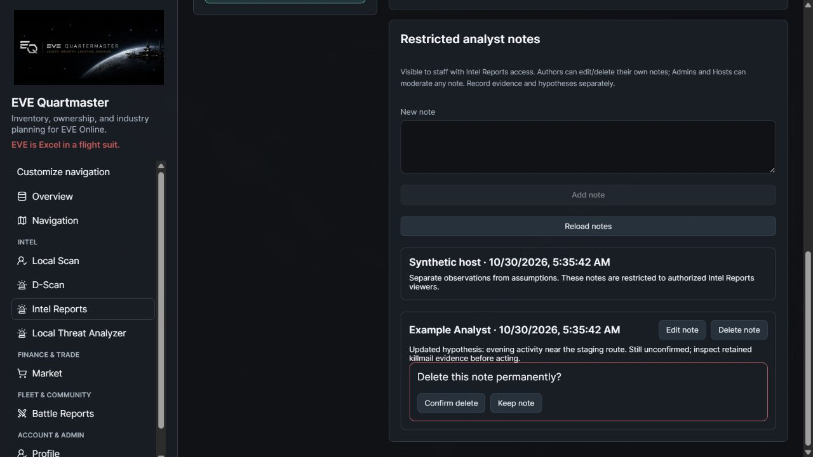
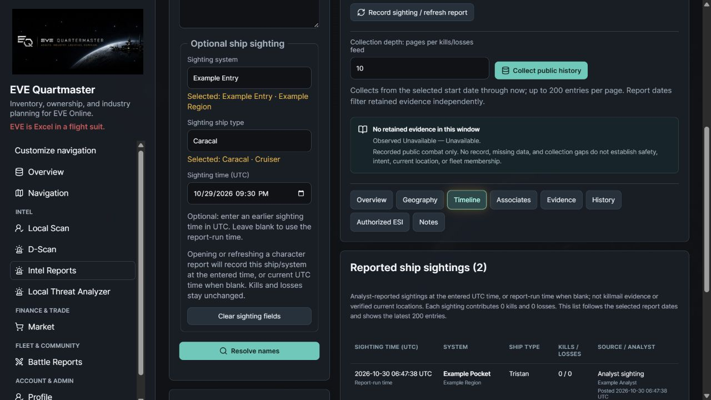
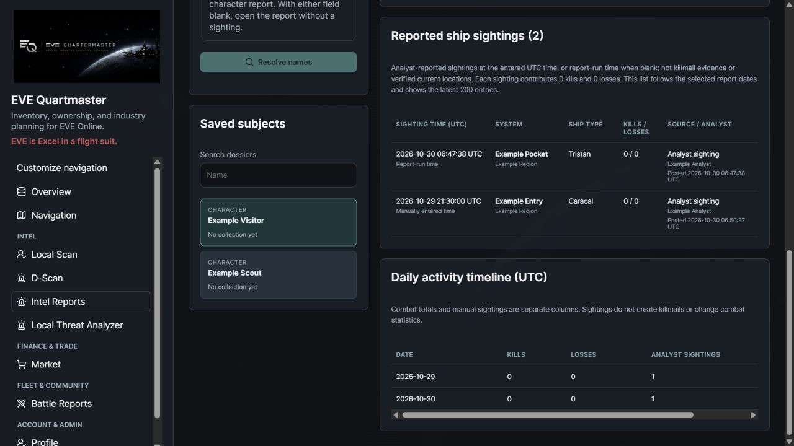
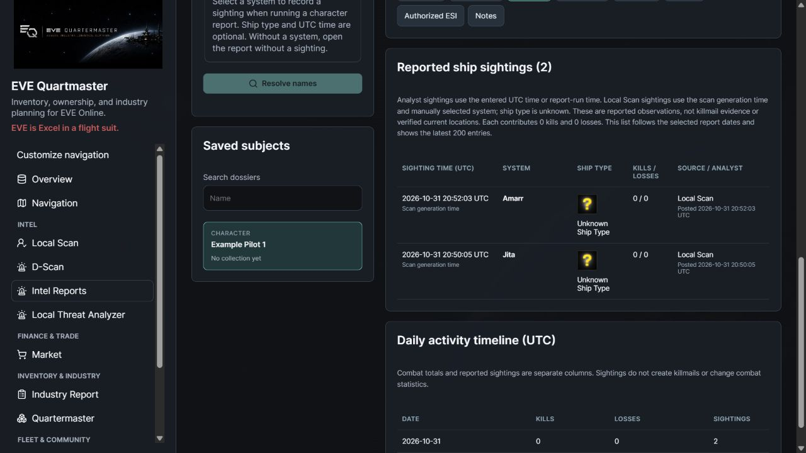
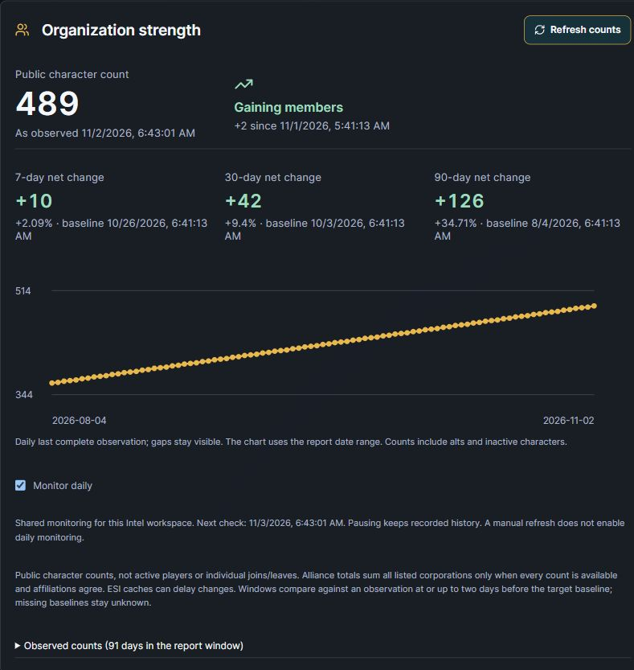
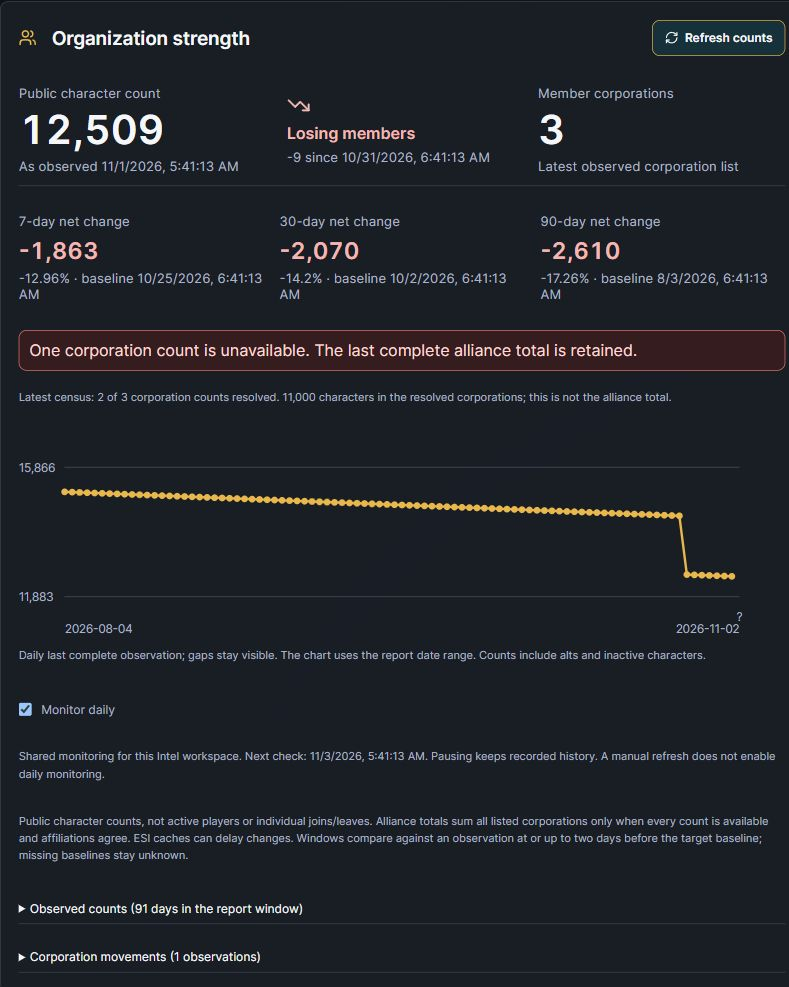
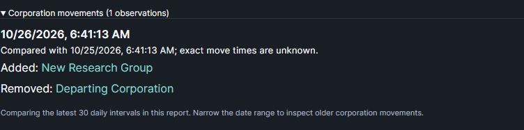
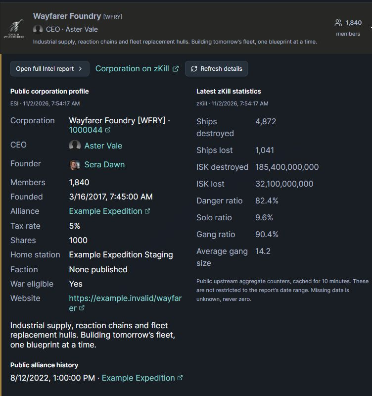
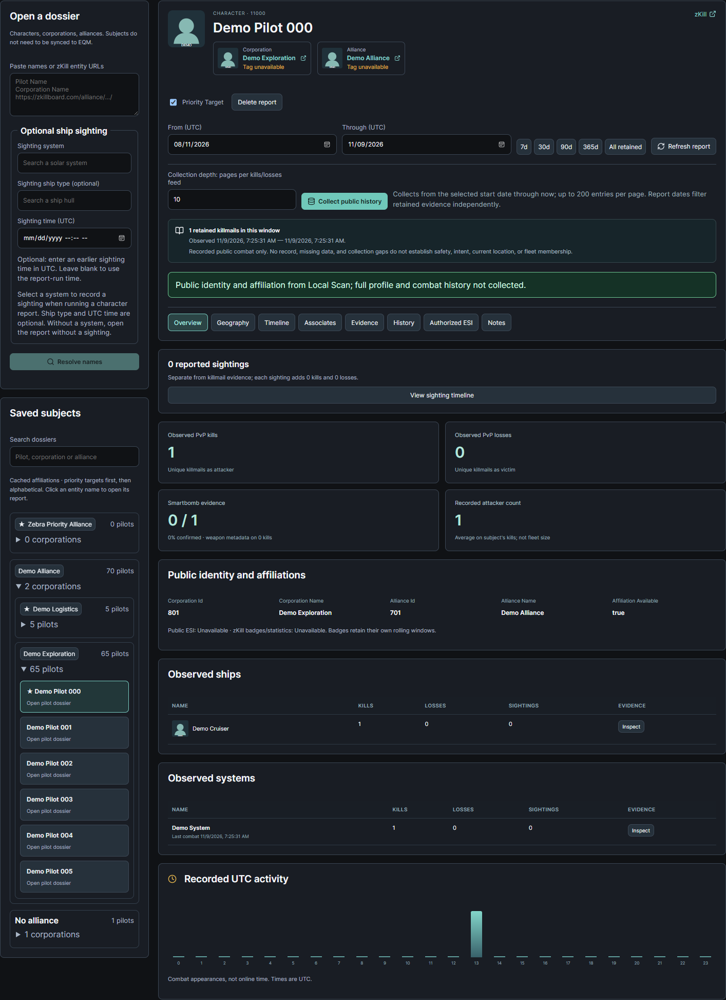
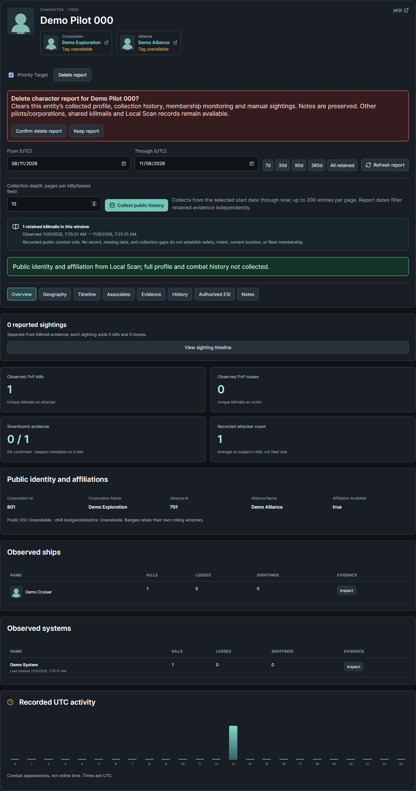

# Intel Reports

Intel Reports is a restricted staff workspace for investigating EVE characters, corporations, and alliances without enrolling outside characters into EQM. Open **Intel → Intel Reports**. Paste one name or zKill entity URL per line, resolve the names, and choose the intended match if the same name identifies more than one entity. Saved dossiers and `#intel/{id}` links still require authentication and Intel Reports access.

## First version

- Public ESI identity, current character affiliation, character employment history, corporation alliance history, and public alliance member corporations.
- zKill discovery for kills and losses, with canonical public ESI killmails stored once in the existing killboard tables.
- Selectable UTC date ranges; observed PvP kills/losses, ships, systems, regions, UTC hours, and daily activity.
- Repeated co-attacker characters, corporations, and alliances, including shared kill counts, distinct days, estimated engagements, and sampled source links. Historical affiliation comes from each killmail.
- zKill character indicators: LOGI, BLOPS, CAPITAL, SUPER, TITAN, CYNO, AWOX, ALLIANCE AWOX, FACTION AWOX, GANKER, FC and BAIT when upstream fields support them. ROOKIE is separately identified as EQM applying zKill's presentation rule to its public counters and birthday.
- Subject-specific smartbomb evidence: confirmed kills, percentage of observed PvP kills, and weapon metadata coverage. A local **Frequent Smartbomber** indicator requires at least five confirmed kills and at least 20% of observed kills in the selected report window.
- Change-only public profile/badge observations, collection history, and restricted analyst notes.
- A separate, permission-checked Authorized ESI tab for available cached skills/SP, queue, saved fitting templates, and applicant verification. Authorized refresh reuses EQM's existing sync services.

The module presents evidence for a human review. Shared attacker appearances do not prove shared fleet membership, identity, intent, or a formal coalition. Recorded combat locations are not current locations or verified home systems. Missing evidence is unknown, not a safety finding.

## Collection and coverage

**Collect public history** starts a durable database job from the chosen start date through the current time. The report end date filters retained evidence independently. The default collection depth is ten pages per kills/losses feed, with an explicit range of 1–100 pages and up to 200 entries per zKill page. The queue permits one active job per subject and at most 100 active jobs overall.

Jobs checkpoint their feed/page, retain progress across page failures, and use database leases so another backend process can recover expired work. Cancelling prevents new writes after ownership is lost. Automatic retries respect upstream backoff and stop after three consecutive failures at a checkpoint; interrupted jobs can resume. A finished page-limited job is **partial**, and a new, deeper collection can extend its retained history. A completed fetch is not a claim that zKill contains every killmail.

The backend lifespan runs the collector. No external scheduler or new user automation is required. zKill requests have a descriptive user agent and gzip support and are spaced within each backend process. Page discovery references and compact zKill flags are cached for an hour; statistics for ten minutes, public character identity for an hour, and other identity for a day. Metadata fallbacks are cached for thirty days. Multiple backend processes share database leases and the page cache, but the outbound pacing gate is process-local; large deployments should use a shared upstream limiter.

Reports analyze the newest 10,000 retained killmails within the requested window, with a 250,000-attacker budget. Whole unfilled batches are excluded rather than analyzing incomplete participant lists. Caps and observed coverage are disclosed. Responses contain the top 50 associates per entity kind, top 100 ships/systems, the 200 newest evidence records, up to ten recent evidence links per ranking, the latest 20 collection attempts, and the latest 30 public change observations. Metadata lookup is bounded per collection: 150 types, 50 systems, and 900 names; unresolved IDs remain visible. Large corp/alliance reports may need deeper collection and subsequent metadata passes.

NPC-only killmails remain identifiable in evidence but do not contribute to the PvP summaries. Smartbomb detection uses the subject's own recorded attacker weapon, classified by SDE group 72; another attacker's weapon cannot tag the subject. An attacker row records one weapon and is not a full weapon-use history. Saved fitting templates do not prove what a pilot flew.

Badges retain zKill's own rolling windows and do not change with EQM's report dates. Ship-role appearances use 90 days; cyno and other character indicators use their documented yearly windows. CYNO means a fitted cyno was lost, not that it was lit. Badge semantics follow the [zKill FAQ](https://zkillboard.com/information/faq/) and its [public badge presentation source](https://github.com/zKillboard/zKillboard/blob/master/templates/components/info_top_image.pug). Transport behavior follows the [zKill API documentation](https://zkillboard.com/api/docs/). Unknown future indicator fields are not guessed.

## Authorization boundary

Intel Reports requires section permission `intel_reports` and an Intel Analyst base role, Officer-or-higher role, or Recruiter capability. Its default section roles are Admin, Director, Officer, and Intel Analyst; existing host behavior remains in force. Combined roles and custom roles based on Intel Analyst are honored. A member recruiter also needs an explicit Intel Reports section grant. Applicants and anonymous/deleted users cannot enter the workspace. Analyst notes and dossier URLs are staff-only.

The public adapter never receives an EVE access token. Tracking an outsider creates an `IntelSubject`, not an `EveCharacter` enrollment. Killmail hash discovery enables the public ESI killmail read without the subject's SSO consent.

Private enrichment is evaluated for every request and never written into public subject data, observations, collection jobs, or public report responses. It requires a currently owned EQM character, an unrevoked token belonging to its current owner, sync enabled, and the relevant grants. Regular access follows existing character-detail and dataset section permissions; it does not give an officer access to another officer's private data. Recruiter access requires an eligible application and verified/stale linked-character verification; its scopes are intersected with recorded applicant consent. Withdrawn/declined applications do not provide recruiter access. Revocation, ownership changes, opt-out, and missing scopes block enrichment. Successful private reads/refreshes are audited without copying private payloads. Responses are `Cache-Control: private, no-store`.

This first increment exposes only skills/SP, queue, saved fitting metadata, and verification status where authorized. It does not yet include private wallets, transactions, assets, contracts, contacts, mail, or complete application answers. Applicant-only sync may provide total SP without a detailed cached skill list. An authorized but never collected dataset is labelled separately from a collected empty dataset. No additional ESI scope is silently requested.

## Storage and Alliance Auth portability

Migration `0089_intel_reports` follows `0088_fleet_assignments` and adds `intel_subjects`, `intel_observations`, `intel_collections`, `intel_source_cache`, and `intel_notes`. Canonical killmail JSON and participants reuse the existing shared killboard store, so overlapping character/corporation/alliance investigations do not duplicate full killmails. Page caches contain discovery IDs/hashes, timestamps, and small zKill flags. Public changes are fingerprinted and stored only when content changes. Associations are computed from retained facts on demand; no permanent all-pairs graph is built.

The framework-independent `backend/app/domain/intel.py` contains the entity parser, indicator rules, evidence calculations, `PublicIntelSource` protocol, and an immutable principal contract. Responses use `schema_version: eqm.intel.v1`. The React feature lives under `frontend/src/features/intel` and accepts an injected API client rather than EQM credentials or roles.

The current HTTP, persistence, worker, and permission adapters are EQM-specific. Porting to FRONT's Alliance Auth will require Django models/migrations, a Celery task adapter, Alliance Auth permission and verified character/token ownership mapping, and a private enrichment adapter that checks Alliance Auth's token grants. Reuse the domain calculations, source contract, response shape, and React view. The principal contract describes that boundary; it does not itself authorize current EQM requests. A working Alliance Auth plugin has not been implemented by this increment.

## Deployment and validation

Rebuild backend and frontend together and apply `0089_intel_reports` through normal backend startup. No new secrets or required ESI scopes. A populated SDE improves ship/weapon/geography metadata immediately; bounded public metadata lookups provide fallbacks.

Check an external character, corp, and alliance; ambiguous pasted names; date windows; limited collection coverage; interrupted retries/cancel; co-attacker evidence; and denied versus permitted private enrichment. The automated suite `backend/tests/test_intel_reports.py` uses synthetic sources and databases, not production records. Local browser verification also uses synthetic data. Live collection completeness depends on upstream availability, page depth, and zKill coverage.

## Editing and deleting analyst notes

On the **Notes** tab, authors can edit or permanently delete their own notes. Public notes are shared with authorized EQM intel users; Private notes are author-only, including against other Hosts/Admins. Admins and Hosts can moderate Public notes; other authorized viewers can read shared notes without changing them. Only the author can change note visibility. New UI notes default Private; existing notes retain shared visibility. [Scan-wide tagging and searchable character notes](local-scan-character-notes.md). API responses expose the allowed controls, and each mutation independently checks current access and the note's subject/author. Losing Intel Reports permission immediately prevents editing/deleting even an authored note.

**Edit note → Save changes** trims and validates the same 5,000-character body limit. **Cancel edit** discards the draft. **Delete note** opens an inline confirmation with **Confirm delete** and **Keep note**. Deleting a note does not remove its dossier, evidence or other notes. Both edits and deletion include the original body and visibility as concurrency conditions; a stale edit/delete returns a conflict instead of overwriting another analyst's changes. **Reload notes** retrieves the latest state. The original author and creation time remain unchanged. Audit entries record actor, subject and note ID without copying note text.

The original edit/delete support used existing tables. The current Public/Private and whole-scan note support additionally requires migration `0106_scan_character_notes`, followed by matching backend/frontend rollout. The mutation endpoints return JSON, including deletion, matching the frontend API client. Browser verification covers saving and reloading an author's edit, read-only controls for another author's note, and the inline deletion confirmation/cancel path; API tests perform deletion and verify permissions, stale edits, validation and subject boundaries. Actual UI capture uses isolated synthetic accounts/dossiers and does not expose operational intelligence.

## Non-combat ship sightings

Beside the name entry, the optional **Sighting system** and **Sighting ship type** fields search imported SDE names. Exact matches resolve automatically; otherwise choose a matching result. Ship choices are published hulls, not modules or blueprints. A valid system records a sighting; ship type is optional. Leave ship blank to record **Unknown Ship Type**. Without a system, opening a report remains a read-only dossier lookup. Entered but unresolved system/ship text must be corrected or selected instead of silently recording incorrect data.

**Sighting time (UTC)** is optional. Leave it blank to use the server's report-run time. Enter a past date/time to post an older sighting. The system also records the posting time and analyst separately; a historical sighting never masquerades as a newly observed location. API timestamps must include a timezone and are normalized to UTC. Future times, naive timestamps and dates before 6 May 2003 are rejected.

Resolve a character name and open the matching dossier to record the selected ship/system/time. Opening an existing saved character dossier also records the supplied context. On the currently open character report, the explicit action becomes **Record sighting / refresh report**. Fields remain available for further report runs. Each successful explicit run creates a new sighting; retries of the same request use a unique request key to avoid duplicate rows. Opening a corporation/alliance does not attach a character sighting. **Resolve names** alone, reading the report URL, date-filter changes, tab changes and background collection polling never create sightings. Clearing the sighting fields restores ordinary report refresh behavior.

The **Timeline** tab shows each retained analyst sighting's system, ship, UTC sighting time, source, analyst and posting time. It distinguishes manual times from report-run times. The detailed list shows the latest 200 sightings within the selected report dates, while counts and daily summaries cover all sightings in that window. If an old sighting falls outside the current From/Through range, expand that range to see it. Sighting-only ships, systems and regions appear with **0 kills / 0 losses** and a separate sightings count, even for a pilot with no killmails. Daily activity has a distinct sightings column.

Sightings are analyst reports, not verified current locations or combat evidence. They never create killmails, alter PvP kills/losses, smartbomb statistics, combat UTC-hour bars, solo statistics, attacker counts or associations. They do not enroll outside characters into ESI collection. The normal Intel Reports authentication/section/role boundary applies to lookups, records and reports. Audit events identify the analyst, subject and record IDs. Profile/badge changes and authorized ESI remain separate.

Apply migration **0099_intel_sightings** after 0098 before deploying the matching API/frontend. It adds `intel_sightings`, subject/time indexing and a unique subject/analyst/request key; no extra ESI scope is required. This pass does not deploy or migrate a live database. The migration and model store canonical IDs plus names captured when recorded.

API: optional `sighting` on `POST /intel/subjects`, or `POST /intel/subjects/{id}/sightings`, containing `system_id`, UUID `request_id`, optional nullable `ship_type_id`, and optional timezone-aware `observed_at`. A missing/null ship ID means Unknown Ship Type; invalid supplied IDs remain errors. The server supplies posting time; clients cannot set analyst/source/K/L. `GET /intel/sighting-lookups?kind=system|ship&q=...` supplies bounded permission-scoped choices. Report reads remain side-effect free.

Verified with zero-combat dossiers, existing combat evidence, idempotent retries, malformed/partial payloads, invalid/non-ship/unpublished SDE types, role revocation, exact date boundaries, historical offsets, distinct posting time, future-time rejection, bounded event lists with full counts, and migration upgrade/downgrade. Actual built UI exercises a new pilot's report-time sighting and an older sighting in a second hull/system; both remain 0/0 and survive page reload.

## Unknown hulls and affiliation identity

System-only sightings use **Unknown Ship Type**, including historical UTC sightings. The canonical hull ID stays NULL; no fake SDE type is created. Unknown hulls form one distinct 0/0 row with their own sighting count and use the generated yellow-question-mark icon, soft white glow and thin silver square border. Known hulls use EVE Image Server icons in observed ships and timeline rows, with the placeholder as an image-load fallback.

Character dossier headers show corporation/alliance logos, full names and `[ticker]` tags beside the portrait. Each complete card links to the corresponding corporation/alliance zKillboard page in a new tab. No alliance is shown as such; missing public metadata is labelled unavailable, never fabricated. Existing reports use the same header immediately with the matching frontend/API.

`GET /intel/subjects/{id}/affiliations` uses the existing authenticated Intel permission boundary and performs only bounded public organization lookups. It loads independently of the main report, reuses 24-hour organization metadata and releases its DB transaction before network waits. A failed lookup keeps any prior name/tag and backs off for 60 seconds; partial failures do not hide the other organization. Read-only cache fills do not record sightings or enroll outside characters. Identity affiliations reflect the dossier's retained public ESI snapshot; normal public collection refreshes that membership snapshot.

Apply **0100_unknown_ship_sightings** after 0099 before matching API/frontend rollout. It makes the sighting hull FK nullable and preserves existing rows and request/time indexes. Downgrade refuses to proceed while unknown-hull rows exist, so it cannot silently delete those sightings. No extra ESI scope or live database migration was performed in this development pass.

The placeholder is `static/icons/unknown-ship.png`, generated and edited using the built-in imagegen tool. The adjacent provenance JSON records the exact generation/edit prompts, source base and checksum. It is an original EQM placeholder, not an EVE ship render.

## Local Scans feed the sighting timeline

Choose a system from search results when generating a **Local Scan**. Every uniquely resolved pilot gets a **Local Scan** sighting in that system, at the scan's server-side UTC generation time, with **Unknown Ship Type**. Names that ESI cannot resolve are not guessed. Without a system, no sighting is recorded. Ship ownership or hulls are never inferred from names or nearby D-Scan results.

The pilot does not need an existing Intel dossier or an authenticated EQM character. Open their character dossier later and the sightings are available in **Timeline**, the sightings summary, unknown-ship totals, systems/regions and daily counts. Date filters still apply: widen the default 90-day window for older scans. Corporation/alliance dossiers do not acquire individual pilots' sightings.

Each scan contributes one sighting per resolved pilot. A separate new scan is another observation; refreshing a report or revisiting its link creates nothing. Scan and observation writes commit together. Scan entries remain after the source report expires or is deleted, as requested, rather than depending on the lifetime of its share link.

Private-scan sightings are visible **only to the creator**, including after deletion of the scan. Other analysts and staff cannot see them through detail rows, totals, geography or daily counts. Anonymous scans do not expose their creator through Intel: scan-derived entries show the **Local Scan** source without account/character attribution or an original share token. Public-scan observations are shared within the authenticated Intel Reports workspace; this does not make Intel dossiers public.

All scan-derived entries contribute **0 kills / 0 losses**. They leave killmails, combat-hour bars, associations, solo and smartbomb statistics unchanged. They are reported observations using a manually selected system, not verified current locations. No extra ESI scopes, outside-character enrollment or public-history collection jobs are introduced. Actual account erasure still removes owned observation records.

### Rollout and existing scans

Apply **0102_local_scan_sightings** after **0101_scan_highlight_colors**, with matching API/frontend. The migration adds a character/time indexed observation table and backfills surviving saved Local Scans with valid named systems, preserving original timestamps and private visibility. It reads saved snapshots in batches of 100, requires no ESI calls, and does not create thousands of dossiers. Already-purged scans cannot be recovered. D-Scan, Industry and Inventory reports do not become Local Scan sightings. Downgrade removes this new observation table; manual analyst sightings are untouched.

The query applies visibility and date restrictions before totals and the latest-200 detail limit. Regression tests cover scan generation, unresolved names, no-system scans, transaction rollback, duplicate pilots/reindexing, late dossier creation, private access including staff, link expiry/deletion, independent rescans, manual/scan merging, date boundaries, counts above 200, and migration upgrade/backfill/downgrade. Unknown-hull, identity and existing report/scan regressions also pass.

Unreleased development captures below use the actual production UI and APIs against isolated synthetic data; no live migration or ESI request was made.

[Generation explanation](../static/ss/v2.0.1/local-scan-intel-generation.jpg) · [Mobile sighting cards](../static/ss/v2.0.1/local-scan-intel-mobile.jpg) · [Capture receipt](../static/ss/v2.0.1/capture-receipt.json)

## Corporation and alliance membership trends

Open a corporation/alliance dossier and use **Overview → Organization strength**. This is a public ESI headcount history, separate from combat records and player sightings. It reports characters, including alts and inactive characters, not unique humans, active pilots or a combat-strength estimate.

- **Refresh counts** queues a one-time public census without turning on recurring monitoring. Requests are deduplicated while queued/running; subsequent manual checks have a one-minute cooldown.
- **Monitor daily** enables a shared monitor for this dossier in the Intel workspace. Any currently authorized Intel analyst can enable/pause it. It runs in the backend while the browser is closed. Disabling invalidates an in-flight lease and keeps all saved observations. Other analysts see the same public count history and monitoring setting.
- Corporation totals use public `member_count`. Alliance pilot totals sum the public counts of every uniquely listed member corporation. At most four corporation requests run concurrently, with a 1,000-corporation ceiling and 180-second census budget. Oversized/failed fetches are unavailable, never silently truncated totals. No private member-list endpoint, character enrollment, extra ESI scope or pilot roster collection is introduced.
- An alliance total is recorded only if every corporation count is valid and its independently cached affiliation agrees with the alliance list. A partial observation keeps the known subtotal and resolved/expected corporation counts clearly separate. Previous complete totals remain visible with their original time; missing data never becomes zero or a false membership loss. An actual complete count of zero is valid. ESI caches and non-atomic endpoint responses mean these are observed public counts, not an instantaneous census.

The module keeps one last complete observation per UTC day. A same-day partial attempt cannot overwrite a complete count. Historical corporation profile observations and their original timestamps are reused where valid, including the retained profile's fetched time. Alliance totals begin with a real census; current corporations are never summed backwards to invent old totals. Migration does not automatically enroll any organization into monitoring or perform network requests.

**Gaining / losing / unchanged** compares the latest two complete observed days and shows the actual comparison timestamp. The 7/30/90-day net changes use the latest complete count as their endpoint and an observation at, or up to two days before, each baseline. The comparison's actual timestamp and percentage are exposed; zero baselines have no percentage. Missing or excessively distant baselines display a dash. Net change is not gross recruitment/churn, and does not identify which individual pilots joined or left. A count older than 36 hours is marked stale. An alliance's change can include entire corporations joining/leaving.

The chart and count table follow the report's UTC dates. Comparison baselines may precede that chart window, and summary counts are labelled with their own observed time. Incomplete days and gaps over two days are not connected on the chart. Up to 2,000 daily snapshots and 2,000 legacy profile observations are considered, with a visible limit notice. **Corporation movements** compares the latest 30 daily intervals available for an alliance and names observed added/removed corporations with zKill links. These are differences between observed lists, not exact movement times; narrow report dates to inspect older intervals. Counts stay separate from kills/losses and sightings.

Monitoring has database leases shared across API processes, recovers an interrupted lease after five minutes, retries partial/failing daily monitors with bounded backoff, and rechecks the requesting analyst's Intel access before and after network work. Lost permission/deleted requester pauses the monitor; an eligible analyst can explicitly re-enable it. Database sessions are closed during public HTTP waits, and background DB work runs off the API event loop. Endpoints retain the existing authenticated Intel boundary and `private, no-store` headers. No public share route is added.

Apply **0105_intel_membership** after 0104 with matching API/frontend. It adds only `intel_membership_monitors` and `intel_membership_snapshots`; downgrade removes those observations/settings while retaining dossiers, combat evidence and profile observations. No live deployment/migration was performed for this pass.

API: `GET /intel/subjects/{id}/membership` accepts the existing report UTC bounds; `POST .../membership/refresh` queues a one-time census; `PUT .../membership/monitoring` accepts a strict Boolean `enabled`. The ordinary report JSON also includes `membership` for corporations/alliances (null for characters), making these counts a reusable Intel data point. Monitoring mutations are audited without private payloads. Counts are not automatically inferred from scanned pilots or killmail participation.

Verified against [CCP's current OpenAPI schema](https://esi.evetech.net/meta/openapi.json): `/corporations/{corporation_id}` supplies the count and `/alliances/{alliance_id}/corporations` supplies public corporation IDs. Automated coverage includes valid/invalid/zero counts, complete/partial alliance sums, affiliation disagreement, concurrency limits, queue/lease recovery, pause/revocation fencing, no held DB connection during HTTP waits, baseline dates, legacy observations, zero-combat parity, permission/header/input checks and migration round-trip. Browser verification uses actual built UI/APIs with fictional histories and a synthetic census adapter; no live ESI counts or player locations were collected.

## Alliance member corporations

**Collect public history** on an alliance now includes a dedicated public ESI census stage, even if the alliance identity profile is still cached. The same count/roster writer is used by **Refresh counts** and opt-in **Monitor daily**. A collection records counts without enabling recurring monitoring. Interrupted/cancelled jobs cannot publish late census results; a failed or partial census marks collection coverage partial while combat-history collection continues.

The alliance's **Overview** and **History** tabs show **Alliance member corporations**. Each row includes the public corporation logo, name/ticker, CEO portrait/name, member count with a people icon and a description synopsis. Search matches name, ticker or CEO; sort by largest count or name. Lists are server-filtered and paginated 50 rows at a time, within the existing 1,000-corporation census limit. The list records its own census time and freshness. It does not follow the combat-history date filter.

Expand a row to load its public corporation profile, CEO/founder names and portraits, alliance, foundation date, tax, shares, home station, faction, war eligibility, website, description and public alliance history. Public names resolve where ESI supports them; unresolved references retain their IDs. Only safe HTTP(S) website links are clickable and descriptions are plain text. The first 100 alliance-history records are shown in the inline panel, with a visible limit notice. **Open full Intel report** opens/creates a corporation dossier using the existing workflow; **Collect public history** there performs a full combat collection. Expanding a row alone does not create a dossier, enroll a character, record sightings or crawl every corporation's killmail history.

The inline **Latest zKill statistics** shows upstream ships/ISK destroyed/lost, danger/solo/gang ratios and average gang size where available. These are public aggregate counters, not calculations for the selected report dates. ESI profiles are cached 24 hours; zKill summaries 10 minutes. **Refresh details** has a one-minute cooldown; failed sources back off for one minute, retain the last good data/time and show stale/unavailable status. Each source has its own fetched time. Source failures are unknown, never zero. A changed CEO cannot inherit the old CEO's cached display name.

Alliance pilot totals use exactly the listed-corporation census. Affiliation disagreement or missing counts remain explicit; the known subtotal is separate from an unknown current total, and a partial census cannot overwrite an existing complete same-day snapshot. Daily history stores compact corporation IDs/names/counts; descriptions/profiles are deduplicated in the existing source cache. Census updates also refresh the dossier's roster summary without changing the alliance identity profile's original fetched time. Older dossiers with only corporation IDs show unknown counts until collection or a count refresh runs. There is no invented historical backfill.

API: `GET /intel/subjects/{id}/corporations` accepts `search`, `sort=members|name`, `page`; `GET .../corporations/{corporation_id}` loads cached public details, and `POST .../corporations/{corporation_id}/refresh` explicitly refreshes eligible sources. Routes use the same Intel role boundary and `private, no-store` responses. Detail requests validate latest-roster membership and current analyst access before and after upstream I/O. Database transactions are released during network waits; corporation HTTP concurrency is bounded, and zKill uses the existing paced public transport. No bearer token, new SSO scope, private member-list endpoint or public dossier link is introduced.

Deploy matching backend/frontend on **0105_intel_membership**; no additional migration or dependency. Recollect an older alliance or use Refresh counts. Browser verification covers expansion, public metadata and names, search/sort, opening a full corporation report, narrow/wide desktop and mobile layouts. Backend tests cover census/profile-cache freshness, shared persistence, partial/failure totals, cancellation, filtering/pagination, cache/cooldown/error retention, source field allow-lists, access revocation and roster changes during I/O.

## Saved subjects, Local Scan stubs and priority targets

**Unreleased EQM 2.3.0 follow-up.** Requires migration `0108_intel_subject_browser` after 0107, plus matching backend/frontend rollout. No new ESI scopes, enrollment or automatic killboard collection. This development pass does not migrate or deploy a live server.

Saved subjects now appear as **Alliance → Corporation → Pilots**. Branches start collapsed; use each disclosure to expand the next level. Click an alliance/corporation name to open that entity's ordinary Intel summary, or a pilot to open their dossier. A cached organization identity can create the organization dossier without an additional public-source lookup. Combat summaries use the existing shared evidence and report-date rules; full profiles, public membership counts and upstream history can still require explicit collection/refresh.

The browser uses cached public affiliations, not a live ESI roster. Counts show saved pilot dossiers, not the organization's total membership. A corporation appears once under its newest known cached affiliation, with organization snapshots winning equal-time ties. Changing priority does not make an old affiliation newer. Different IDs remain separate even when names match. **No alliance** is distinct from **Alliance unknown / Corporation unknown**. Tracked organizations with no saved pilots remain visible.

**Search dossiers** matches pilot, corporation and alliance names across the complete saved set, retaining the matching ancestors. Matching organization names include their saved descendants. Pilot lists load 50 at a time, with **Load more pilots**; this replaces the sidebar's previous silent 200-subject limit. Search starts fresh collapsed branches; refreshing results or changing a priority preserves expanded branches.

Open any pilot, corporation or alliance report and check **Priority Target**. Uncheck it to clear the flag. The setting is shared with authorized Intel users and displayed with a star. At each level, priority entities sort first alphabetically, followed by regular entities alphabetically. Flags belong to the selected entity only: they do not mark its alliance, corporation or pilots automatically. Opening an inferred organization creates its dossier before it can be marked. Mutation routes independently enforce Intel access and read-only restrictions and audit changes without note content.

### Automatic Local Scan dossiers

Every successful newly generated Local Scan creates an initial dossier for each distinct resolved character that has no active dossier, even when no character note is supplied. Unresolved names are skipped. The scan and its new stubs commit together; a failed write rolls both back. Existing active dossiers, profiles, notes and priority settings are left unchanged. This is prospective; older saved scans are not automatically backfilled.

Stubs retain only the publicly resolved character identity and available corporation/alliance identity. They are explicitly labelled partial; a normal full profile/history collection remains an explicit action. No characters are enrolled into EQM or added to SSO sync, and no collection jobs, combat evidence or manual sightings are invented. Existing canonical combat evidence can already appear in the new summary. Private scan locations, share tokens, account attribution and scan-note bodies are not copied into the identity snapshot. Existing separately stored Local Scan observations retain their own visibility rules. Creating public-identity stubs does not grant the scanning account access to Intel Reports; all reads retain the existing restricted staff permission boundary.

### Delete a pilot, corporation or alliance report

Select the entity's dossier, choose **Delete report**, then **Confirm delete report**. **Keep report** cancels. Deletion clears only that entity's collected public profile/badge snapshot, observations, collection attempts, manual sightings and membership monitoring/history. It also clears its Priority Target flag. Collection/monitor leases are invalidated in the deletion transaction, so an in-flight worker cannot restore the deleted report afterward.

**All notes are preserved**, with the same author, Public/Private visibility and search permissions. A minimal archived identity anchors the notes and existing links, while its report is removed from the active subject list. A preserved note link opens a notes-only view. A later Local Scan re-creates a deleted pilot's public identity stub using the same note identity; adding any deleted entity again restores its dossier. Private notes remain author-only, including against other staff.

Deleting an organization report does not delete its pilot/corporation dossiers. Its grouping header can therefore remain visible based on those saved affiliations. Canonical killmails, reusable public-source caches, enrolled characters, independent Local Scan reports/observations and other dossiers are shared records and remain intact. Re-created reports can rebuild summaries from that retained evidence. This action deletes dossier-owned report data, not all knowledge of the entity throughout EQM.

API: authenticated `GET /intel/subject-tree?q=…`, paged `GET /intel/subject-tree/pilots?alliance=…&corporation=…&q=…&offset=…&limit=…`, `PATCH /intel/subjects/{id}/priority` with a strict Boolean `priority`, and `DELETE /intel/subjects/{id}`. Existing subject creation/report/note routes remain in use. Responses retain `Cache-Control: private, no-store`.

Validation uses synthetic databases/sources: scan creation/idempotency/rollback, more than 200 subjects, paged completeness, search ancestors, unknown affiliations, same-name IDs, priority set/clear ordering and affiliation freshness, all three deletion types, note visibility/re-creation, shared killmail retention, stale worker fencing, access denial and migration upgrade/downgrade. Actual UI verification covers desktop and 390px mobile, collapsed branches, paging, entity summaries, priority controls, search, confirmation/cancel, cleared selection/hash and preserved-note links. SQLite tests do not emulate PostgreSQL's row-lock scheduling; workers and deletion use the same subject-before-job/monitor lock order. No production or upstream ESI data was used.

