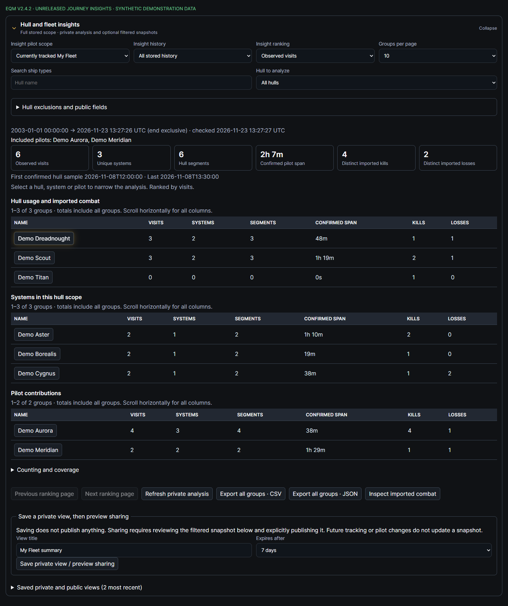
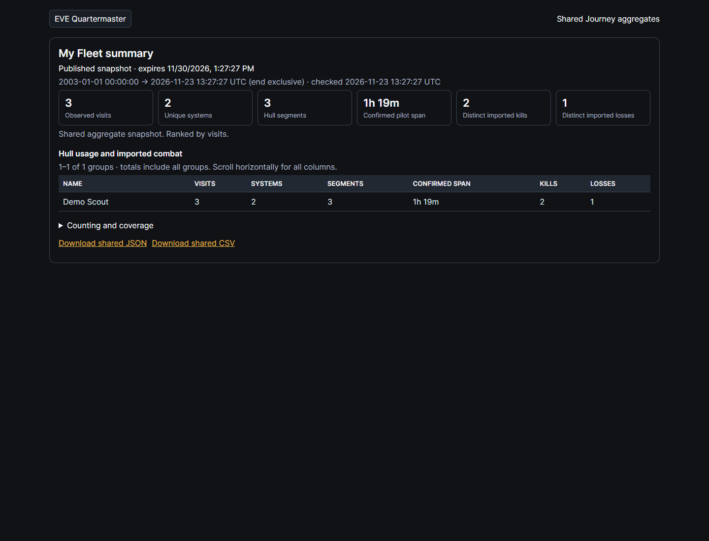

# Hull and fleet insights

Available in v2.4.3. This feature requires matching backend/frontend builds and migration `0112_journey_analytics_views`; it adds no ESI scope or collection.

## Analyze your stored fleet

Open **Hull and fleet insights** beneath Journey analytics, on the platform Analytics page, or inside **My Fleet**. The pane starts collapsed and reads nothing until opened. Choose all currently owned pilots, currently tracked My Fleet pilots, or an explicit owned-pilot selection. Paused pilots remain available in explicit/account scope. The included pilot names are shown privately; corporation-wide platform scope never broadens Journey ownership.

Choose all stored history or UTC dates. The inclusive Through date becomes an exclusive next-day API boundary. Rank by observed visits, confirmed observation span, imported kills or losses. Search/select a ship type, or select a hull, system or pilot from a ranking to drill down. My Fleet system selections also focus its existing map. Filters narrow both travel and combat; missing combat permission shows unavailable values and cannot produce a combat ranking.

The hull table includes combat-only hulls with no Journey samples. Private summaries show first/last confirmed hull samples; system and pilot tables break down the selected hull. Imported combat links are private and paginated. These are ship **types**, not named individual physical ships. Kill hulls come from each pilot's attacker record; loss hulls come from the victim. Duplicated attackers are deduplicated; missing or conflicting hulls stay unknown.

All stored observations in the scope contribute, independently of the replay's 2,000-visit cap or ranking page. Hull spans are clipped to the selected window, stop at actual segment endpoints and do not bridge gaps or inherit a different hull's time. Summed simultaneous pilot spans are not elapsed fleet time, verified flight hours or online time. Shared killmails count once in the fleet summary, but can appear in multiple hull/pilot contribution groups. Group subtotals need not sum to the distinct fleet totals.

Private **Export all groups** CSV/JSON downloads include all qualifying ranking groups, scope/filter metadata, checked-at time and counting/coverage definitions. They do not load raw histories into the browser. Public downloads, described below, contain only the saved visible rankings plus complete summary, explicitly labelled as such.

## Save privately, preview, then optionally publish

1. Under **Hull exclusions and public fields**, choose exact hull exclusions, SDE ship classes, and optional capital/supercapital presets. Exact and class exclusions combine as a union. Capital classification reuses EQM's shared SDE/Dogma classifier; the supercapital preset covers titans and supercarriers. Missing/unclassifiable types are always excluded from public reports.
2. Leave pilot and system names off, or explicitly opt into the aggregate name rankings you want to publish. Public output never contains raw journeys, exact visit times, live positions, fittings, internal pilot IDs, killmail IDs/rows, or external killmail links. An external public killboard may independently reveal information; this view does not control it.
3. On the first ranking page, enter a title and expiration (1, 7, 30 or 90 days). Click **Save private view / preview sharing**. This saves a private immutable aggregate snapshot and shows exactly the public response. No link is made public by saving, tracking a pilot, or entering My Fleet.
4. Review the filtered snapshot, then choose **Publish this reviewed snapshot**. Publication requires the preview hash for that stored report. The chosen pilot cohort is frozen: later linked/enabled pilots and future observations do not enter the snapshot.
5. Manage saved views with **Review**, **Make private**, **Rotate link**, or **Delete**. Making private and republishing generates a new token; the old token remains invalid. Expired/revoked links and their download endpoints stop serving data. Already downloaded files cannot be recalled.

The server applies exclusions before aggregating every span, count, system, pilot, ranking and distinct kill total. An allowed pilot's participation in a shared kill may remain without exposing a blocked participant. Public responses do not reveal excluded/unknown counts or private exclusion settings. Public queries cannot supply alternate pilot IDs or filters.

Public requests recheck that the owner still exists, has Navigation access, owns every frozen pilot identity, and retains combat access if the snapshot included combat. A transferred/removed pilot, deleted owner or lost permission disables the public report, including downloads. Create a fresh preview after a scope change. Responses use no-store and noindex headers; an open public page revalidates every 30 seconds and when it becomes visible. Revocation immediately blocks subsequent requests; it cannot erase data a visitor already obtained.

## Implementation and rollout

- Private API: `/journey/insights/options`, POST `/query`, `/combat`, `/export/{csv|json}`, and owner-only `/views` management.
- Separate public API: `/journey-views/{unguessable_token}` and `/export/{csv|json}`. It never reuses private history/map/export endpoints.
- New table `journey_analytics_views` stores owner, frozen cohort, private filter settings, an explicit public projection, visibility, creation and expiry. No live/updating-share mode is implemented; changing filters requires a fresh preview. No account-wide snapshot, subscription or background collection is introduced.
- Deploy matching API/frontend and apply migration 0112 through the normal upgrade path. No live deployment, version bump, release or APK is performed by preparing this feature.

## Verification and previews

Backend synthetic SQLite/API tests exercise account isolation, explicit/current fleet cohorts, clipped mid-visit hull spans, combat-only and unknown/conflicting hulls, duplicate/shared kills, pre-aggregation exclusions including future classified types, supercapitals, anonymous access, private-by-default publication, preview gating, changed permissions/ownership, expiry/revocation/rotation, exports and migration up/down. Existing Journey regressions remain covered. Production PostgreSQL data, authenticated live pilots and Android runtime are not exercised by the synthetic checks.

Actual Edge desktop/mobile captures render the implemented components against the real new API with an isolated SQLite fixture and fictional pilots. [Provenance and complete gallery](screenshots.md#hull-and-fleet-insights--unreleased-after-v242).

