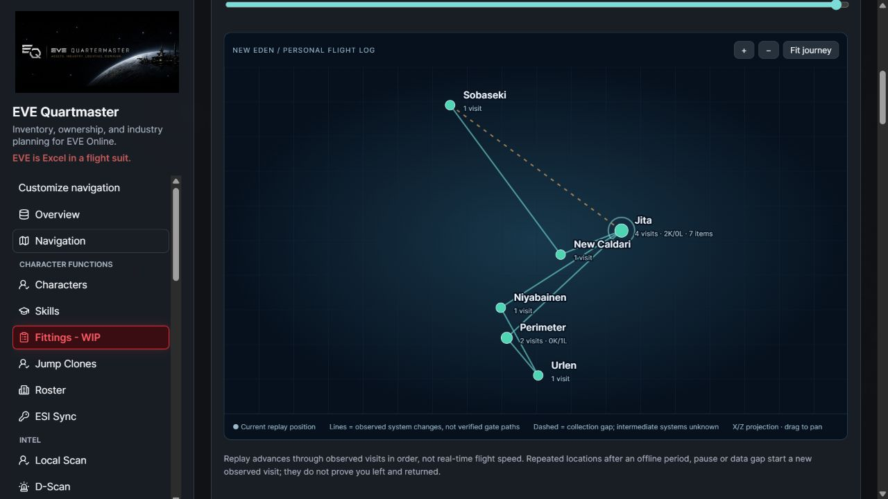
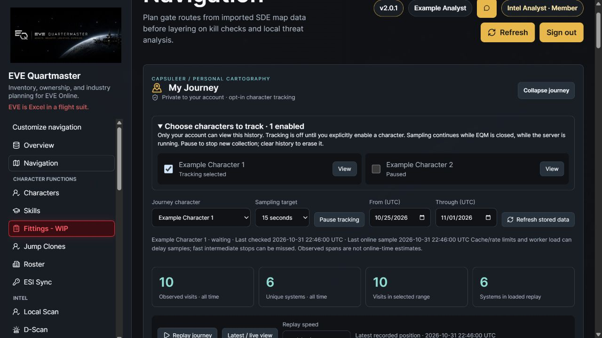
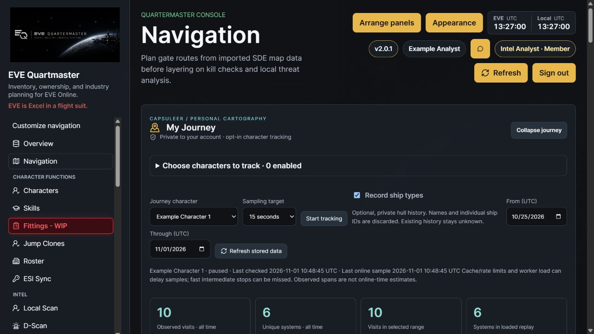
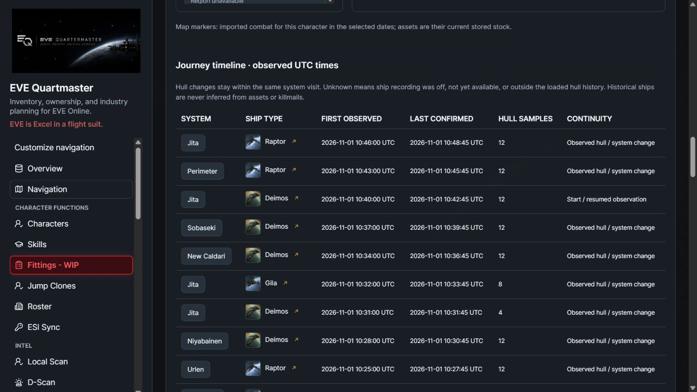
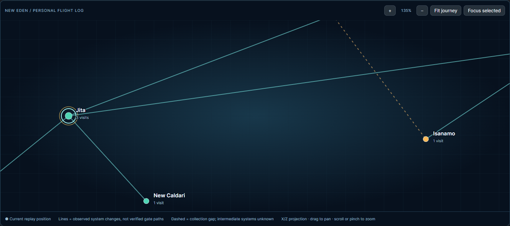
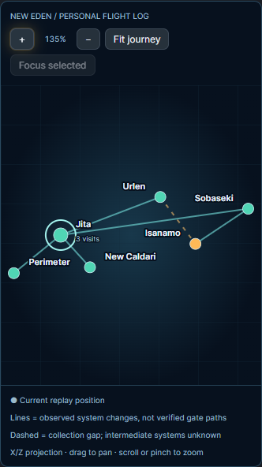
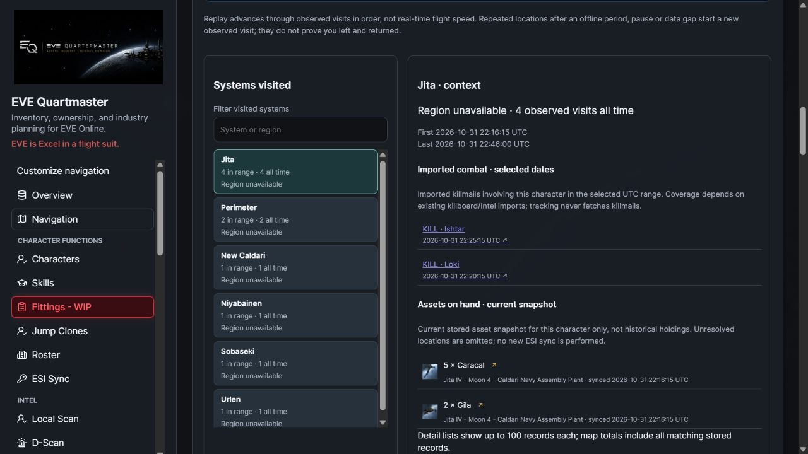
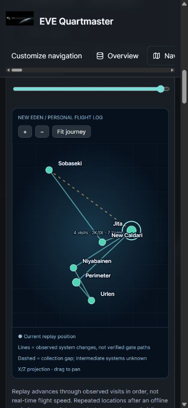
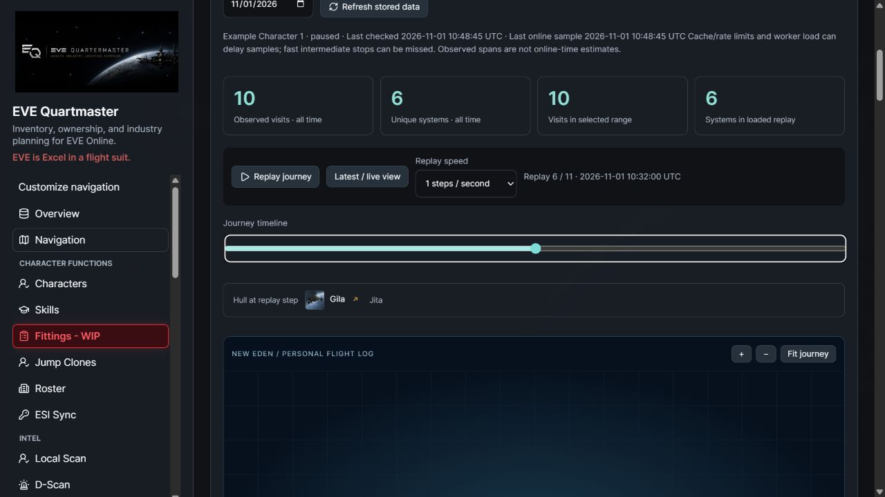
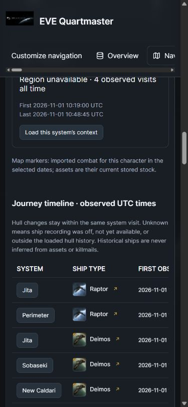

# My Journey — private capsuleer flight log

**Unreleased 2.0.1 development feature.** Open **Navigation → My Journey** to record and replay selected characters' observed movements on an interactive New Eden map. Migrations **0103_journey_history** and **0104_journey_ship_history**, plus matching API/frontend, are required. No live deployment or real EVE consent was performed for these captures.

## Start, pause and erase

Choose your linked character. If prompted, **Enable read-only location access** opens EVE SSO for that exact character, requesting `esi-location.read_location.v1` and `esi-location.read_online.v1`, while preserving already granted scopes that remain permitted. Existing revoked grants can be replaced with fresh minimal consent. Authorizing alone does not start tracking: click **Start tracking** or select the character under **Choose characters to track**. Each character opts in separately; use the character selector to view their separate journey.

Sampling defaults to a **15-second target**, selectable as 15/30/60/120/300 seconds. Collection continues when the browser is closed while the EQM API server is running. **Pause tracking** stops collection and preserves history. **Erase this character’s journey history** opens an explicit review/confirmation, erases only that character’s journey visits, and pauses tracking. Assets, killmails and other reports remain intact. Tracking is disabled by default for every account; migration does not enroll any character or recover earlier travel.

## Optional ship types and hull icons

For the selected character, **Enable read-only ship access** requests `esi-location.read_ship_type.v1` alongside the existing location/online consent. This is read-only and is validated against that exact linked character. Consent alone never enables collection. Select **Record ship types** to opt that character into hull sampling; existing trackers and new characters default to location-only. Turning ship recording off preserves earlier hull history but stops new hull collection. Pause stops both kinds of collection. You can still pause or opt out if ship authorization is lost.

The sampler reads the character's current `ship_type_id` through ESI and stores timestamped hull segments within a visit. It discards the custom ship name and individual `ship_item_id`. Changing hull inside one system adds a timeline/replay step without adding a system visit. Traveling to another system still creates a normal visit. Current/replay hull badges and timeline entries include small CCP hull icons, names and existing type-level in-game links. Missing artwork falls back to a bordered placeholder; missing imported type metadata retains the sampled ID as `Type <ID>`.

Older visits and location-only intervals show **Unknown hull**; EQM never reconstructs those ships from assets, killmails or a later hull observation. A newly enabled hull starts at its first actual sample. Timeline gaps do not imply the previously recorded hull was flown continuously. API ship/location/online responses are independently cached and are not an atomic game-state transaction, so quick boarding changes or jumps may be missed or appear delayed. A failed/malformed ship response does not record a guessed hull; the sampler backs off and breaks continuity, using the existing authorization-stop behavior for terminal failures.

Hull history has the same account-only access, ownership rechecks, pause/erasure, transfer boundaries and no public sharing as system history. Utility-role consent does not enable regular asset/skill collection. Erasing a character's journey removes its hull segments as well. Ship sharing/redaction/export controls remain shelved future work.

## Visits, totals and replay

The first online location sample starts an observed visit. Further samples in the same system update its last-confirmed time and sample count. A system change starts another visit; returning to a system increases its total. The panel shows all-time visits/unique systems, visits overlapping the selected UTC dates, per-system counts, first/last sightings, and the chronological visit log. **Observed span** means the interval between recorded samples, not time online or exact time spent in system.

An offline response, pause, failed sample or long gap breaks continuity. Resuming creates a new observed visit, even in the same system; this does not prove that the character physically left and returned. The displayed visit totals count these recorded observation segments. First/last times in the log retain the original sample bounds for visits overlapping the chosen dates.

**Replay journey** reveals observations in order at 0.5/1/2/4 steps per second. Play/pause, timeline scrubbing and **Latest / live view** control the display. This is an in-browser animated replay, not an exported video. Replay steps include visits and recorded hull changes. Replaying two hulls in the same visit moves the hull badge without increasing visit totals; speed is steps per second rather than actual flight speed. The map supports pan, zoom, fit and keyboard-selectable systems, and fits its projection to desktop/mobile dimensions. Search the visited-system list for keyboard access and systems without coordinates.

The map uses imported SDE X/Z positions. Lines join observed system changes; they do not claim a verified stargate route or travel method. Dashed links mark collection gaps. Unobserved intermediate systems are never filled in using a guessed shortest route. Characters can pass through systems between polls, so this is a sampled log rather than a complete jump counter. Online status and locations may lag because ESI caches them; worker load, downtime and rate limits can also delay samples.

The response includes at most the first **2,000 visits** in the selected window, with a visible truncation warning. Narrow the dates for a complete replay. All-time system totals remain complete. Timeline pages show 50 entries; the replay uses the loaded visits and hull segments. At most 5,000 hull segments are returned within loaded visits, with an explicit warning when truncated; narrow the date window for a complete replay. Unavailable hull rows stay unknown. History is retained until the account erases it; ordinary app restarts preserve it.

## Map controls

The unreleased v2.1 follow-up matches the Atlas interaction style:

- **Scroll the mouse wheel/trackpad** over the map to zoom around the pointer, or use **+ / −**. The readout shows the current zoom (50%–8,000%).
- **Drag** the background, a route line, or a star to pan. A click/tap selects a system; dragging does not select it. Releasing outside the map or cancelling a touch gesture ends the drag.
- On touch devices, **drag with one finger** or **pinch with two fingers**. Scroll the page outside the map to move the page.
- **Fit journey** restores the full projected view. **Focus selected** centers the selected system at 8× zoom.
- Focus the map with the keyboard: **arrow keys** pan, **+ / −** zoom, and **Home / 0** fit. Visited stars retain **Enter / Space** selection and the searchable visited-system list remains available.

Markers and labels stay at a consistent screen size as the route scales. Replay/scrubbing and context selection preserve your chosen zoom/pan; resizing the map or switching character/date range fits the new view. Wheel gestures over the map are consumed by the map, not the page.

Verification: nine journey math/replay/hull tests and eight actual-browser checks cover anchored wheel zoom, bounded zoom, panning, star selection, focus, keyboard input, replay retention, outside release, touch pinch/pan and cancellation recovery. Desktop/mobile captures use the actual JourneyPanel with synthetic local HTTP responses and illustrative coordinates; no production API or real character data was used. [Capture provenance and checksums](../static/ss/v2.1/capture-receipt.json).

## Combat and asset context

Select a star or a system in the visited list. Map markers and the detail panel use **existing EQM data for that character only**:

- Imported killmails involving the selected pilot as attacker or victim, in the selected UTC range. Duplicate attacker rows do not duplicate kills. This requires Killboard, Battle Reports or Intel Reports permission. Context covers the selected date range and does not assert a kill occurred during a particular sampled visit.
- Current stored character assets in that system, with quantities, item links, locations and sync times. This requires Assets permission. Nested assets inherit resolved station/structure locations through their own-character hierarchy; unresolved locations are omitted. Corporate stock and other characters’ inventories are not added to this view.

The asset layer remains a **current inventory snapshot during replay**, not historical holdings. Refresh stored data after a normal asset/killboard sync to update context. Location-only journey tracking does not collect ship types; optional hull recording requires separate opt-in. Neither mode starts asset, skill or killmail collection and does not change regular sync opt-outs. Utility-only accounts remain outside ordinary private collection. Detail lists show up to 100 records per layer; map counts aggregate all matching stored records.

## Privacy and operations

Navigation permission is required. All history/settings/context routes enforce the current account's ownership of the linked character, with **no staff override**. Journeys are account-private and have no public share link. A character transfer does not expose the old account’s history to the new account. Unlinking, revocation, lost scopes, disabled Navigation or account deletion stops new writes. History stays in this private module, separate from Local Scan/Intel observations. Account/character deletion cascades owned journey records where applicable.

The server stores system IDs, UTC first/last observations and sample counts, plus private tracking state. With explicit hull opt-in it also stores ship type IDs and timestamped segment/sample counts within the visit; custom ship names and individual ship IDs are discarded. Station IDs, structure IDs and exact in-system positions from the location response are discarded. Short-lived access tokens and online cache entries remain in bounded process memory. Refresh-token rotation is persisted only after checking the original credential still matches. The sampler refresh requests only location/online scopes, adding ship-type read access when the character has explicitly opted in. A scope-mode change invalidates the transient bearer cache so a location-only bearer is never reused for ship collection.

The API lifecycle runs a bounded background sampler. Atomic database leases coordinate concurrent API processes and recover after interruption; paused/erased trackers invalidate in-flight leases. Ownership, enabled state and scopes are rechecked after network waits. Database sessions close before OAuth/ESI awaits. Cached online status avoids redundant calls; location scheduling follows remaining `Cache-Control` lifetime (legacy `Expires` fallback), requested interval and the existing shared ESI transport's rate/error controls. Failures back off, and terminal authorization failures stop collection until explicit reauthorization/restart. Errors do not log credentials or positions.

Apply `0103_journey_history` after 0102, followed by `0104_journey_ship_history`, with matching API/frontend. It creates `journey_trackers` and `journey_visits`, owner/character uniqueness, due-work and character/system/time indexes; no historical data is backfilled. The 0103 downgrade removes journey history only. Migration 0104 adds `track_ship` (false by default), a current-segment pointer and `journey_ship_segments` with a cascading visit foreign key and visit/time index. It does not enroll or backfill existing histories. Downgrading 0104 drops hull history/settings while retaining system visits. Source-based timing guidance follows [CCP’s cache-header guidance](https://developers.eveonline.com/blog/smarter-caching-when-events-drive-invalidation).

## Verification and screenshots

Backend tests cover opt-in/default privacy, utility scopes and real-auth Quartermaster mutation limits, staff isolation, repeated samples and revisits, gap/clock behavior, pause/erase, leases, credential races, in-flight revocation/transfer/permission changes, cache headers, offline detection, failure backoff, connection release during network waits, current-own-character context, nested assets, distinct killmail counts, explicit UTC context timestamps, date limits and migration upgrade/downgrade. Replay tests cover ordering, revisits, gaps, missing coordinates and projection. Run `npm --prefix frontend run test:journey` and the production build.

Browser captures use the actual built UI/APIs against an isolated synthetic database. Public CCP system coordinates are used for a fabricated route; pilots, holdings and combat are demo data. The preview does not perform real OAuth, collect a live character's location, or issue a game action. Playback advances through the route, scrubbing works, character switching clears the previous view, star selection loads context, opt-in/pause persist, and mobile layout has no document overflow. No JavaScript console errors were observed.

Ship follow-up verification adds 18 backend tests: explicit minimal ship consent without other collection, location-only defaults even with a broad grant, within-system switches and unchanged totals, cache/scoped bearer separation, post-network revocation/opt-out checks, malformed responses, no retained custom name/item ID, pause after revoked scopes, erasure/ownership/limits and migration upgrade/downgrade. The original regression run passed 136 backend tests plus 7 subtests; the final 18-test hull suite includes three additional network/OAuth checks (139 unique backend tests overall). Five frontend replay/projection tests and the final production build pass.

The actual browser preview verified per-character consent isolation, setting persistence, Deimos-to-Gila replay steps within Jita without inflating the ten-visit total, hull icons in desktop/mobile timelines and no document overflow or console errors. Fixtures contain synthetic hull history, not real flight logs. The sampler was not run against a real EVE grant. The official [ESI OpenAPI schema](https://esi.evetech.net/meta/openapi.json) was checked for the ship endpoint and required read scope; the old `/latest/swagger.json` URL no longer resolved during this check.

[All captures and checksums](../static/ss/v2.0.1/capture-receipt.json)
