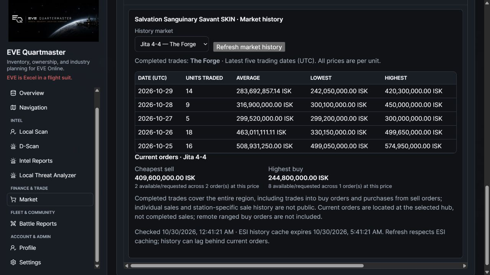

# Expandable market history

Unreleased 2.0 development feature; deployment is separate. No new migration or ESI scopes are required. Use matching frontend and backend versions.

Run a **Market Appraisal**, then click a matched item's name (or focus it and press Enter) to expand its summary directly below the price-check row. Click again to collapse it. Unmatched items do not request history. The summary loads only when opened and grows with the page; the appraisal table no longer imposes a separate vertical scrollbar.

Choose one of the appraisal's available individual hubs in **History market**. This resolves the region from the existing built-in/custom hub definition. The NPC aggregate has no single region, so an individual hub must be selected. Custom system hubs use their imported region and known market station locations.

The table shows the latest five trading dates reported by ESI, newest first: **Date (UTC), Units traded, Average, Lowest, Highest**, with prices in ISK per unit rather than stack totals. These are completed trades across the **entire region**, including buy-order fills and purchases from sell orders. They are not individual last transactions or proof that each trade occurred at the selected station. No-trade dates are not filled with invented zeros.

Below the table, current orders show the lowest sell and highest buy price at the selected hub, plus remaining quantities and order counts at each best price. Built-in hubs filter to their station; custom system hubs filter to their known stations. Remote ranged buy orders originating elsewhere are omitted, consistent with the appraisal's hub-local scope. Current asks/bids are separate from completed-trade history.

**Refresh market history** checks again through EQM's shared ESI transport/cache. The summary includes a check time and ESI history-cache expiry when available; refreshing does not bypass upstream caching. History can lag behind live orders. History and order failures are independent, visibly labelled, and never converted into zero trade volume. Leaving/collapsing aborts the browser request and ignores stale responses; backend fetches are individually bounded to 45 seconds. The read-only database transaction is released before awaiting ESI, so upstream delays do not occupy a database connection. No history fetch is added to the initial bulk price-check request.

API: authenticated `GET /market/items/{type_id}/history?hub=jita&limit=5`, with Market section permission, an imported SDE type and a configured/resolved hub. Limit is bounded to 1–30 rows (the UI uses five). No arbitrary upstream URL or station parameter is accepted. No private market transaction endpoint is queried.

Verification covers newest-first/limit/price/quantity calculations, station filtering, custom-region resolution, invalid IDs/hubs/limits, authentication, empty data and independent upstream/malformed payload errors. The actual built UI was exercised with synthetic ESI responses: expand/collapse/keyboard reopen, Jita/The Forge → Amarr/Domain → Jita, and full page scrolling. The screenshot is illustrative fixture data, not a current live price quote.

