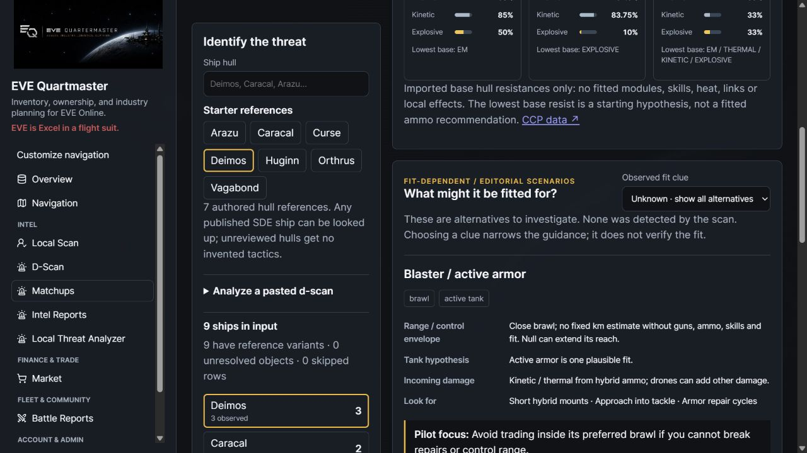
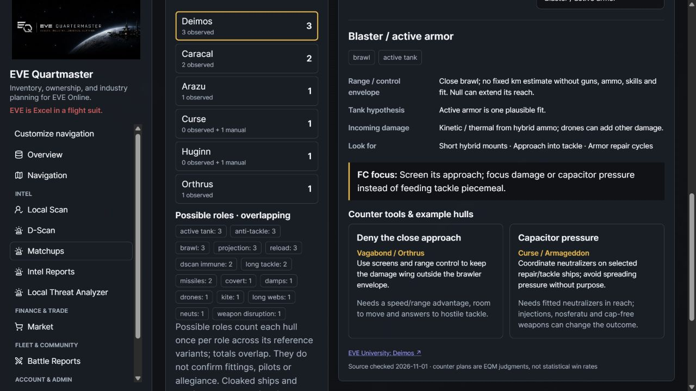
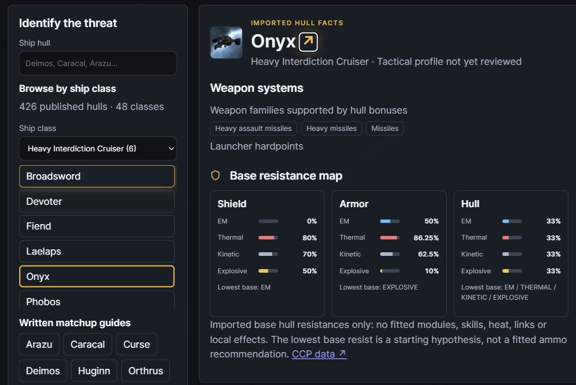
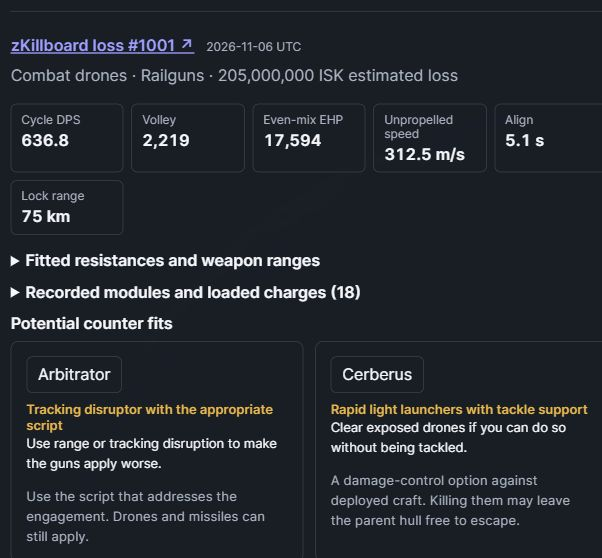
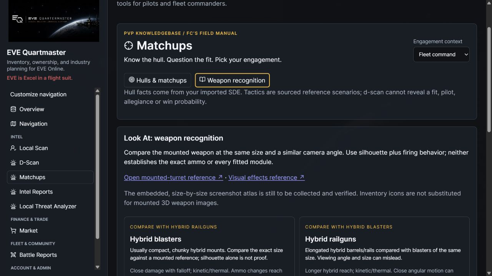
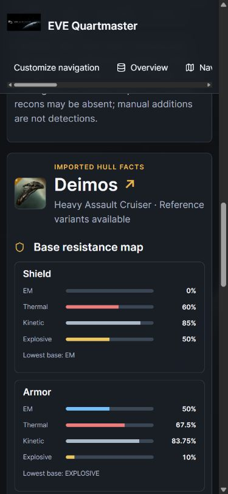

# PvP Knowledgebase: Matchups

Open **Intel → Matchups** and choose **Solo / small gang** or **Fleet command**. The v2.3 catalog covers every published ship in the installed SDE. The catalog and example fits require matching API and frontend builds.

## Quick use

1. Browse by **Ship class** or search by name. CCP subclasses such as Assault Frigate and Heavy Interdiction Cruiser are alphabetized, with hulls sorted by name within each class.
2. Read **shield, armor and hull separately**. The map shows base damage resistances, not a fitted tank. Native type values include built-in type resistances; skills, fitted modules, heat, links and environmental effects are not evaluated. Lowest values are shown only when the entire layer is known; ties are retained, missing/invalid values remain Unknown. Never choose ammunition purely from the hull's shield hole when it may be armor tanked.
3. **Unknown · show all alternatives** is the initial fit clue. Select a scenario only when you have a reason to investigate it. Its weapon/tank hypothesis, incoming damage, range/control envelope, observations and counter tools are conditional editorial guidance, not a detected fit or win probability.
4. Switch context to change both the pilot/FC focus and the counter-tool plan. Named example hulls illustrate a role; they are not a ranking and do not verify your fit, skills, numbers, tackle, logistics or ability to disengage.

All published SDE ship hulls have base-fact lookup. The initial authored catalog contains **seven hulls / nine scenarios**: Deimos (blaster, rail), Vagabond (autocannon), Arazu (covert tackle/damps), Curse (neuts/drones), Huginn (long webs), Caracal (rapid light, HAM/heavy alternatives) and Orthrus (kiting/extended tackle). This is not a statistical inventory of the current meta. Other hulls explicitly have no reviewed tactical profile.

## Ship catalog and example fits

Each hull card shows weapon families indicated by imported hull bonuses, plus turret and launcher hardpoints and drone or fighter capacity where available. Strategic cruisers also depend on the offensive subsystem. Use observed weapon families on the example cards to see what actually appeared in the sampled losses.

Select **Find example fits** on a hull to read up to three distinct fits from the first 40 available non-NPC losses in zKillboard’s ship-loss results. Open **Recorded modules and loaded charges** to inspect fitted modules, rigs, subsystems, drones or fighters and recorded charges by slot. Each example links to its public killmail. Missing records or a disabled killboard source receive an explicit notice. Loss records are a sample of ships that died, with incomplete coverage and no implication about the current opponent’s fit or how often a fit wins. [zKillboard API](https://zkillboard.com/api/docs/) · [CCP killmail coverage](https://support.eveonline.com/hc/en-us/articles/11730655033884-Killmails)

**Estimated fitting stats** apply the current SDE and EQM simulator to recorded equipment. Estimates assume all skills V, recorded charges, cold modules, no implants or fleet boosts, an inactive propulsion module and no special modes. EHP uses an even damage mix. DPS is per cycle before reload or target application. Unsupported effects can affect estimates. Total DPS and volley are omitted when recorded ammo or modeled damage is insufficient. Fitted resistance rows are separate from the base hull map.

Counter suggestions use the observed equipment and the selected pilot or fleet context. A rail Deimos can suggest an Arbitrator with a tracking disruptor and a range or tracking script, for instance. Each suggestion explains when it helps and what limits it. The named hull opens its own reference and loss lookup. These are starting points for building a counter fit. [Rail Deimos loss](https://zkillboard.com/kill/139713584/) · [CCP Arbitrator bonuses](https://www.eveonline.com/ru/news/view/alliance-tournament-xxi-rules-and-regulations)

Live verification used CCP SDE build **3670638**, with **426 published ship types across 48 classes** and all 12 base resistance values present on every hull. The audit also sampled live zKillboard results for eight hulls, including Deimos, Onyx, Typhoon and Erebus. The browser captures use synthetic loss records and public equipment types. [Capture receipt](../static/ss/v2.2.1/capture-receipt.json)

## Range and evidence

Numeric range examples are conditional references, never a universal safe distance: the catalog records assumptions where the source supplies them. A Vagabond falloff example is not its optimal range; the Curse/Huginn module examples depend on pilot skill and module grade. Heat, ammunition, hull bonuses, fitting changes and fleet boosts can invalidate a guessed boundary. Most first-pass cards use a qualitative envelope until a complete reference fit can be validated.

SDE facts are read from the installation's imported database, so refresh the SDE normally. Editorial references have source URLs and a **source checked** date. A source check is not live fit verification or certification that a tactic remains the dominant meta. Counter plans are EQM editorial judgments based on the stated conditions, not claims made verbatim by each linked guide. No third-party article text or images are bundled into this initial catalog.

## D-Scan workflow and privacy

An authenticated D-Scan result has **Open in Matchups** when the account may view Matchups. It projects ship type counts, observed/manual counts and possible roles from the existing snapshot. It excludes the source's object names, pilots, affiliations, system, creator and linked Local Scan. The existing D-Scan permission, private creator-only access, expiration and deletion checks still apply; even staff cannot read another creator's private scan through Matchups. The snapshot is not rewritten.

Alternatively, paste a scan under **Analyze a pasted d-scan**. The existing bounded parser handles three/four-column clipboard rows (5,000 rows, 500,000 characters). It resolves types with imported SDE, counts repeated observations and reports unresolved/skipped rows. Analysis returns only hull counts and notes; it stores no scan/report, creates no public link or Intel sightings, and performs no pilot or upstream ESI lookup. The browser clears submitted text after successful analysis. Current results remain in component memory until navigation/reload.

**Possible roles** combine reference variants. Each hull counts once per tag, but roles overlap and are not confirmed fitted capabilities; scanned ships need not all be hostile. Unknown/unreviewed types do not receive generated tactical conclusions. Combat recons are d-scan immune, cloaked ships may be absent, and manual additions remain explicitly manual. The input is not a verified fleet roster or kill forecast.

All Matchups endpoints require authentication and the independent **Matchups** section permission and return private/no-store responses. Defaults allow built-in roles other than Applicant; existing combined/custom-role and section-disable rules apply. Quartermasters can perform the narrowly allowed read-only analysis POST without gaining ordinary report generation or collection rights. No public Matchups endpoint is added. Navigation customization/Quicklaunch and three arrangeable section panels support the new module.

## Weapon recognition

The second view contains eight starter family references: blasters/rails, autocannons/artillery, pulse/beam and rapid-light/HAM-heavy launchers. It describes cautious silhouette/behavior checks and links the authored [mounted-turret reference](https://wiki.eveuniversity.org/Turret_Recognition) and [visual effects guide](https://wiki.eveuniversity.org/Identifying_Visual_Effects).

**An embedded mounted-weapon screenshot atlas is not implemented yet.** Inventory icons and hull portraits cannot establish the mounted model. Capture/verify exact size and family, camera angle, firing effect and asset provenance before adding images. Older reference art can go stale; tracer color alone is not proof of a weapon subtype or ammo.

## Knowledgebase architecture and next work

Facts, editorial content and presentation are separated: `services/matchups.py` queries SDE and projects scans; `services/matchup_knowledge.py` contains version-controlled source-backed scenarios/counter tools; authenticated `api/matchups.py` exposes bounded read/analysis routes; the dedicated frontend feature renders the manual. No probabilistic fit classifier, AI-generated combat advice, scraped fit-frequency claim or automatic winner score is used.

Next development layers:

- Extend example fit modeling to tackle envelopes, application graphs, heat and special modes as simulator coverage improves. Add validated counter fitting exports.
- Matchup context: own hull/fit and friendly composition, enemy variant uncertainty, space/security and gate constraints, starting distance, support/numbers, objective and escape plan. Explain why a counter helps and when it fails.
- Mounted-weapon atlas: actual verified screenshots/clips by family, size and variant; retain source/license/provenance and review history. Start with the common medium guns seen around the pocket.
- Coverage: common tackle/EWAR/logistics and battlecruiser/marauder variants, then capitals and escalation tools. Quantitative claims need complete fit assumptions or dated observational evidence.
- Reviewed alliance lessons and notes: proposed/draft/published revisions with author/source/change history, correction workflow and explicitly separate private/alliance/public visibility. No user-authored editing or publication workflow is implemented in this first pass.
- Later fit-frequency enrichment can use permitted public evidence with sampling windows, bias/coverage notes and freshness. Historical loss fits cannot establish the ship currently on grid.

Journey sharing/redaction/animated exports remain shelved on the roadmap. They are unrelated to this module and have not been enabled.

## Sources and verification

- [CCP Static Data](https://developers.eveonline.com/static-data) and [SDE guide](https://developers.eveonline.com/docs/guides/staticdata/).
- EVE University authored hull guides: [Deimos](https://wiki.eveuniversity.org/Deimos), [Vagabond](https://wiki.eveuniversity.org/Vagabond), [Arazu](https://wiki.eveuniversity.org/Arazu), [Curse](https://wiki.eveuniversity.org/Curse), [Huginn](https://wiki.eveuniversity.org/Huginn), [Caracal](https://wiki.eveuniversity.org/Caracal), [Orthrus](https://wiki.eveuniversity.org/Orthrus).
- [Turret mechanics](https://wiki.eveuniversity.org/Turret_mechanics), [missile mechanics](https://wiki.eveuniversity.org/Missile_mechanics), [turret recognition](https://wiki.eveuniversity.org/Turret_Recognition), [visual effects](https://wiki.eveuniversity.org/Identifying_Visual_Effects). Azual Skoll's 2013 chart was discoverable through UniWiki but did not render during this check; no claim of validating or importing its images.

73 backend tests pass across Matchups, D-Scan, combined roles and appearance, including real-auth Quartermaster limits, disabled/custom permissions, raw private scan responses, expiry, strict input bounds, resistance conversion/ties/missing values, unknown hulls and source/variant integrity. Production TypeScript/Vite build passes (existing chunk-size advisory).

Actual browser checks use the production build and real APIs against isolated SQLite with synthetic accounts/scan counts and **public CCP ESI hull/dogma records**. Verified hull search and unreviewed fallback, read-only paste analysis, saved private D-Scan handoff, context/clue selection, responsive resistance bars and no document overflow; error console empty. No real private ESI calls, game actions or deployment. Captures are actual UI, without repainting.

[Screenshot receipt](../static/ss/v2.0.1/capture-receipt.json)
