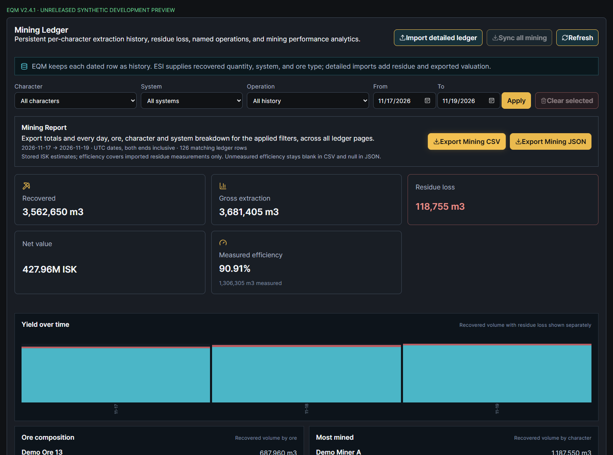
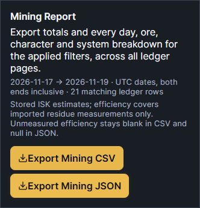

# Mining Report exports

Unreleased EQM **2.4.1** frontend addition. Open **Mining Ledger**, choose a date period and optional **Character**, **System** and **Operation** filters, then select **Apply**. The **Mining Report** panel above the summary cards provides **Export Mining CSV** and **Export Mining JSON**.

From and To include both selected UTC ledger dates. Leave either blank for an open-ended period. Changing any filter disables export until that selection loads successfully; loading and failed refreshes also block stale downloads. A late response from an earlier selection cannot replace a newer report.

## Included analytics

- Selection totals: recovered and residue quantities; gross quantity; recovered, residue and gross volume in m³; estimated recovered, residue and gross value in ISK; measured efficiency; total gross volume covered by residue measurements.
- Every returned day, ore, character and system breakdown. Exports include the entire filtered analytics result, beyond the ledger's current page and the charts' last-31-day/top-ten display limits.
- Applied filter IDs/names, inclusive date semantics, matching ledger-row count, first/last recorded day, recorded-day count, application/schema versions, export time and time the report data was loaded from EQM.

JSON uses the versioned `eqm.mining-report.v1` schema with `totals`, `by_day`, `by_ore`, `by_character` and `by_system`. CSV is one UTF-8 file with a byte-order mark and a `section` column: a `totals` row followed by those four breakdown sections. Metadata repeats on each row. Numeric column names state units, stored precision is retained, and text is quoted and protected against spreadsheet formula interpretation. Filenames include the selected date period and UTC export timestamp.

Unmeasured efficiency remains **null in JSON** and **blank in CSV**; a measured zero stays zero. Per-group measured gross volume is unavailable from the existing API and stays blank in CSV; the selection total is included. Empty selections still export metadata and zero totals with empty breakdowns. Missing days are not filled with fabricated zero observations.

## Meaning and access

Values come from EQM's retained ledger and existing authorized analytics response. The report does not request fresh ESI data or current market prices. Stored ISK estimates are not realized profit. Efficiency covers imported residue measurements; absent residue can understate gross extraction. The loaded-from-EQM timestamp records the report fetch, not the last ESI sync.

Exports explicitly project analytics and selected-filter metadata. They omit raw ledger entries, operation notes, the full character roster, credentials and unrelated payload fields. Existing Mining Ledger permission, character visibility, opt-out, date and operation filtering remain server-enforced. No new endpoint, migration, consent scope, background collector or public share is added. Deploy the updated frontend to make these actions available on a running installation.

## Synthetic development previews

Actual MiningLedgerPage rendered in a local preview with fabricated pilots, operations and extraction data; no production account or user screenshot was used. Browser verification covers actual CSV/JSON downloads, date and combined filters, pagination independence, pending/failed/overlapping requests, empty ranges and 390px layout. The preview uses a synthetic API adapter, not a live server or full authenticated application.

Capture provenance: [receipt](../static/ss/v2.4.1/capture-receipt.json).
