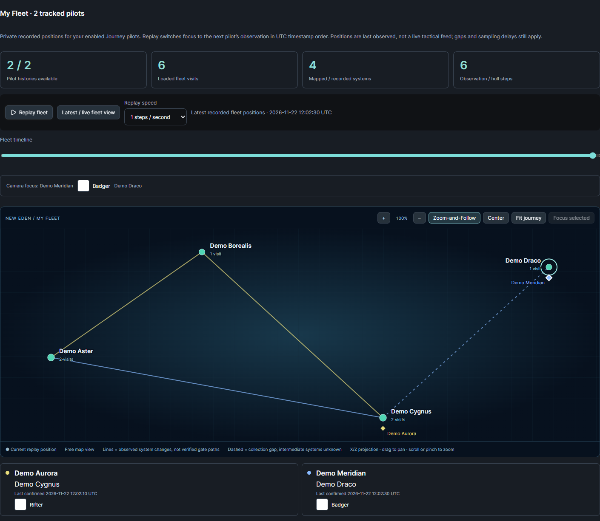
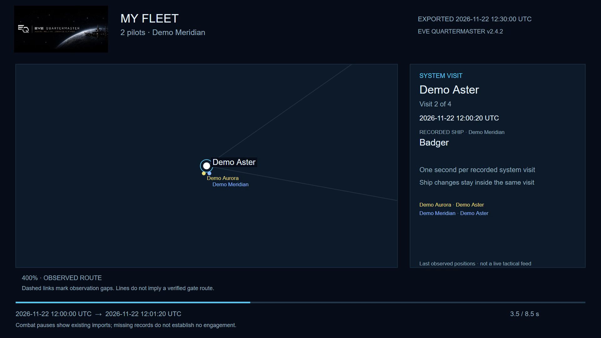

# My Fleet and Journey movies

**Unreleased source follow-up after v2.4.2.** These changes need an updated frontend. They add no database migration, server collection, ESI permission, or new tracking enrollment.

## One map for your tracked pilots

In Navigation, open **My Journey**, then select **My Fleet**. Every currently enabled Journey pilot on your EQM account is included. The existing tracking controls determine membership; paused pilots remain available in individual My Journey history. Existing private, owner-checked Journey APIs provide each pilot's stored observations. Other users' characters are not queried.

The map shows pilot colors and name labels, per-pilot observed paths, and a roster with each pilot's last confirmed system, UTC timestamp, and recorded hull. Co-located markers are offset to make them readable; their offsets are not in-system positions. Missing SDE coordinates leave a pilot in the roster, and missing hull samples stay unknown. Paths never connect one pilot's observation to another pilot's location.

Replay merges visits and recorded hull changes in timestamp order, with deterministic pilot-ID ordering for ties. The camera follows the pilot whose next observation is reached. Starting fleet replay enables Zoom-and-Follow; manual pan/zoom, Fit, Center, and Focus selected keep the existing map behavior. Scrubbing backward does not show pilots or hull changes that had not yet been observed.

Latest view means latest **recorded positions in the selected dates**, not a live tactical feed. The existing 15-second visible / 60-second hidden-page refresh reads stored data; it does not force an ESI sample. Sampling/cache delays, worker load, missed intermediate stops and collection gaps still apply. Enabled but offline pilots may have old last-known positions. Confirmed spans are not online-time estimates.

The loaded map is capped at 2,000 merged visits; each pilot's normal history API also has its existing cap. Truncation and unavailable pilots are shown explicitly. A failed pilot prevents a loaded fleet movie from being presented as complete. Narrow the dates, retry, or use segmented export for complete history.

## Fleet GIF / MP4 export

The existing three export scopes work for My Fleet:

- **Single clip:** select a range of loaded merged visits, up to 500 per clip.
- **Segment selected dates:** read every enabled pilot's paged history for the selected UTC range.
- **Entire recorded journey:** include every recorded date for those pilots, including an older pilot history beyond another pilot's start date.

All scopes render at **1920 × 1080**. MP4 uses H.264 at 30 fps; GIF uses 10 fps and has no audio. Clips retain the existing fitted opening/closing, close-up camera, EQM branding, UTC timestamps, part numbers, one second per visit, and three seconds per engagement page. The focused pilot and other pilots' recorded positions remain identified on the fleet map. Positions already known before a later clip are carried into that clip.

Segmented export merges the next timestamped event from each pilot's authenticated snapshot stream. It reads bounded current pages rather than loading every pilot's entire history into memory. Movement and engagement events interleave across pilots, including across history/clip boundaries; a late engagement cannot jump ahead of another pilot's earlier move. Engagement pages are ordered by their first record's timestamp. A shared killmail can appear for each involved pilot; it is not attributed to another pilot merely because they occupied the same system.

Each clip keeps the existing 500-visit, ten-minute and 128-MiB bounds. Large files split automatically at timeline events. Long engagements continue in the next part without replaying their preceding visit. Folder export writes numbered clips and an index. Download mode creates one clip at a time and waits for save confirmation before continuing. Cancel preserves saved parts, while date/pilot/view/scope changes cancel the active exporter through component cleanup.

Snapshots are independently established and checked for each pilot; this is **not an atomic, simultaneous fleet snapshot**. Existing signed cursor, ownership, permission, history-revision and attachment-count checks remain in force. A failed stream stops the export rather than silently dropping that pilot. The index labels the independent snapshot scope and records completed/pending timeline boundaries; it is not a reload-resume facility.

Imported engagements remain limited to records accessible through the current combat permissions. Some pilots/pages can be travel-only when combat is unavailable. No new killboard fetch or combat inference is introduced. Hull history comes from recorded hull observations, not killmail fitting assumptions.

## Optional space ambience

MP4 exports offer an opt-in **Space ambience** checkbox and volume control. The original procedural track uses slow pads and sparse bell tones, with a fade at the start and end of each clip. It is generated locally in small PCM chunks and encoded to AAC; there are no third-party recordings or music downloads. Music starts off. The default volume is deliberately quiet, and the control ranges from 0% to 30%.

AAC support depends on the browser. If it is unavailable, turn music off and retry. GIF remains silent. Each segment has its own opening/closing and audio fades; stitching keeps those transitions.

## Combine saved MP4 clips

Expand **Combine Journey MP4 clips** below the exporter, choose the numbered files from an export run, review their automatically sorted order, and click **Save combined MP4**. Move or remove files before starting if needed.

The stitcher validates every clip before writing. Clips must have one 1920 × 1080 H.264 video track and matching decoder settings. Optional audio must be AAC with matching settings; all clips must contain music or all be silent. GIF and mismatched clips are rejected rather than re-encoded or resized.

The join copies compressed packets with adjusted timestamps into one fragmented MP4. It does not decode/render video frames or construct a single in-memory combined Blob. Each input is opened in turn with a small read cache, and writes use a bounded cache plus backpressure. File references and container indexes still use memory; this is not a guarantee of constant memory for arbitrary multi-hour inputs. No multi-hour browser memory benchmark is claimed.

Direct file saving requires desktop Chrome/Edge with the File System Access API. Other browsers and Android's embedded WebView retain individual downloads. Files are never uploaded. Cancellation aborts the output file transaction; original clips and an existing destination's previous contents remain intact. Browser/OS failures may still require checking the chosen output location.

The stitcher retains each clip's opening, closing, branding and fades. It does not remove repeated titles or create new camera transitions. Video quality and dimensions stay unchanged.

## Verification

Synthetic tests cover timestamp merges, identity collisions, per-pilot paths/hulls, future-position exclusion, map truncation, 2,400 paged visits, late cross-pilot engagements, ten-minute continuation, retained positions, earlier pilot start dates, unavailable combat, failed streams, cancellation and bounded fetch concurrency. Existing single-pilot Journey tests remain included.

Actual JourneyPanel browser checks cover desktop and 390px views, replay/scrubbing/follow, explicit pilot-load failures, loaded and segmented fleet exports, original synthesized music, GIF, and real writable-file stitching. The production worker generated actual 1080p MP4/GIF media. Codec/duration/audio and packet-preservation checks are recorded with the capture provenance.

These are isolated synthetic component checks, not production SSO/ESI, native file-picker dialogs, Android device tests, or a live deployment. File-picker tests used real origin-private file handles.

## Hull and fleet analytics and sharing

Open **Hull and fleet insights** within My Fleet to analyze all stored rows for the currently tracked cohort, an explicit owned-pilot selection, or all owned pilots. Select hull/system rows to narrow the analysis; system selection can focus the fleet map. Private exports include all qualifying groups. Optional public snapshots have a separate filtered preview, hull/class exclusions and revocable links; private raw histories/maps/movies remain private. This backend/frontend follow-up requires migration **0112_journey_analytics_views**. [Full workflow and privacy boundaries](journey-insights.md).
