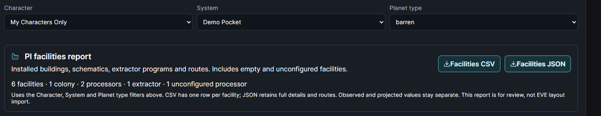
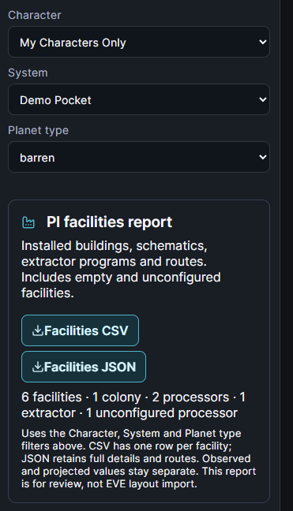

# PI facilities export

Open **Inventory & Industry → Planetary Industry → Colonies & supply**. Below the **Character**, **System** and **Planet type** selectors, the **PI facilities report** shows the number of installed buildings, colonies, processors, extractors and unconfigured processors in the selected scope.

- **Facilities CSV** exports exactly one row per installed facility, including command centers, empty launchpads/storage, extractors and unconfigured processors. Structured recipe inputs, contents and inbound/outbound routes are JSON cells, so multiple stored commodities do not duplicate a facility row.
- **Facilities JSON** exports `eqm.planetary-facilities.v1`: report/source timestamps, the selected filters, recalculated counts, colony identities and checkpoint/projection metadata, full facility details and complete reported routes/waypoints. It omits sync tokens and unrelated pilots' metadata.

Both exports follow all three selectors, including permitted character groups or an individual pilot. No-match selections disable the buttons. Selection never broadens backend visibility; existing PI account/corporation permission boundaries remain in force. Downloaded files contain the selected operational data and should be shared deliberately.

The report includes facility and commodity IDs/names, coordinates when supplied, configured recipes and per-cycle inputs/output, extractor product/head count/program dates/yield projections, observed status/inventory and projected status/inventory/produced/blocked amounts. JSON retains each pin's supplied details; CSV provides 56 stable columns. Blank values mean unavailable, while reported zeros remain zero. CSV quotes commas, quotes and newlines and protects text beginning with spreadsheet formula prefixes.

Configured daily recipe output is cycle output multiplied by 86,400 divided by cycle seconds. This is supplied-factory capacity, including configured but starved processors; it is not a claim of actual daily production. Unknown recipes/rates remain blank. Extractor projected output is separately labeled. Each colony retains source/checkpoint freshness, projection warnings and truncation information.

This is an installed-facility inventory report, not an EVE clipboard template or a proposed colony. The current source does not provide full link geometry, facility capacity or installed CPU/power usage, so these are not inferred. The existing general Export CSV/JSON and supply report remain available unchanged. Use the Operation planner's template workbench for EVE layout templates.

Frontend-only change; no migration, ESI scope, production query or account write is added. Requires the updated frontend to be deployed before the new buttons appear on a running server. Source/application version remains 2.4.0; preparing this feature does not deploy it.

## Verification

`npm --prefix frontend run test:planetary` covers the new report and existing colony/supply/production exports. Dedicated cases verify one-row-per-facility cardinality, empty/unconfigured facilities, character/group/system/type filters, unknown/legacy scopes, catalog recipe fallback, zero versus missing values, observed/projected separation, route topology, CSV quoting/formula handling, stable empty headers and JSON metadata.

The actual `PlanetaryIndustryPage` was exercised in a local Edge browser preview using fabricated pilots/colonies and in-memory API fixtures. JSON/CSV downloads were saved and read back, selectors/no-match disabling checked, and desktop/390px screenshots visually inspected. Portrait requests were intercepted with synthetic SVG; no production ESI, account, server or private gameplay data was used. TypeScript and the complete production Vite build pass; the existing bundle-size advisory remains.

