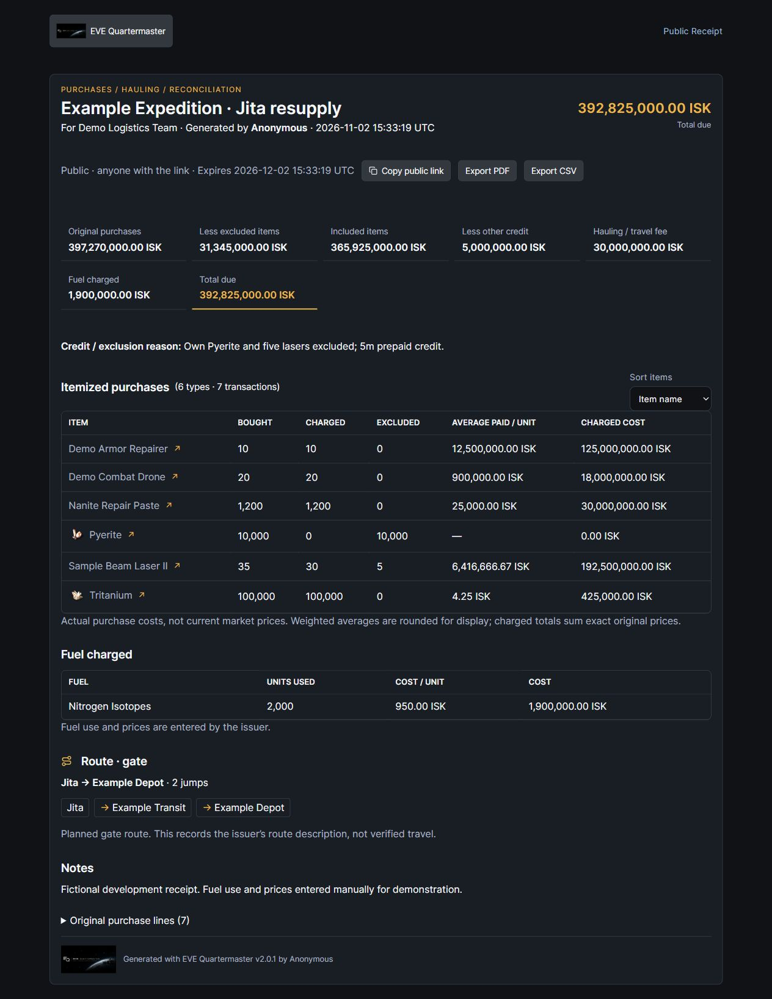
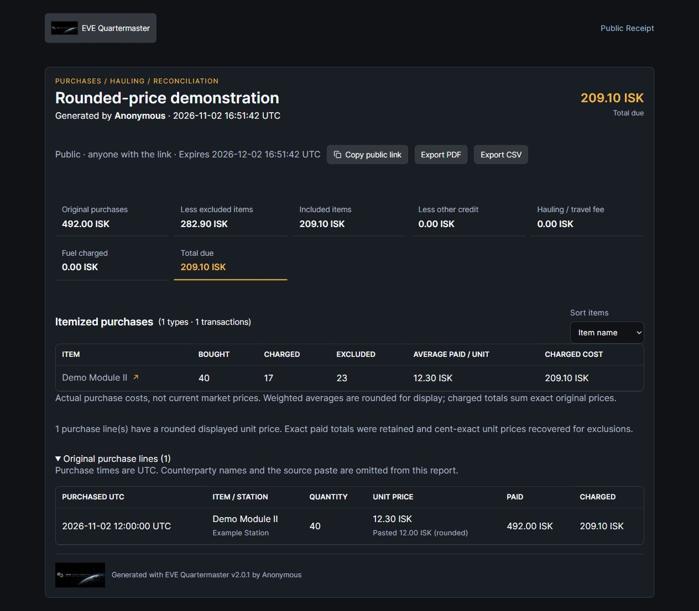

# Market-run Receipts

Open **Finance & Trade → Receipts**. It uses your existing **Market** permission, including utility roles; Navigation permission additionally enables local system lookup/gate planning. No wallet, asset, skill or additional ESI access is requested. The module is available to custom navigation/Quicklaunch layouts and uses the account palette/panel layout.

1. Paste EVE **Wallet → Market Transactions** purchases, with all seven tab-separated columns: UTC date, quantity, item, unit ISK price, negative total, counterparty and station. Click **Parse purchases**. The current parser supports the English clipboard format, optional English header/BOM, comma thousands and up to two decimal places. It rejects sales, escrow journal entries, malformed rows, zero/fractional quantities and unexplained quantity × unit-price mismatches. No row is silently discarded apart from blank lines and the recognized header.
2. Uncheck an entire purchase line or reduce its **Charge quantity**. Repeated identical clipboard rows are retained with a warning, because separate legitimate purchases can look identical; an explicit button can exclude later repeated rows. Editing/reparsing the paste resets line exclusions so old row IDs cannot accidentally apply to new purchases.
3. Enter an optional separate **Other exclusions / credit** with a reason, **Hauling / travel fee**, and up to eight **fuel charges** (fuel type, whole units actually used, actual unit cost). A credit may offset items, hauling and fuel but cannot produce a negative total. Fuel also present in charged purchase lines produces a review warning; EQM does not silently alter either charge.
4. Add optional route endpoints, intermediate systems/cyno stops and actual jump count. Navigation-enabled users can plan safer, shortest or highsec-only gate paths, including up to eight via systems, using imported local SDE without a live network refresh. Manual/JF/mixed routes remain issuer-entered descriptions; the module does not calculate JF range/fuel or prove travel. A planned route is marked manual if edited.
5. Preview, then **Save receipt** to export PDF/CSV or retain it. Saved records are immutable snapshots; **Reuse as draft** restores source, exclusions, fees and route and saves subsequent changes as a separate receipt. Purchase lines are paginated 100 at a time for editing/detail; report item totals and exports include every line.

## Reconciliation and limits

`Total due = original purchases − excluded item quantities − other credit + hauling fee + fuel used × actual unit costs`.

Each server calculation uses decimal ISK values, not binary floating-point arithmetic or current market estimates. Items are grouped case-insensitively across different purchase prices. The pasted paid amount is authoritative. If a whole-ISK or one-decimal unit price differs, EQM recovers the cent-exact paid amount per unit only when it rounds to that displayed price. It shows both prices and a warning in the editor, report and PDF/CSV. Explicit two-decimal mismatches, inconsistent rounding and non-cent-exact implied prices are rejected. Partial exclusions allocate the original paid cents proportionally (half-up), with charged plus excluded always equal to paid. Weighted averages are rounded to two decimals only for display. Reports retain purchased/charged/excluded quantities, total deductions, actual transaction UTC times/stations, item totals, fees, fuel and route. Known SDE types get item icons; unknown names remain valid without importing the SDE or fetching prices.

Limits: 1,000,000 pasted characters, 5,000 purchase lines, 1,000 different item names, 500 listed route systems, eight fuel rows, and at most 10 saved receipts per user per minute. Monetary fields/totals cap at 9,999,999,999,999.99 ISK. Invalid line errors include the source row number. Preview/parse do not save records. The source parser cannot independently confirm that the pasted transactions happened.

## Privacy, sharing and attribution

Private is the default. Only the creator can list/read/reuse/export/delete their receipts, including when another account is a director/admin. **Create a public link** explicitly allows anyone holding the token to view included item names/quantities, prices, recipient, notes and route until expiry/deletion. Public links are not a public listing and send no-store/noindex/nofollow/noarchive/no-referrer headers.

The original paste, counterparty names and private draft are never returned by public routes or PDF/CSV exports. The original source is retained only in the creator's saved draft. A non-anonymous issuer uses the linked **main character**; missing main attribution falls back to **Anonymous**, never an account/login name. **Anonymous issuer** suppresses the character attribution. Manually entered recipient/notes/route are still included when shared, as explained beside the checkbox. Credit reasons and excluded items remain visible for reconciliation.

Retention choices: 30m, 1h, 2h, 12h, 24h, 3days, 7days, 30days (default), permanent. Delete individual records, a UTC generation-date interval or all your own receipts. Deletion/expiry revokes public views and exports. Exports recheck access/expiry/deletion after rendering. CSV prefixes spreadsheet formula-like text; PDF escapes user text and repeats a branded header/page number. PDF/CSV rendering releases the DB transaction and expensive exports are bounded to two workers.

## Integration and rollout

Routes: `GET /receipts/context`; `POST /receipts/parse`, `/preview`, `/route`, and `/receipts` to save; `GET /receipts/reports` with paging; `GET /receipts/reports/{token}`; `POST /receipts/reports/delete` using explicit tokens/date range/all-in-scope; authenticated `/reports/{token}/export/pdf|csv`; public `/public/{token}` and `/public/{token}/export/pdf|csv`. Public browser links use `/#receipt/{token}`.

Existing saved-report storage is reused with `report_kind=receipt`; no new schema migration or runtime dependency. Deploy matching backend/frontend; earlier pending Intel membership changes still require their own migration 0105. Personal receipt mutations are allowed by the Quartermaster utility gate, without allowing writes to organizational assets. Receipt cleanup uses the existing expired-report purge. No deployment or live ESI action was performed during development.

Validation: 57 receipt cases (including rounded clipboard prices and public/CSV persistence), plus 92 previously passing appearance/role regressions, final TSC/Vite build, actual browser parsing/exclusions/fuel/planning/private/public/reload/reuse checks, responsive containment and real export download. A real pasted example was reconciled separately in a private check, without retaining the source in Git. All published demos below are fictional.

[Cost controls](../static/ss/v2.0.1/receipt-cost-controls.jpg) · [Mobile](../static/ss/v2.0.1/receipt-mobile.jpg) · [PDF example](examples/receipt-demo.pdf) · [PDF first page](../static/ss/v2.0.1/receipt-pdf-page1.png) · [Capture provenance](../static/ss/v2.0.1/capture-receipt.json).

