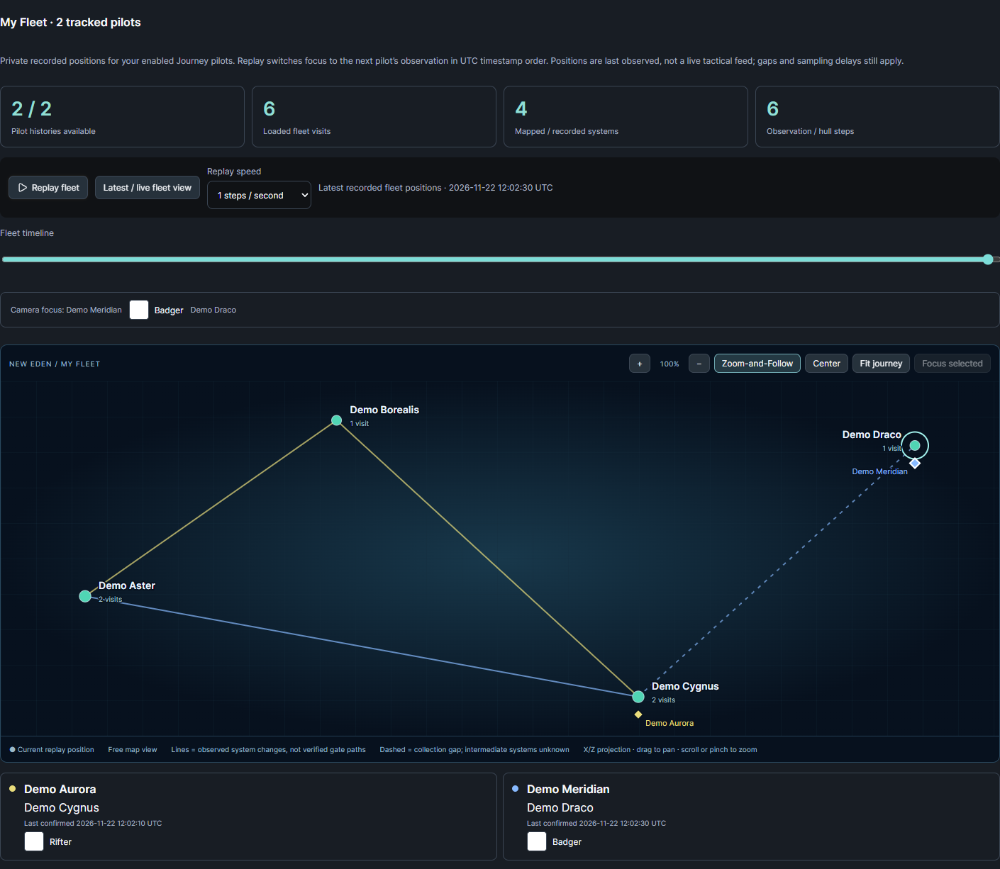
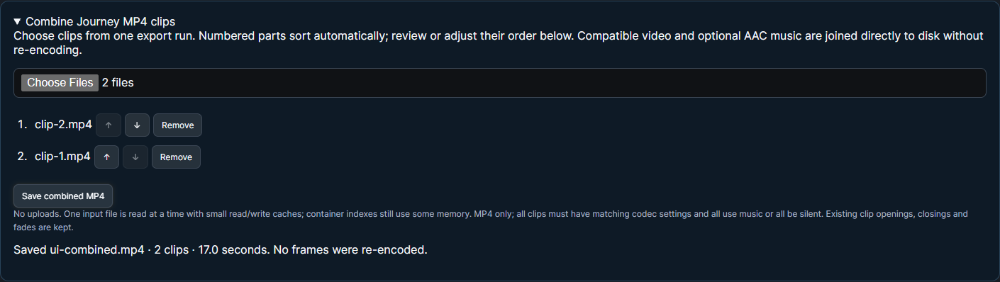

# Next release — My Fleet, same universe

**Unreleased source follow-up after [v2.4.2](v2.4.2.md).** No version bump, commit/push, deployment, tag, release publication or new APK is implied by this draft.

## My Fleet

Put all your enabled Journey pilots on one private map. Replay and 1080p GIF/MP4 export switch focus to the next pilot’s recorded movement in UTC timestamp order, while keeping the others’ last-observed positions visible. Per-pilot colors, hulls and paths stay separate; sampling gaps, missing coordinates and unavailable data stay explicit.

## Make a fleet movie

Use the familiar single-clip, selected-date and entire-history export scopes, with exact continuation into numbered parts. Optional original space ambience adds a quiet AAC soundtrack to MP4. Then combine compatible saved MP4s directly to disk without re-rendering frames or building one huge in-memory Blob. File order is reviewed before stitching, and cancellation aborts the unfinished output.

Fleet data remains private to the current account and uses existing authenticated Journey APIs. Per-pilot snapshots are independent, not atomic. Frontend-only rollout; no migration, new dependency or ESI scope. Desktop Chrome/Edge direct-file saving is required for stitching; GIF remains silent. [Guide](../my-fleet.md).

The screenshots are actual UI/encoded output with synthetic data. Raw-image URLs will resolve after a future authorized push; this draft does not publish them.
