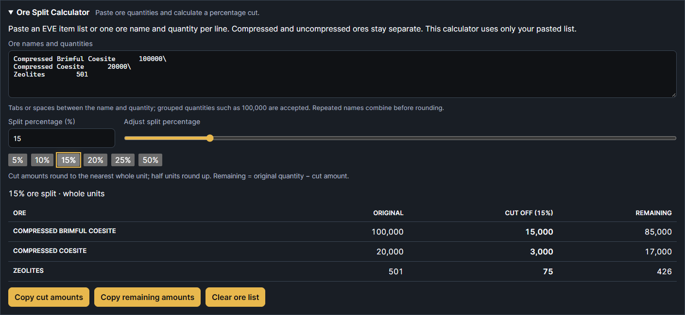

# EQM — Unreleased follow-up after v2.4.1

Version and release tag have not been assigned. This feature is not part of the published v2.4.1 release.

## Cut the ore, skip the arithmetic

Open **Mining Ledger → Ore Split Calculator**, paste ore names and quantities, and choose a percentage by typing or moving the slider. Presets cover **5%, 10%, 15%, 20%, 25% and 50%**. See each ore's original quantity, whole-unit cut and remainder, then copy either list.

Compressed and uncompressed ores stay separate. Repeated names combine before rounding, malformed rows are flagged, and blocked clipboard access provides selectable output. The calculator uses only the pasted list and works independently of ledger filters or a successful ledger load. [Guide](https://github.com/n00bgames/eve-quartermaster/blob/main/docs/ore-split-calculator.md).

Frontend-only update. No new database migration, ESI scope or backend endpoint. Existing application version remains 2.4.1; publication and deployment are separate.
