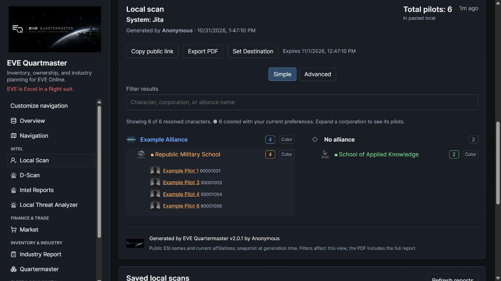
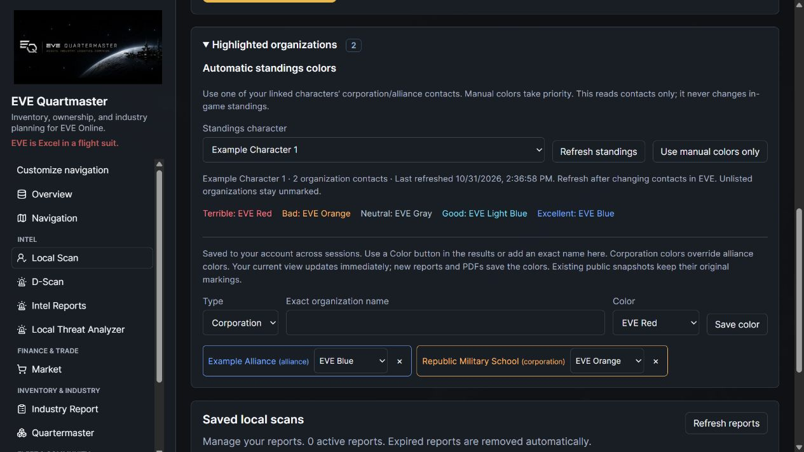

# Local Scan: give the neuts some color

Pick a corporation or alliance straight from a generated scan and give it an EVE-style color. Your scheme sticks between sessions, corporation overrides win over alliance colors, and new public reports/PDFs keep the colors you generated them with. Linked Local Scan results in D-Scan get the same treatment.

**Unreleased follow-up:** deploy migration 0101 with the matching API/frontend. Manual colors and an optional saved own-character standings source are implemented. Load read-only corporation/alliance contacts, refresh when they change, and keep manual overrides in charge.

[Controls and rollout](https://github.com/n00bgames/eve-quartermaster/blob/main/docs/scan-colors.md)

