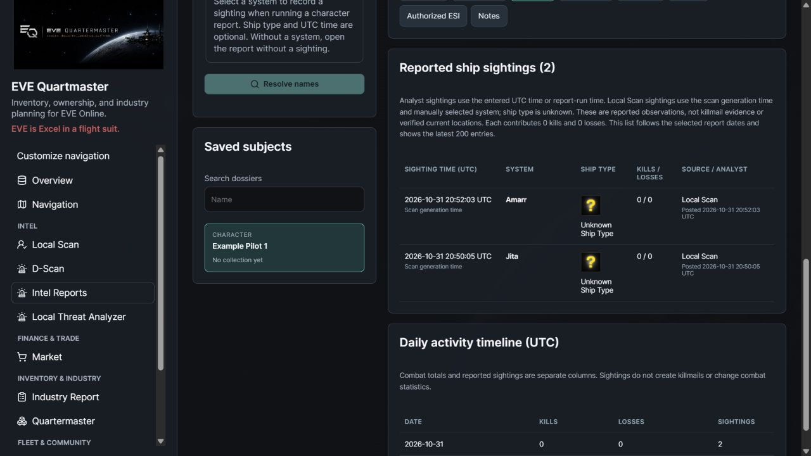
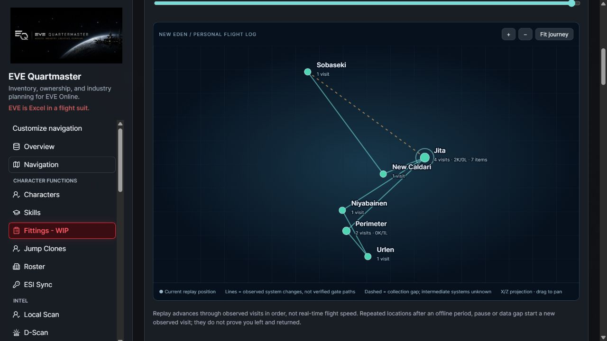
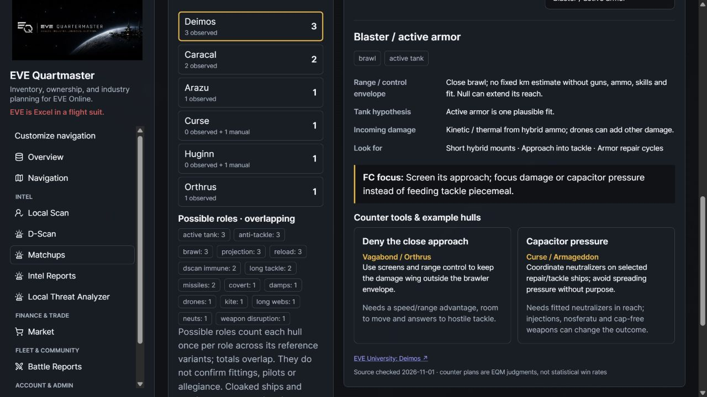
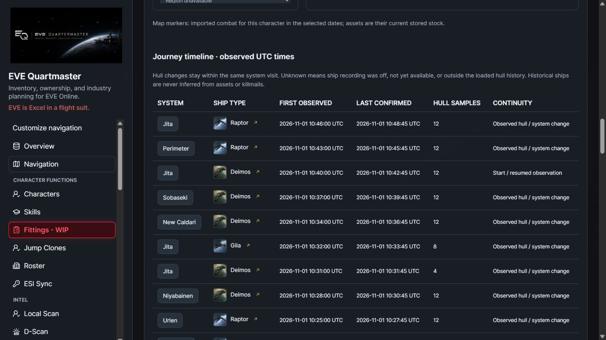
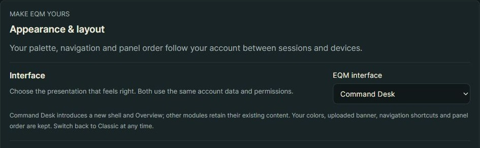
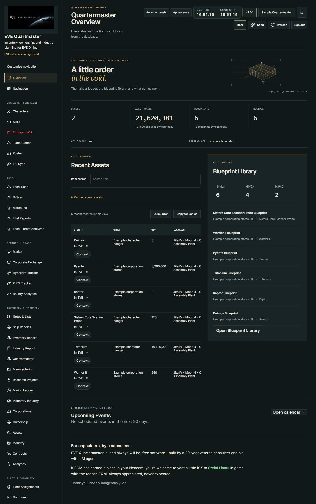
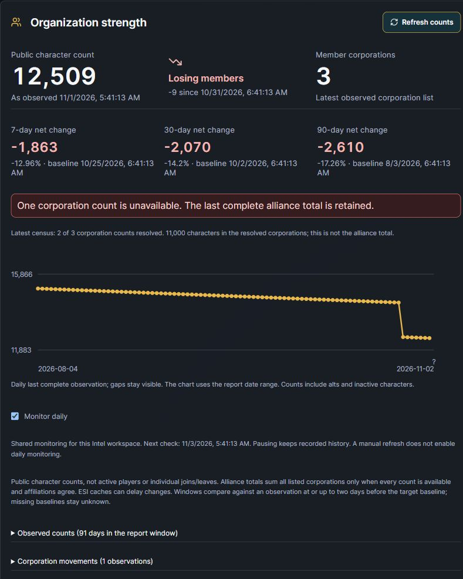
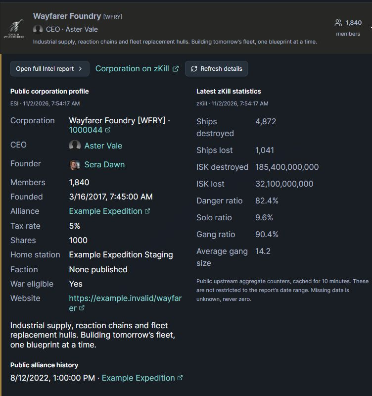
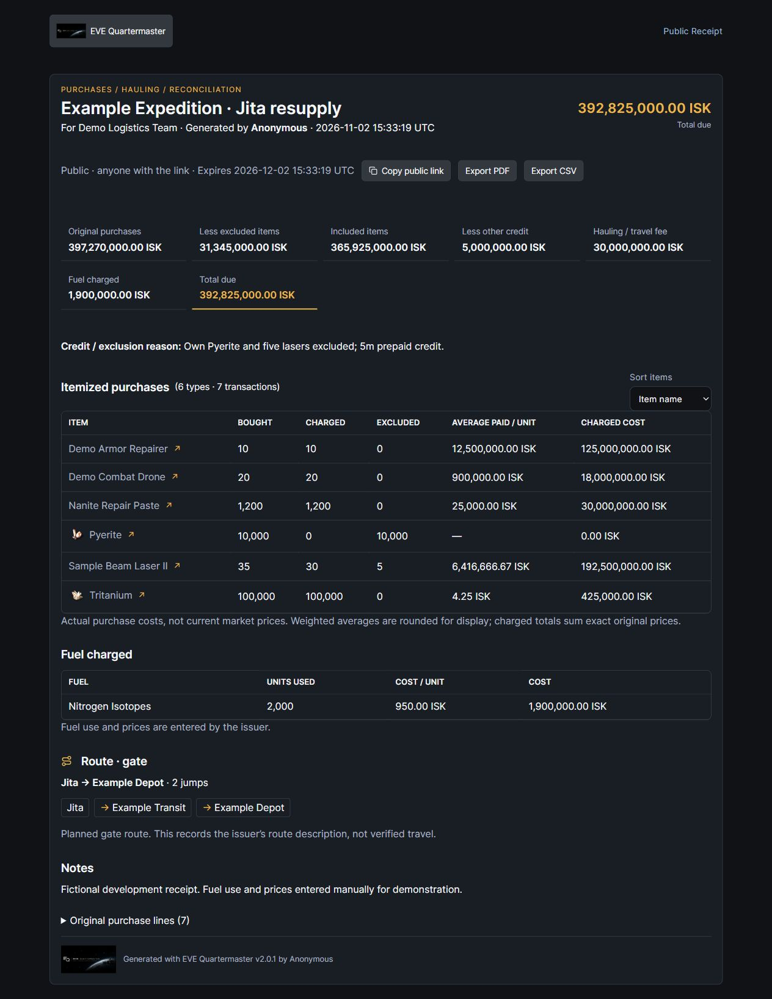

# 🚀 EQM - v2.0.1 - "Let's Not Even TRY to Go There!" Hotfix

Pochven has been evicted from the jump planner. All 27 systems are excluded from searches, routes, required cynos and alternate stops—with server-side checks for anyone trying to sneak one in manually.

No cyno, no jump. The space triangles can keep their expensive dreads. Fly dangerously—somewhere you can actually jump to. o7

## Unreleased follow-up: keep tabs on the neuts

Got a local list and a system? Every resolved pilot now leaves an **Unknown Ship Type** sighting in Intel, stamped with the scan's generation time. Open their dossier later and see where you spotted them, even after the scan link expires. Private stays yours; the killboard doesn't get imaginary kills. o7

Requires migration **0102** after 0101 and matching API/frontend. Existing saved system-tagged Local Scans are backfilled at their original times; already-purged scans cannot be recovered. These are manually located observations, not live tracking.

[Workflow and privacy](https://github.com/n00bgames/eve-quartermaster/blob/main/docs/intel-reports.md#local-scans-feed-the-sighting-timeline) · [README](https://github.com/n00bgames/eve-quartermaster#readme)

Screenshot and feature are from the unreleased working tree; this draft does not claim deployment or published images before the next push.

## Unreleased follow-up: “Where the hell have I been?”

**My Journey** gives your capsuleers a private flight log. Pick who to track, let EQM record observed system visits, then replay the trip on a New Eden map. Revisits, system totals, imported killmails and the character’s current stock add a little context to all that aimless gate-flashing. Pause it whenever you want; erase the history when you’re done.

The sampling target starts at 15 seconds, subject to ESI caching and server load. Gaps stay gaps—EQM doesn’t invent the jumps it missed. Minimal location/online consent, private to your account, and no automatic enrollment. Browser replay includes play/pause, speed and a timeline slider.

Requires **0103_journey_history** after 0102 and matching API/frontend. [Guide](https://github.com/n00bgames/eve-quartermaster/blob/main/docs/journey-map.md) · [README](https://github.com/n00bgames/eve-quartermaster#readme). This is an unreleased working-tree preview; images become available on GitHub after the next push.

## Unreleased follow-up: “What the hell just landed on my gate?”

**Matchups** starts EQM's PvP Knowledgebase: look up a hull, check its base resistances, investigate possible fits and switch between **Solo / small gang** and **Fleet command** guidance. Bring a D-Scan straight into a threat list, then look at range-control problems and counter tools before feeding the next interceptor.

The starter catalog has seven hulls/nine scenarios, with sources and dates. It keeps base facts separate from unknown fittings; no magic win percentages. Weapon-family references are included; the embedded mounted-gun screenshot atlas and fully validated fitted examples are still on the workbench.

No additional migration or private ESI scopes. Matching API/frontend required. [Guide and coverage](https://github.com/n00bgames/eve-quartermaster/blob/main/docs/matchups.md) · [README](https://github.com/n00bgames/eve-quartermaster#readme). Working-tree development capture; this draft does not claim a push, release or deployment.

## Unreleased follow-up: “What was I flying when I got here?”

**My Journey** can now record the hull you're flying, with small ship icons in the timeline and a hull badge during replay. Swap ships in the same system and you'll see the change without getting a fake extra system visit.

Enable read-only ship access, then choose **Record ship types** for that character. Existing tracking stays location-only until selected. Earlier hulls remain unknown; private stays private, and custom ship names/individual ship IDs are discarded. Journey sharing and animated exports remain on the workbench.

Requires migration **0104_journey_ship_history** after 0103 and matching API/frontend. [Guide](https://github.com/n00bgames/eve-quartermaster/blob/main/docs/journey-map.md#optional-ship-types-and-hull-icons). This is a working-tree preview, not a deployment or published release.

## Unreleased follow-up: choose your desk

A little order in the void. **Command Desk** brings a new shell and Overview, with open totals, a hangar ledger and original cargo-yard artwork. Prefer the old chair? **EQM-Classic** stays, and existing accounts keep it until they choose otherwise.

Your palette, banner, Quicklaunch links and panel arrangements come with you. Intel and Industry keep their existing functional screens for now; their new dossier/manifest designs are still studies. This first integration is not deployed or released yet. No new database migration.

[Controls and rollout](https://github.com/n00bgames/eve-quartermaster/blob/main/docs/command-desk.md)

## Unreleased follow-up: “Are they growing, or bleeding members?”

**Intel Reports → Organization strength** puts numbers behind that question. Watch a corporation or alliance daily, refresh its public headcount on demand, and check observed gains/losses over 7, 30 and 90 days. Alliance corporation arrivals/departures get their own evidence list.

Missing ESI data doesn't turn into a fake exodus. Incomplete alliance counts retain the last complete total and show what's missing. These are character counts, including alts and inactive pilots—not a magic estimate of how many people will answer a ping.

Requires **0105_intel_membership**, matching API/frontend. [Controls and limits](https://github.com/n00bgames/eve-quartermaster/blob/main/docs/intel-reports.md#corporation-and-alliance-membership-trends). Unreleased working-tree capture; this draft does not claim deployment or public image availability before push.

## Unreleased follow-up: “Who’s actually in that alliance?”

Alliance collection now counts every member corporation through public ESI. **Alliance member corporations** turns that census into a searchable roster: logos, CEOs, headcounts and a quick synopsis. Expand a corporation for its public profile and latest cached zKill numbers, then jump into a full Intel dossier when you want the whole story.

Daily monitoring keeps the same roster current. A missing ESI response doesn't magically delete half their alliance; unknown counts stay unknown and the last complete total is retained.

[Corporation list](https://raw.githubusercontent.com/n00bgames/eve-quartermaster/main/static/ss/v2.0.1/alliance-corporations.jpg) · [Guide](https://github.com/n00bgames/eve-quartermaster/blob/main/docs/intel-reports.md#alliance-member-corporations). Uses migration 0105 already required above; no additional migration or ESI scopes. Unreleased working-tree captures, not a deployment or published release; image links become public after the next requested push.

## Unreleased follow-up: “Keep the receipt, capsuleer.”

Did the Jita run, burned the isotopes, and now someone wants the bill? **Finance & Trade → Receipts** turns pasted market purchases into a tidy reimbursement report. Exclude your own stuff, split quantities, add the hauling fee and actual fuel, then show the route alongside the total.

Private by default. Optional expiring public links, main-character or anonymous attribution, branded PDF/CSV exports and deletion that revokes the link. No wallet access, no live-price guesswork. Gate planning uses the local map; JF/cyno stops and fuel use are entered by you.

[Guide](https://github.com/n00bgames/eve-quartermaster/blob/main/docs/receipts.md) · [Sample PDF](https://github.com/n00bgames/eve-quartermaster/blob/main/docs/examples/receipt-demo.pdf). No new migration for Receipts. Matching API/frontend required; images/docs become public after the next requested push. This draft does not claim deployment.
