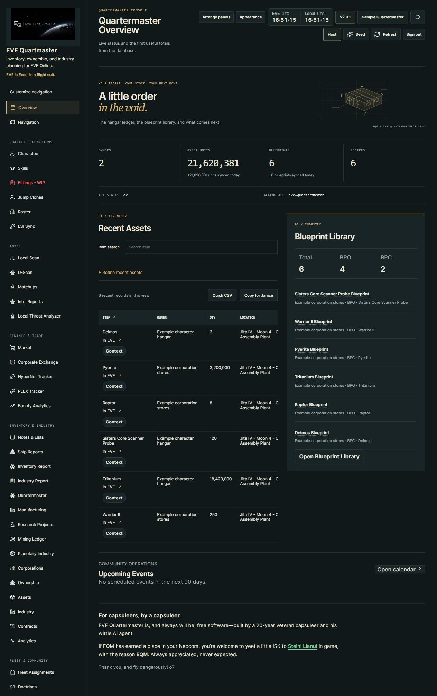
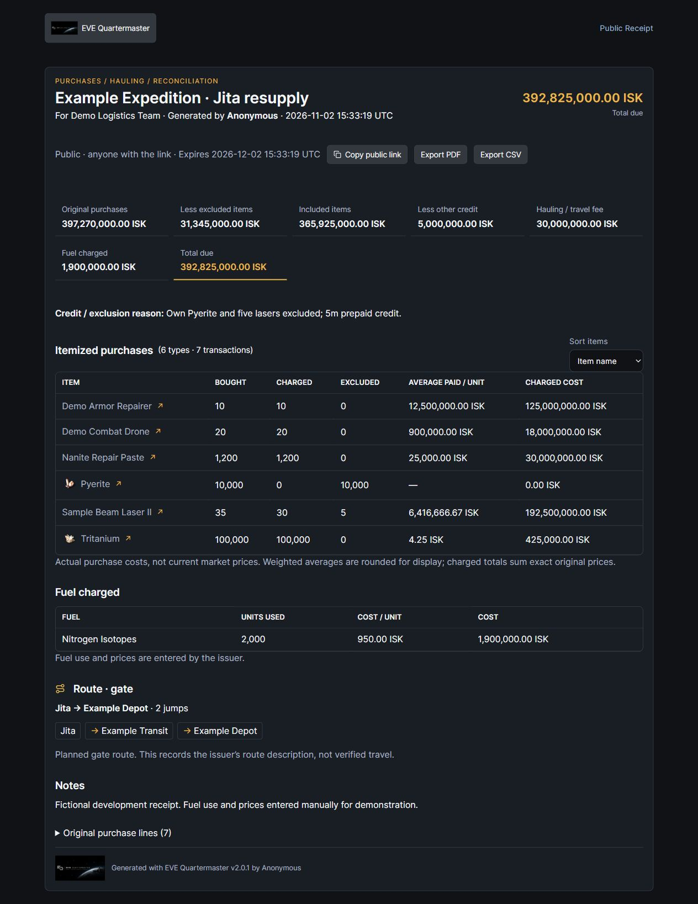

<!-- Release copy prepared 2026-11-04 from published V2.0 (b2cb718f13cc32c1778026e6e477b0774b1c7021) through 5e9731bbc63a1ce1e5ca16a31ceed551907d33db plus version-only preparation. The user will create v2.1; this change does not create a tag, GitHub release, APK, or deployment. Existing screenshot paths and provenance are intentionally preserved. -->

# EQM - v2.1 - "Different Skin, Same Great Taste!" Release

**[Release: v2.1](https://github.com/n00bgames/eve-quartermaster/releases/tag/v2.1)** · [Source & installation](https://github.com/n00bgames/eve-quartermaster#readme) · [Screenshot gallery](https://github.com/n00bgames/eve-quartermaster/blob/main/docs/screenshots.md)

New desk. More intel. Receipts for the questionable shopping trips.

**EVE Quartermaster 2.1** brings together the changes since **v2.0**, with a fresh optional interface and more ways to remember who passed through local, where your pilots went, what happened in the fight, and who owes you for the Jita run.

Still **EVE is Excel in a flight suit.** This time we changed the flight suit.

## Different skin

**Command Desk** adds a new application shell and Overview. Your colors, branding, Quicklaunch links, and panel arrangements come along. Prefer the old layout? **EQM-Classic remains available**, and existing accounts keep it until they choose otherwise.

## More useful intel

- **Room for the fleet:** Local Scan now accepts **9,999 unique pilots**, including linked local lists in D-Scan.
- **Colors that stick:** save corporation/alliance markings across scans, or optionally use a linked character's contacts for standings colors. Manual rules take priority.
- **Remember the visitors:** system-tagged Local Scans feed timestamped Unknown Ship Type sightings into Intel history, which survives the scan link's expiry. These are observations, not invented killboard activity.
- **Watch organization strength:** opt-in daily public headcount monitoring adds 7/30/90-day net changes, history charts, and observed alliance corporation movements. Expand alliance member corporations for logos, CEOs, counts, public profiles, and cached zKill summaries. Incomplete data stays explicitly incomplete.

## Where the hell have I been?

**My Journey** adds an opt-in, account-private travel log with observed system visits, an interactive map, and animated timeline replay. Optional **Record ship types** adds hull changes and icons without counting an in-system ship swap as another visit. Pause or erase tracking when you want; gaps and earlier unknown hulls stay unknown.

**Intel → Matchups** starts the PvP Knowledgebase with base-hull resistance references, sourced scenarios, Solo/small-gang and Fleet-command guidance, counter tools, and D-Scan handoff. The starter catalog covers seven hulls and nine scenarios; fitted examples and the mounted-weapon screenshot atlas remain future work.

## Keep the receipt, capsuleer

**Finance & Trade → Receipts** turns pasted market purchases into reimbursement reports. Exclude personal purchases, split quantities, add credits, hauling fees and actual fuel costs, and include the route.

Keep receipts private or explicitly share an expiring link, then export branded PDF/CSV. Rounded clipboard unit prices retain the actual paid totals and accurate exclusions; genuine arithmetic mismatches are still flagged. JF/cyno stops and consumed fuel are entered by you.

## The kills your guns missed

**Battle Reports → Find all battle kills** discovers public kills across your selected systems and UTC window, including losses your selected pilot never appeared on. Background progress, resume/cancel, ESI verification, and explicit partial-coverage labels support collection. Team edits, saved reports, sharing, and exports preserve that wider scope.

Public sources can miss unreported, delayed, or very recent losses; a finished collection is not a guarantee that every kill was reported.

## A couple of practical fixes

- **Pochven is excluded from jump-planner searches and routes**, including required cynos, alternate stops, and manually entered jump endpoints.
- New Windows/Linux **restart-eqm** helpers restart existing application containers and verify readiness while leaving PostgreSQL and Redis running.

**Upgrading from v2.0?** Back up your database, follow the documented update workflow, and update the matching backend, worker, and frontend. This release includes migrations **0101–0105**. Journey and contact-based standings features require their explicit optional consent.

*Images are existing captures from the 2.0.1 development cycle using synthetic demonstration data. The screenshot gallery retains their provenance. Application/package version: **2.1.0**; release/tag name: **v2.1**.*

[Full changelog](https://github.com/n00bgames/eve-quartermaster/blob/main/CHANGELOG.md) · [Report a bug or request a feature](https://github.com/n00bgames/eve-quartermaster/issues)

Fly dangerously. Keep the receipts. **o7**
