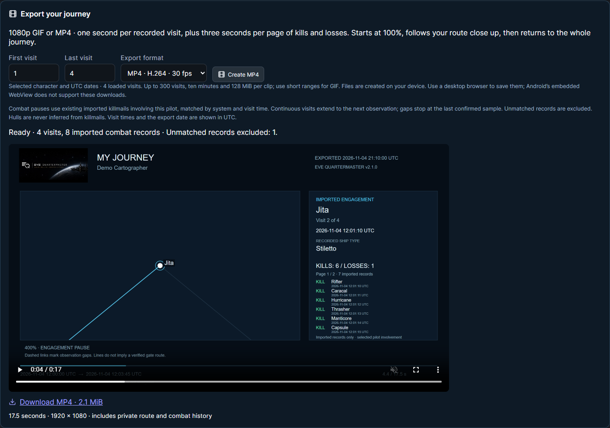

<!-- Unreleased source preparation. No tag, release publication, deployment or APK build is implied. Images retain their original 2.1.0 capture provenance. -->

# EQM - v2.2.1 Release

[Planned release: v2.2.1](https://github.com/n00bgames/eve-quartermaster/releases/tag/v2.2.1) · [Changelog](https://github.com/n00bgames/eve-quartermaster/blob/main/CHANGELOG.md)

**My Journey gets room to move—and a way to take the trip with you.**

- Zoom and pan the journey map with a mouse, touch or keyboard, use Fit journey and Focus selected, and retain your view during replay.
- Create **1080p GIF or H.264 MP4** movies with a full-journey opening, close-up travel at one second per recorded visit, observed ship types and UTC timestamps, then a return to the whole map. EQM branding and the export date stay in the film.
- Pause at engagements to list imported kills/losses, destroyed hulls and UTC times: six records per page, with three extra seconds per page. Revisits get their own results; unmatched records and unknown hulls remain explicit.
- Generate privately on your device with progress, cancellation, preview and desktop-browser downloads. Android WebView saving is not included.

[Map controls](https://github.com/n00bgames/eve-quartermaster/blob/main/docs/journey-map.md#map-controls) · [Export timing, limits and browser support](https://github.com/n00bgames/eve-quartermaster/blob/main/docs/journey-map.md#gif-and-mp4-exports) · [Full-resolution engagement frame](https://raw.githubusercontent.com/n00bgames/eve-quartermaster/main/static/ss/v2.1/journey-export-engagement.png)

Application/package/API/export version: **2.2.1**. Android source: **versionName 2.2.1 / versionCode 30**. Rebuild the APK to change an installed wrapper's version. Matching API/frontend required for combat exports; no new migration or consent scope. Clips are limited to 300 loaded visits, ten minutes including pauses and 128 MiB. Combat uses existing pilot-involved imports and can be incomplete.

The demonstration images were captured with synthetic data on 2.1.0 development source before this version bump; their original version labels and checksums are preserved. This is an unreleased draft. The planned release link becomes available when the tag/release is separately created.
