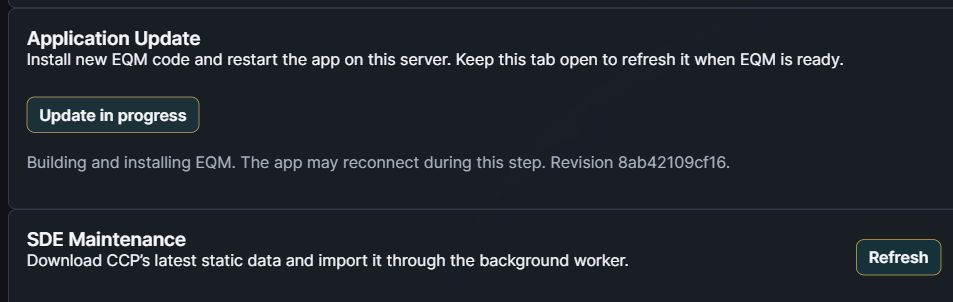
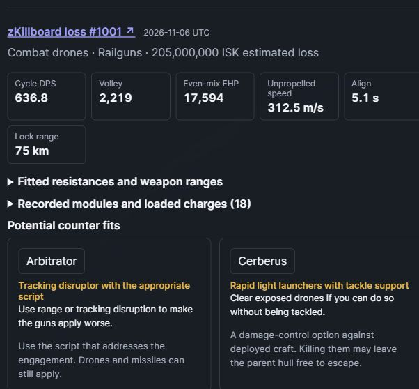
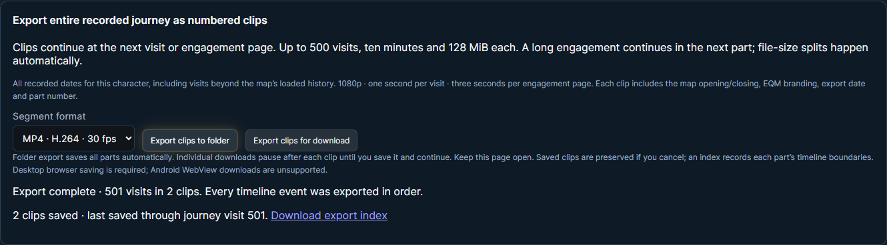
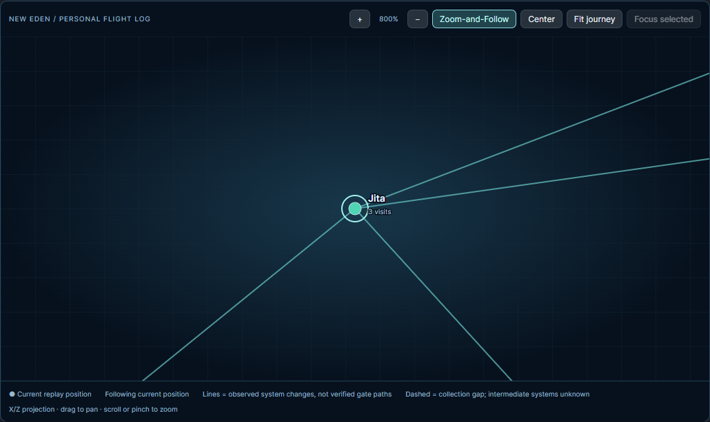
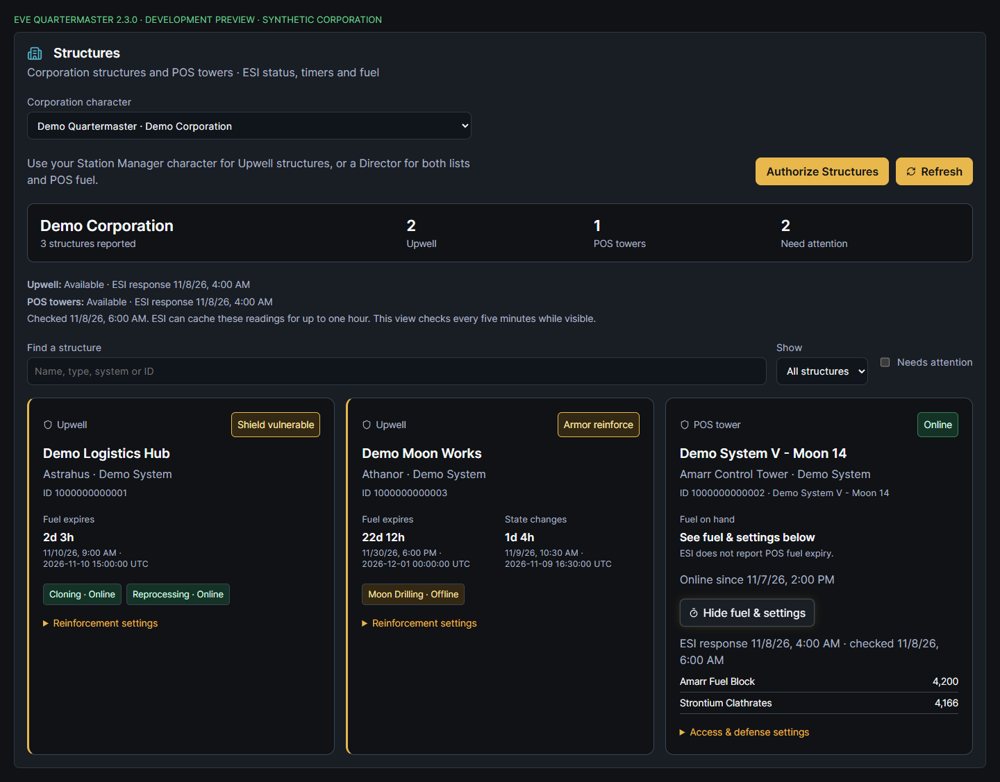
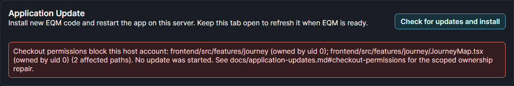

# EQM v2.3

## Update from Settings

Open **Settings → Application Update** to check for a new version and install it. After you [set up the optional helper on the Docker host](https://github.com/n00bgames/eve-quartermaster/blob/main/docs/application-updates.md), EQM runs the appropriate Windows or POSIX update script, shows progress through the restart, and refreshes the requesting tab when the new revision is ready.

## Research a ship in Matchups

Browse every published ship in the installed SDE, grouped by subclass and sorted by hull name. See each hull's weapon bonuses and base resistances, then research up to three distinct public zKillboard loss fits for recorded equipment, estimated fitting stats, and possible counters. [Matchups guide](https://github.com/n00bgames/eve-quartermaster/blob/main/docs/matchups.md#ship-catalog-and-example-fits)

## Export your journey

Use **Zoom-and-Follow** to keep the current replay/latest recorded position centered, or **Center** to recenter once without changing zoom. Manual navigation releases following. Zoom and pan the **My Journey** map, or export your travels as a branded 1080p GIF or H.264 MP4 with observed hulls and UTC timestamps. Engagements pause to show the kills and losses EQM has imported. A clip supports up to 500 visits; export selected dates or your entire recorded history in numbered parts that resume at the next visit or engagement page. EQM creates the clips privately in your desktop browser and writes a JSON index for segmented exports. [Journey guide](https://github.com/n00bgames/eve-quartermaster/blob/main/docs/journey-map.md#segmented-and-entire-journey-exports)

## Monitor owned structures

**Unreleased development feature:** Open **Inventory & Industry → Structures** for your corporation's Upwell structures and POS towers. Check service status, fuel expiry and reported timers, then expand a tower for its fuel quantities and access/defense settings. Search and filter the list; missing authorization and cached readings stay explicit. Requires matching backend/frontend rollout plus the selected character's EVE corporation roles and Structures authorization. [Guide](https://github.com/n00bgames/eve-quartermaster/blob/main/docs/structures.md)

## Other changes

- **Application Update** checks checkout ownership/access before Git changes files, with an actionable failure message and a scoped source-ownership repair command. POSIX root execution is refused. Restart the host helper after installing this follow-up. [Repair guide](https://github.com/n00bgames/eve-quartermaster/blob/main/docs/application-updates.md#checkout-permissions).

- **Sync All** saves refreshed ESI credentials separately to prevent a stall. EQM gives a readable notice for temporary gateway failures and retries checking an existing job.
- C-N4OD has been removed from the built-in market hub list.

Upgrade the backend and frontend together. The Android wrapper source is now **2.3.0 (versionCode 31)**; rebuild the APK to update an installed wrapper. [Full changelog](https://github.com/n00bgames/eve-quartermaster/blob/main/CHANGELOG.md)

The examples above use synthetic data captured during development.
