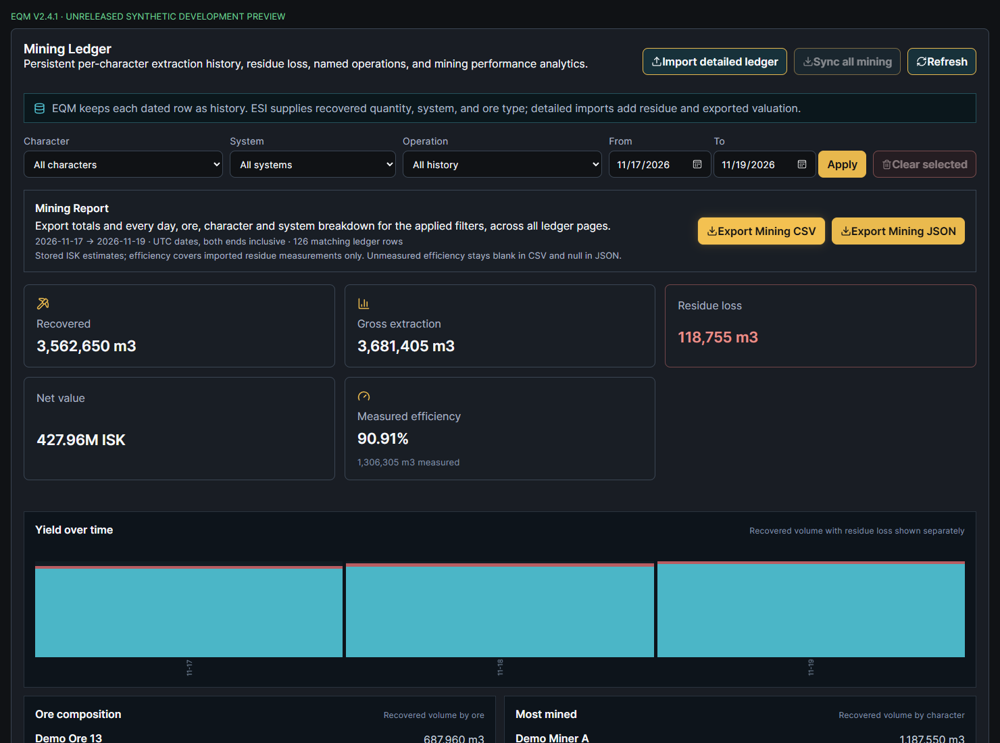
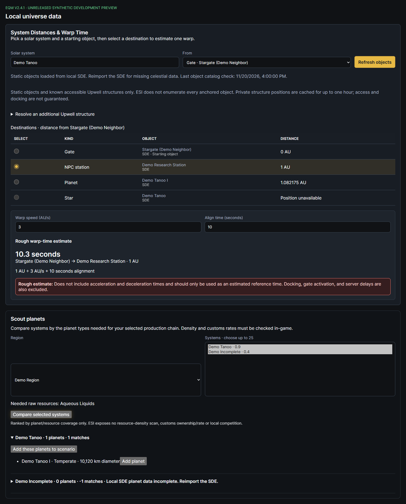

# EVE Quartermaster v2.4.1 — Mining reports and local universe data

**Unreleased release draft.** Mining Report screenshots show the actual UI with synthetic data. No new APK has been built.

[Planned v2.4.1 release](https://github.com/n00bgames/eve-quartermaster/releases/tag/v2.4.1) · [Full changelog](https://github.com/n00bgames/eve-quartermaster/blob/main/CHANGELOG.md)

Static universe lookups now use the imported SDE database for PI Scout, colony
names, fitting and manual-import metadata, Intel fallback, Gatecheck station
names and navigation distances. Live ESI name/ID resolution, activity snapshots,
and authorized Upwell structures remain available. The compatibility pin stays
`2026-07-22`.

## Mining Report

Choose a date period and optional character, system and operation filters in **Mining Ledger**, select **Apply**, then download **CSV** or **JSON** from the new **Mining Report** panel. Reports contain full-period totals and every day, ore, character and system breakdown across all ledger pages, with units and applied-filter metadata. Stored values keep their precision; unmeasured efficiency stays distinct from zero. Changed filters and loading/failed requests block stale exports. [Guide](https://github.com/n00bgames/eve-quartermaster/blob/main/docs/mining-report.md).

Frontend-only feature; no migration or new ESI scope. Stored ledger estimates are not realized profit or live market prices. Requires the updated frontend on a running installation.

## Upgrade and reimport

The Settings updater follows **origin/main**, not release tags or attached ZIPs.
It fast-forwards the checkout and runs `docker compose up --build -d` through the
platform update script. Backend startup waits for PostgreSQL and runs
`alembic upgrade head` before starting the API; this upgrade adds
`0111_local_universe`. The worker waits for the migration head bundled with its build before accepting
queue jobs. It does not run migrations itself.

Before updating, back up the database, let active SDE/queue jobs finish and keep
the queue idle during the rebuild. The worker now checks the database migration head before starting RQ; a failed
or mismatched migration leaves it stopped with a diagnostic. Do not queue new work until
Application Update reports the new API/frontend/worker revision ready. This
release preparation does not run the updater on a server.

After readiness, open **Settings → SDE Maintenance**, download the latest CCP
YAML ZIP, choose **Use downloaded archive for import** and **Queue SDE import**
(or select automatic import on download). Run the full import, not agents-only.
Wait for completion and check planet/star totals and PI Scout. Import commits
in batches; failed imports can be partial and must be retried. Existing ZIP paths
remain supported. Reimport is an operator action, never silently triggered by
schema migration or a release tag.

## Missing data and stars

Migration adds nullable fields without inventing a backfill. Until reimport,
Scout marks missing type/radius data and requests reimport. Unknown items/planets
retain ID labels and missing manual-import rows return a useful 404.

CCP's `mapStars` data has no position. New stars have unknown coordinates and
cannot provide a distance estimate. Previously cached coordinates are preserved.
Planet radius comes from the SDE in metres and is converted to diameter in km.

See [local universe evidence, tests and operator instructions](../local-universe.md).
The Android source version is 2.4.1 / code 33; the previous release APK must not be
relabeled as a newly built 2.4.1 artifact.

## Changes already on main since v2.4.0

This package also includes the existing four post-tag commits: fitting reference
fleet verification, opening zKillboard loss fits in Fittings, reordered/collapsible
navigation panels, and pilot dossier exports/association filters. Their existing
changelog history is preserved. No old screenshot is presented as a new 2.4.1 capture.

## Combined checkout validation

The prepared patch was merged with the existing v2.4.1 source bump and Mining Report exports. The combined checkout passed **151 backend tests plus 7 subtests**, **15 frontend tests**, and the production frontend build. Host-updater checks ran 11 cases: 4 passed and 7 POSIX-only cases were skipped on Windows. Compose configuration validated; Docker Desktop's engine was unavailable, so no container-stack/PostgreSQL upgrade was performed. Four browser check groups verified the actual Navigation and PI Scout components with synthetic local responses, including unknown star positions, missing-data guidance and 390px containment. [Capture provenance](../../static/ss/v2.4.1/capture-receipt.json).
