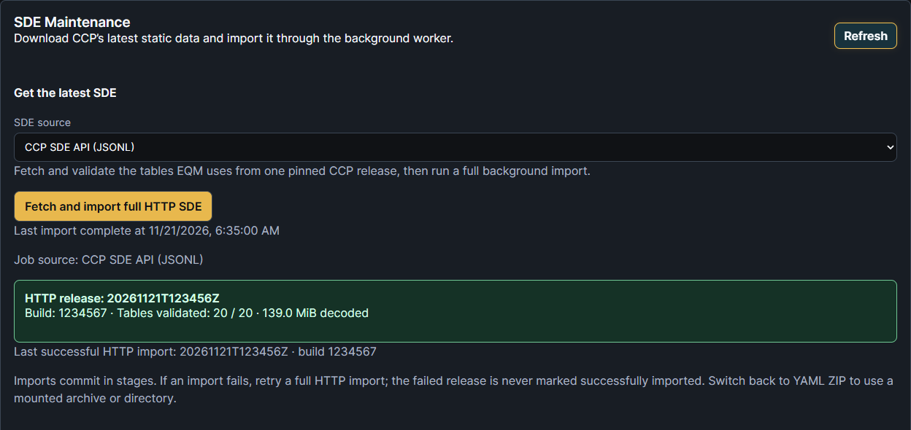
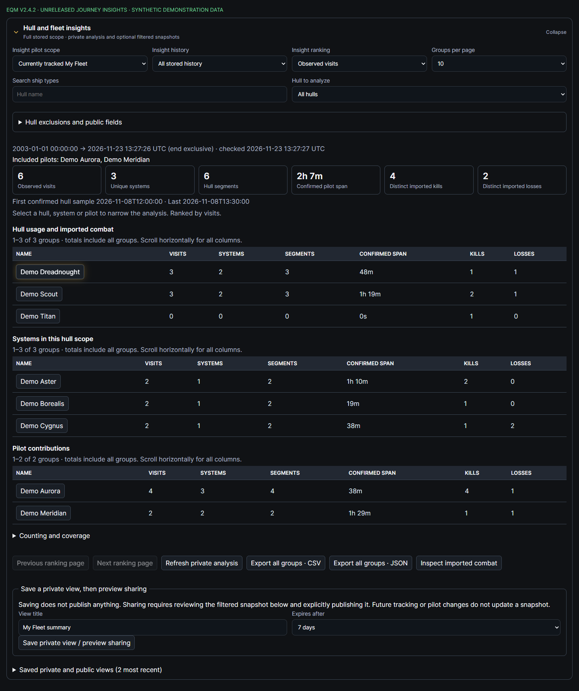
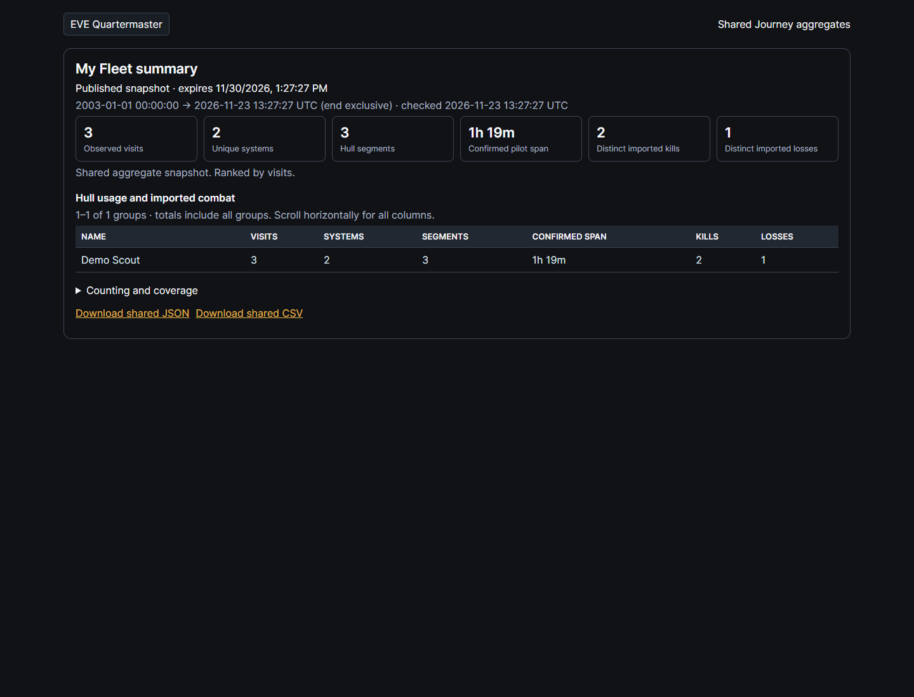

# EQM - v2.4.2 - "No ZIP, Sherlock!" Release

Fresh static data, straight from CCP: **Settings → SDE Maintenance** now supports the **HTTP JSONL SDE**, with pinned releases, background progress and clear retry status. YAML ZIP remains available.

Also included: **Ore Split Calculator**—paste your ore, pick a percentage, and copy the cuts or leftovers. Presets: 5/10/15/20/25/50%.

**[Download v2.4.2 and the updated Android APK](https://github.com/n00bgames/eve-quartermaster/releases/tag/v2.4.2)**

Update matching API, worker and frontend, then explicitly choose **CCP SDE API (JSONL)** and run a full import. No new migration from 2.4.1. [SDE guide](https://github.com/n00bgames/eve-quartermaster/blob/v2.4.2/docs/sde-maintenance.md#ccp-http-sde-source-v242).

## Preview

The preview uses fabricated release/build/totals. Mobile preview and source checksums: [screenshot gallery](https://github.com/n00bgames/eve-quartermaster/blob/v2.4.2/docs/screenshots.md#http-sde-import--v242).

## Operator details

- Existing admin/host permission boundary, worker queue and global SDE lock are reused. HTTP imports are full imports; mounted ZIP/directory and agents-only options remain available under YAML.
- Validate all required downloads before writes; import stages still commit in batches. Retry a failed full import to repair any partial changes. A failed job does not advance the last-successful HTTP release receipt.
- Set `SDE_HTTP_MAX_BYTES` if needed (default 4 GiB decoded), and provide staging space under `SDE_DOWNLOAD_PATH`. HTTPS access to `sde.evetech.net` is required from the worker.
- No new database migration or ESI scope. From versions before 2.4.1, apply migration 0111 and perform a full import for planet/star metadata. Live ESI behavior and its compatibility date stay unchanged.
- Android: fresh version 2.4.2 / code 34 APK, existing package/signing configuration, SHA-256 checksum attached. Signature and metadata verified; no Android device runtime test.

## Validation

Automated: 59 backend regression tests (HTTP/ZIP maintenance, import totals, local universe, system distances and PI projection); 21 frontend unit tests; six actual Settings browser scenario groups with synthetic API data; TypeScript/frontend production build. New source fixtures are schema-derived paired records, not independent whole-release ZIP parity.

Real isolated integration passed on **20261120T165826Z / build 3724492**: two full live CCP HTTP imports through Redis/RQ into disposable PostgreSQL 16, with identical processed/stored totals on rerun and clean staging. A deliberate live fetch-size failure before writes left the database unchanged and did not advance the imported release. Verified Rifter, Jita station, gate destination, unknown star coordinates, PI Scout's Tanoo I diameter (10,120 km) and a Navigation distance from imported positions, with ESI access blocked during runtime checks. Imported 68,407 planets and 8,089 stars; processed 53,941 types, 658,480 type-dogma attributes and 19,303 blueprint activities. This validates the HTTP release and repeatability; it is not a full independent ZIP-release parity claim or a production-host rollout.

GitHub publication does not update or restart the remote application host. Back up the host database, let active SDE jobs finish, deploy matching services and queue the import separately.

## Unreleased follow-up: Hull and fleet insights

Explore ships flown most, systems visited in a hull and imported kills/losses across your selected pilots. Full private CSV/JSON exports complement the bounded on-screen rankings. Save views privately, preview a server-filtered snapshot, then choose whether to publish it. Block exact hulls, ship classes or capitals; pilot and system names stay off until selected. Public links expire and can be rotated or revoked. Raw Journey history and killmail links remain private.

Requires matching backend/frontend and migration **0112_journey_analytics_views**. Source remains 2.4.2; this follow-up is not in the published v2.4.2 tag/APK. [Guide](https://github.com/n00bgames/eve-quartermaster/blob/main/docs/journey-insights.md).

