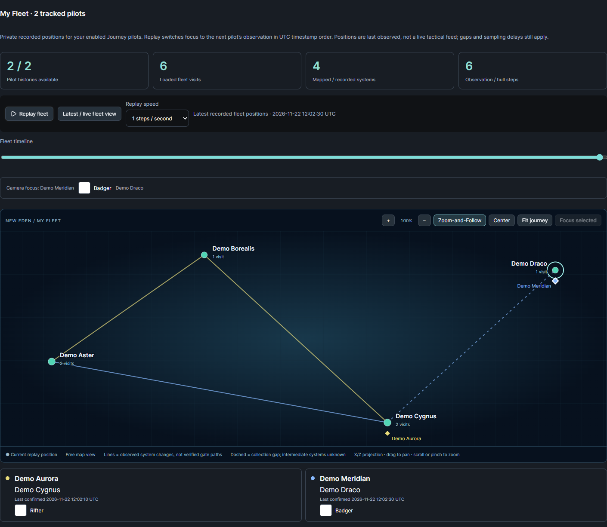
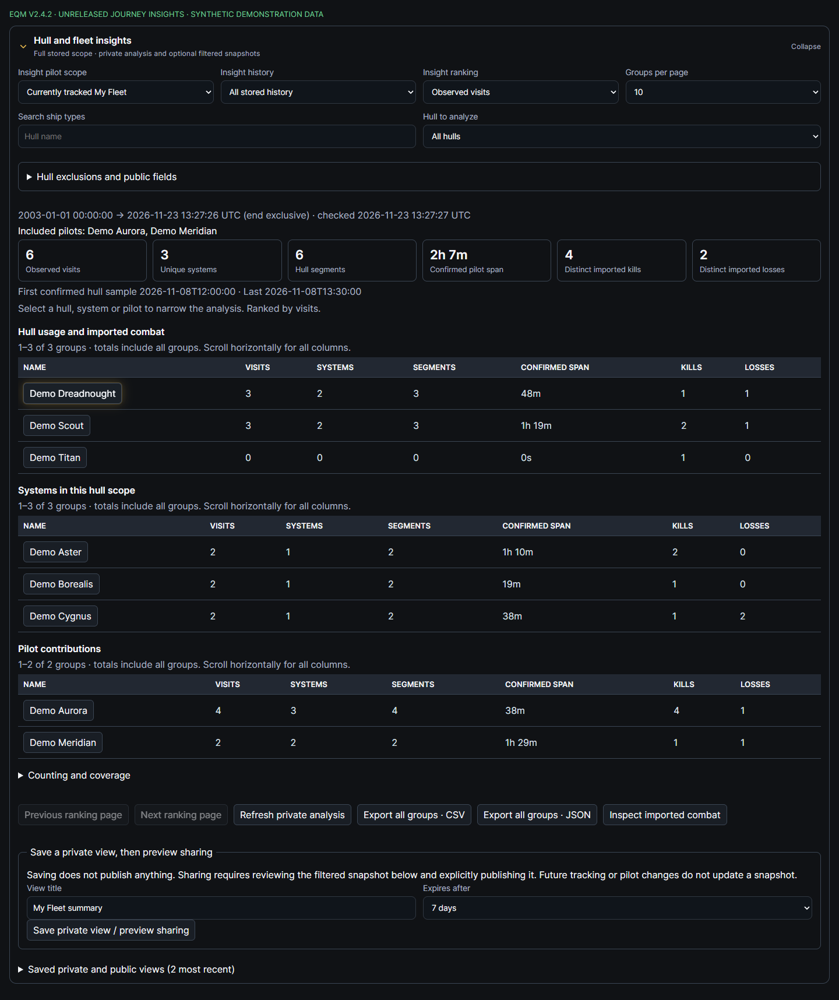

# v2.4.3 — Fleet of Foot

Version notes for the application and source update. GitHub release/tag publication and an Android APK build remain separate operations; the latest published APK is still v2.4.2.

## Your fleet, one map

**Navigation → My Journey → My Fleet** shows every enabled tracked pilot on one private map. Replay follows whoever moves next in UTC timestamp order. Export loaded history, selected dates or full history into numbered GIF/MP4 clips, optionally with original space ambience. Combine compatible H.264/AAC MP4 parts directly to disk in desktop Edge or Chrome without re-encoding frames.

[My Fleet and movie guide](../my-fleet.md). Pilot snapshots remain independent; missing observations and sampling gaps stay explicit. GIF is silent.

## Know your hulls, choose what to share

**Hull and fleet insights** ranks ships, systems and imported combat across all owned pilots, your tracked fleet or an explicit selection. Drill into a hull, choose UTC dates and export complete private CSV/JSON rankings.

Saved aggregate views start **private**. Review a filtered preview before publishing; exclude hulls/classes/capitals before aggregation, opt into pilot/system names, set expiry, rotate links or revoke access. Public snapshots omit raw journeys, positions, exact visit times and killmail links. Already downloaded data cannot be recalled.

[Insights guide and privacy boundaries](../journey-insights.md). These screenshots retain their original pre-version-bump capture paths and receipt; they are synthetic UI captures, not private gameplay data.

## Update and validation

Deploy matching backend, worker and frontend. Upgrading from v2.4.2 applies **0112_journey_analytics_views** through normal backend startup. No new ESI scope or collection is required; the version metadata bump itself adds no migration.

Application/API/package/export/user-agent version: **2.4.3**. Android source: **versionName 2.4.3 / versionCode 35**; existing installed wrappers continue loading the hosted app.

Feature validation recorded before this version bump: 91 backend tests, 45 Journey/media regressions, TypeScript and production build, plus 10 synthetic Edge browser workflow groups and migration checks. The preceding feature deployment verified PostgreSQL migration 0112 and public asset hashes. Authenticated live pilot/share creation was not exercised.
