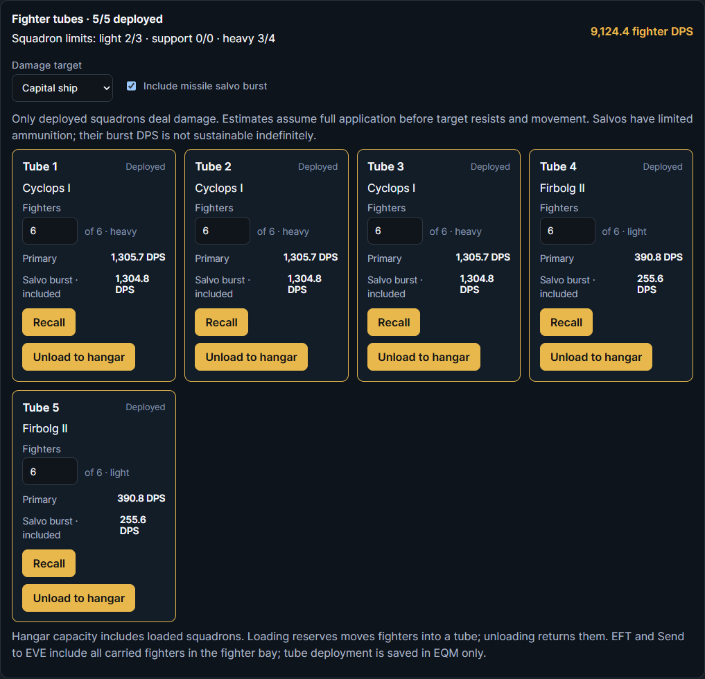
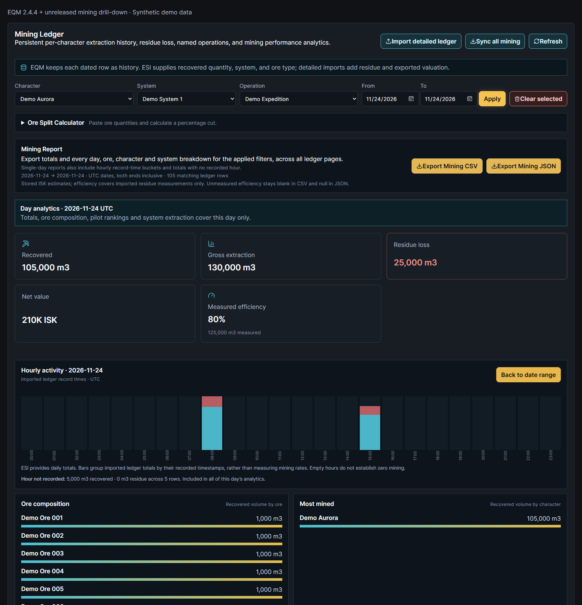

# EQM v2.4.4 — Fleet, Fighters & PLEX

Keep your fleet together, follow its journeys, and spend less time entering PLEX trades.

- **My Fleet & Journey insights:** tracked pilots on one map, timestamp-ordered replay, fleet movies with optional space ambience, clip stitching, hull/combat rankings, and private-by-default aggregate views with filtered public sharing.
- **PLEX screenshot imports:** import purchases and sales from wallet screenshots, review the results, and save with duplicate checks and FIFO validation. OCR stays in your browser.
- **A small fitting-module improvement:** fighter tubes for carriers, supercarriers and the Caiman, with squadron limits, deploy/recall controls, skill/hull/module damage bonuses and optional salvo burst.

**The fitting module is still in development. This is only a small improvement, with more work to come.** Fighter DPS remains an estimate; salvo burst is ammunition-limited.

A fresh **Android 2.4.4 APK (versionCode 36)** is included. Existing server settings are retained; new installations can choose their EQM server on first launch.

Update matching backend, worker and frontend services. Upgrading from v2.4.2 applies existing migration **0112_journey_analytics_views**; this version bump adds no further migration or ESI scope.

## Mining Ledger update — November 25

Click a day on the mining graph to switch to **hourly record-time buckets** and show **that day's analytics**: recovered volume, residue, value, efficiency, ore composition, pilot/system rankings, ledger history and CSV/JSON reports. **Back to date range** restores your previous filters.

**ESI supplies daily totals only.** Hourly bars use imported ledger timestamps rather than measured mining rates. Volume without a usable hour stays clearly marked **Hour not recorded** and remains included in all day totals.

This is a follow-up to the original v2.4.4 tag, deployed from `main`. No new migration or ESI scope, and the existing Android APK receives the updated interface from its configured EQM server.
