# EQM v2.4.0

**Unreleased release draft.** [Planned v2.4.0 release](https://github.com/n00bgames/eve-quartermaster/releases/tag/v2.4.0) · [Full changelog](https://github.com/n00bgames/eve-quartermaster/blob/main/CHANGELOG.md)

## Pick your capsuleer workspace

Four new space editions join Classic and Command Desk: **Orbital Ring**, **Imperial Archive**, **Void Cartography** and **Frontier Terminal**. Choose a top orbital dock, an ivory archive index, a right-side star atlas or an industrial hamburger drawer. Each has its own panel geometry, page pictograms and palette. Frontier includes expandable vertical departments and dedicated **Profile / Administration** sections. Account preferences, shortcuts and panel order stay saved. [Guide and full previews](https://github.com/n00bgames/eve-quartermaster/blob/main/docs/space-interfaces.md)

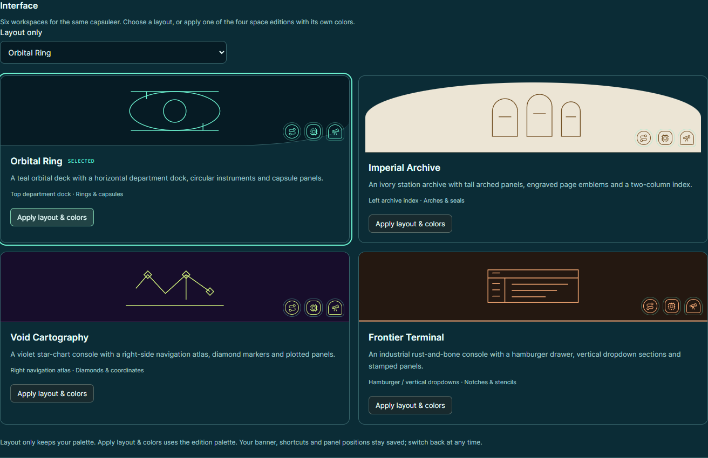

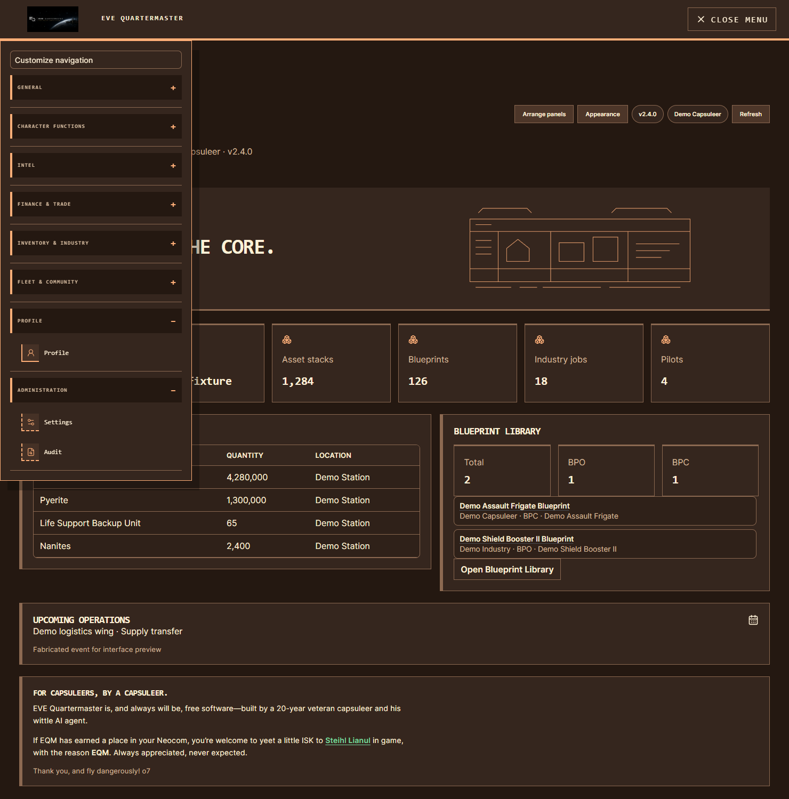

## Find owned T2 and T3 blueprints

Filter **Industry → Blueprints** by **T2** or **T3**, then choose **Ships** or **Modules / subsystems**. Existing owner, BPO/BPC, subtype and search controls combine with the selection, and CSV/JSON exports use the same filters. Product tech levels come from imported SDE Dogma, including blueprints in active research. [Guide](https://github.com/n00bgames/eve-quartermaster/blob/main/docs/blueprint-tech-filters.md)

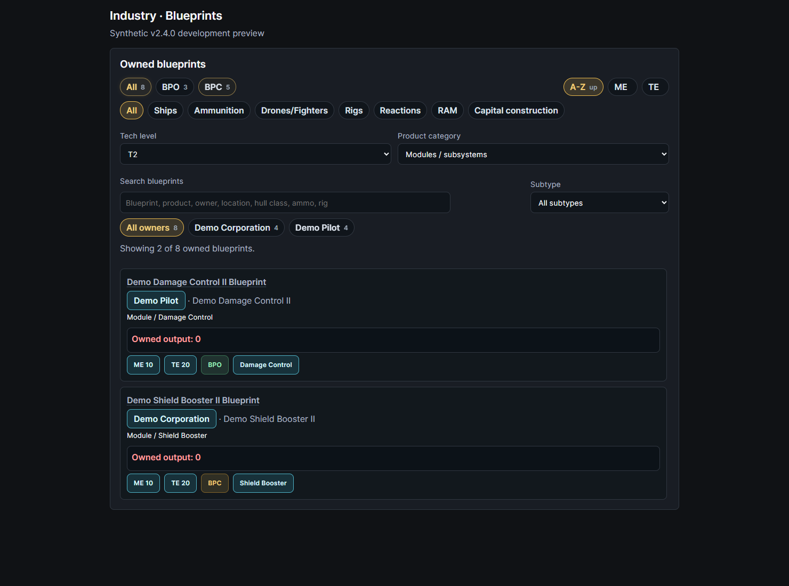

## Export installed PI facilities

The **PI facilities report** exports buildings, recipes, extractor programs, contents and routes as CSV or JSON. Character/group, system and planet-type filters apply; empty and unconfigured processors remain visible. Observed and projected values retain their source timestamps. [Guide](https://github.com/n00bgames/eve-quartermaster/blob/main/docs/pi-facilities-export.md)

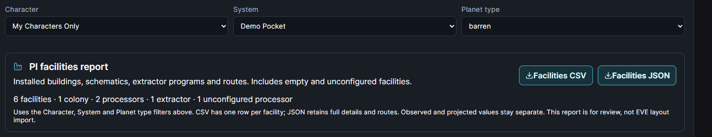

## Run and share Intel Reports

Choose a **system, character, corporation or alliance**, select UTC dates, and inspect common combat hulls, most active systems, UTC activity and recent killmails. Pull up to **10 pages of recent zKill evidence** with an explicit button, replacing the old one-page/25-killmail limit. Overlapping entries are deduplicated; partial pulls keep verified evidence and show page/reference/import/failure counts with a retry cooldown. System reports add separate internal sighting frequency plus available hourly ESI jumps, ship deaths, pod deaths and NPC kills; source gaps stay unknown. Save privately or create an expiring public snapshot, then revoke it from your saved reports. Public snapshots exclude all staff notes, priority flags, scan/manual observations and private ESI. [Workflow and source coverage](https://github.com/n00bgames/eve-quartermaster/blob/main/docs/intel-report-builder.md)

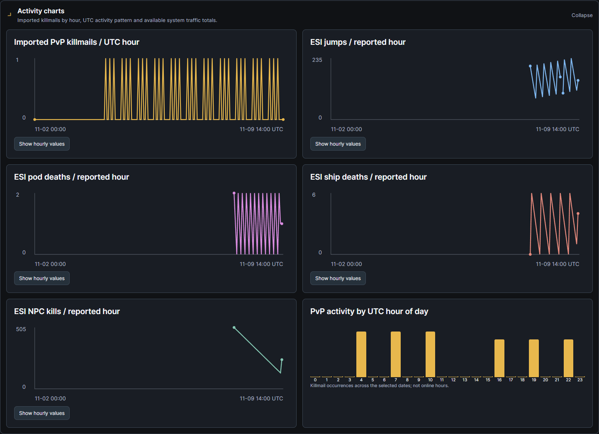

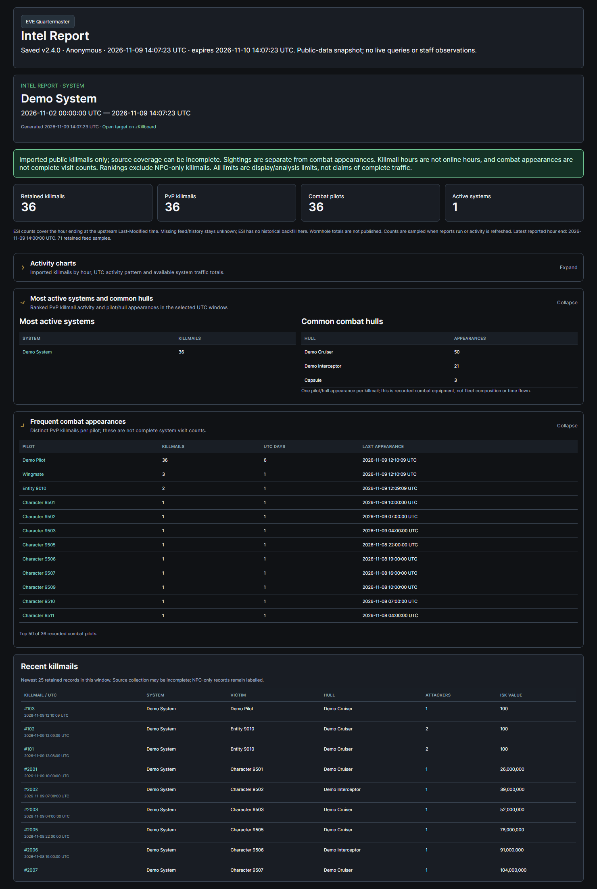

## Organize Intel subjects

Browse **Alliance → Corporation → Pilots** in expandable branches, collapsed by default. Search the full saved set, load more pilots and click corporation/alliance names to open their entity summaries. Each report has a clearable **Priority Target** checkbox; priority entries appear first alphabetically within each level. Newly generated Local Scans create missing public-identity pilot stubs. Confirmed report deletion preserves notes and their visibility while clearing the selected entity's dossier data. [Guide](https://github.com/n00bgames/eve-quartermaster/blob/main/docs/intel-reports.md#saved-subjects-local-scan-stubs-and-priority-targets)

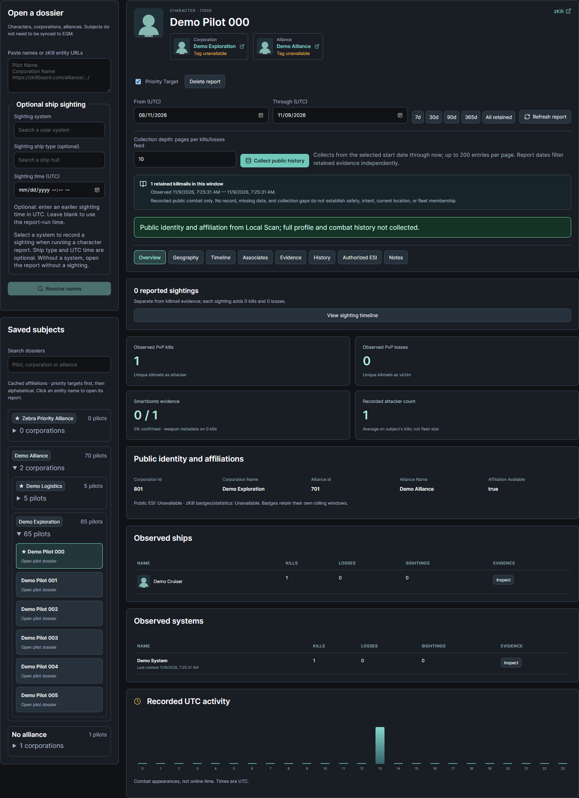

## Tag and find character groups

Add one **Public Note** or **Private Note** to every resolved pilot in a Local Scan, then search its text to find all matching characters and their dossiers. Notes survive scan expiry and dossier deletion. Public notes stay inside signed-in EQM intel; private notes remain author-only. Neither appears in public scan links or PDFs. [Guide](https://github.com/n00bgames/eve-quartermaster/blob/main/docs/local-scan-character-notes.md)

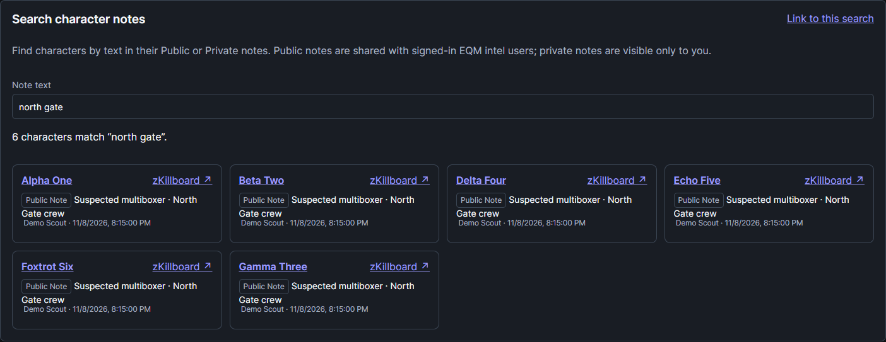

## Track owned structures and your POS

Officers and higher Calendar managers can now opt each structure into **Calendar timers & reminders**, choose eligible recipient roles, and customize reminder lead times. EQM sends inbox notices and a flashing, dismissible banner as fuel depletion or reinforcement ends approach. Calendar deadlines follow saved readings and reported ESI updates; manual reinforcement uses an exact end or a strontium estimate. Shared timers exclude private POS notes and quantities. [Timer guide](https://github.com/n00bgames/eve-quartermaster/blob/main/docs/structures.md#calendar-timers-and-role-reminders)

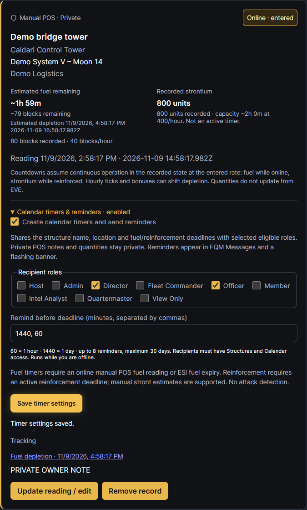

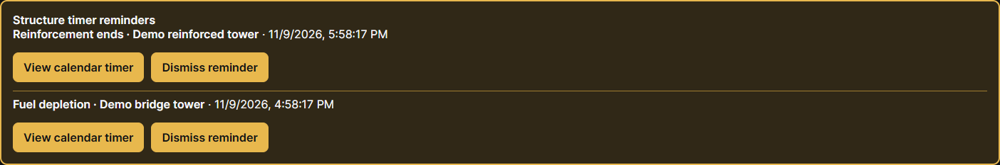

**Inventory & Industry → Structures** shows available corporation Upwell/POS state, services, fuel and timers through the viewer's own authorized ESI character. Missing scopes/roles and partial coverage remain explicit. Private **manual POS tracking** supports timestamped fuel/strontium readings without an EVE Director role. Check **Reinforced mode** to count down strontium, or enter an exact reinforcement end. Manual tracking is planning, with no automatic attack alerts. [Guide](https://github.com/n00bgames/eve-quartermaster/blob/main/docs/structures.md)

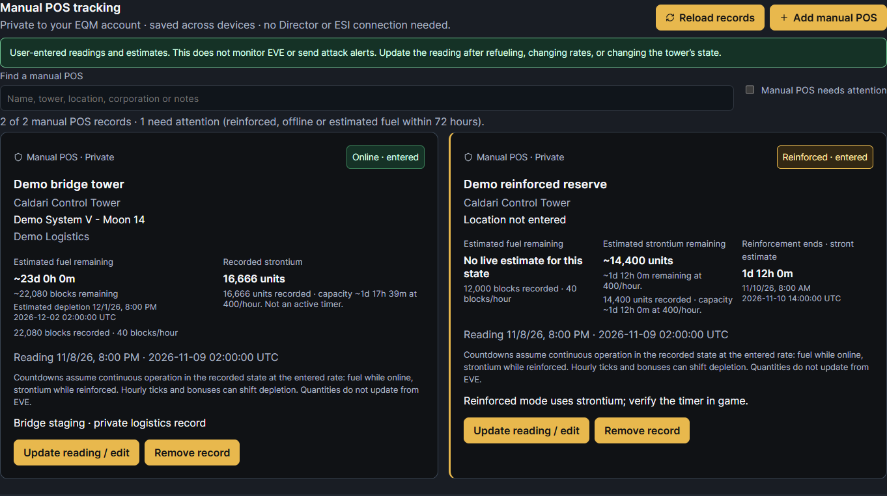

## Explore Journey analytics when needed

See systems most visited, ship types most flown, recorded hulls with most imported kills, systems with most kills, ship types most lost and pilots with most observed jumps. Compare linked pilots and UTC dates, rank travel hull use by visits or confirmed span, and drill into journeys. Combat hull positions, values and bars use imported kills/losses independently; kill ordering is applied before the top-N cutoff. Existing account privacy and combat permissions apply. Journey analytics appears on Journey and Analytics; analytics panes throughout EQM now start collapsed while preserving filters and privacy controls. [Journey guide](https://github.com/n00bgames/eve-quartermaster/blob/main/docs/journey-map.md#journey-analytics) · [Analytics panes](https://github.com/n00bgames/eve-quartermaster/blob/main/docs/analytics-panes.md)

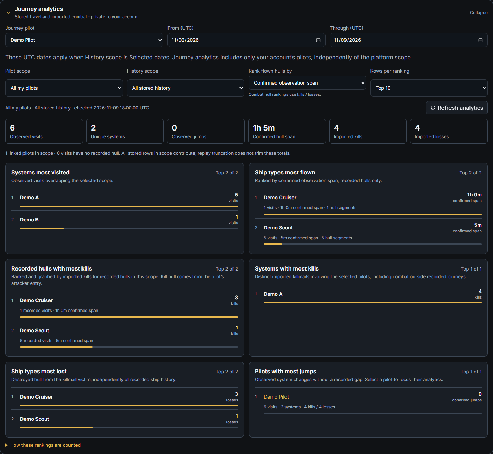

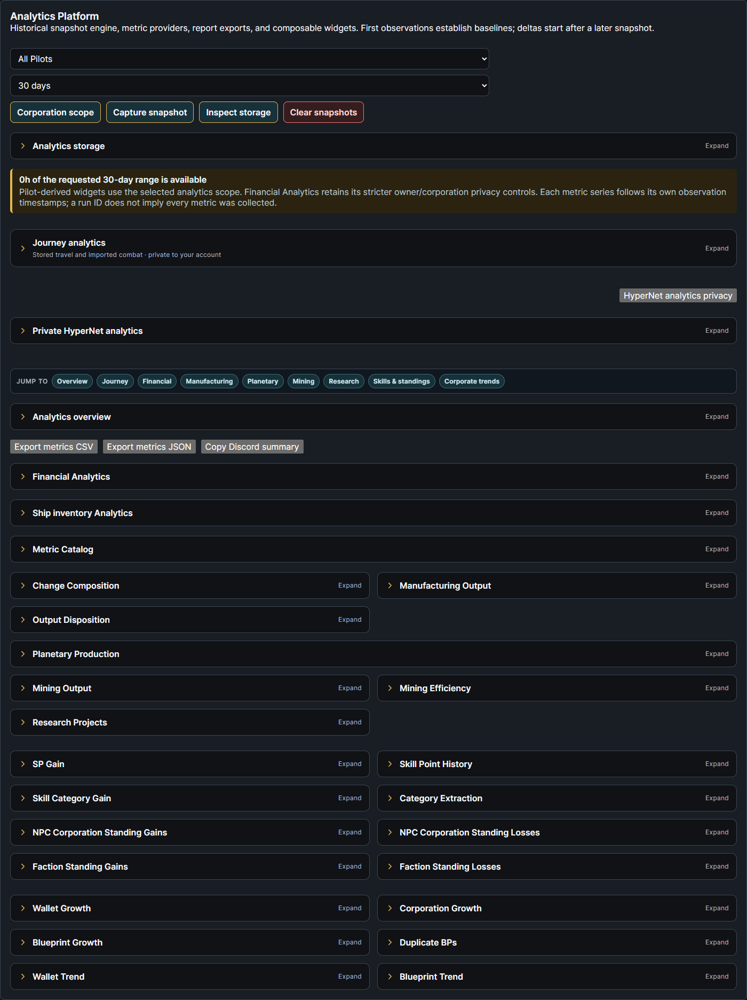

## Upgrade notes

Application, package, API, export and upstream user-agent version: **2.4.0**. Android wrapper source: **versionName 2.4.0 / versionCode 32**; rebuild the APK to update an installed wrapper. No APK is built by this version bump.

Deploy matching backend/frontend builds and run the normal migration chain through **0110_structure_timers**, including 0106 for character-note visibility, 0107 for manual POS records and 0108 for dossier priority/retention. Migration 0109 stores reported-hour ESI activity for Intel Reports; 0110 adds saved structure calendar timers and durable role reminders. Intel report hourly storage requires migration 0109; no new ESI scope is requested. ESI structures still require the appropriate corporation roles and scoped consent; manual POS records do not. No live deployment, migration, tag or release publication is performed by preparing this draft.

The Intel report-builder captures under `v2.4.0` show the current actual UI with synthetic fixtures. Earlier screenshots under `v2.3.0` are unchanged pre-bump development captures; their original paths and receipts remain intact. [Gallery and provenance](https://github.com/n00bgames/eve-quartermaster/blob/main/docs/screenshots.md).
