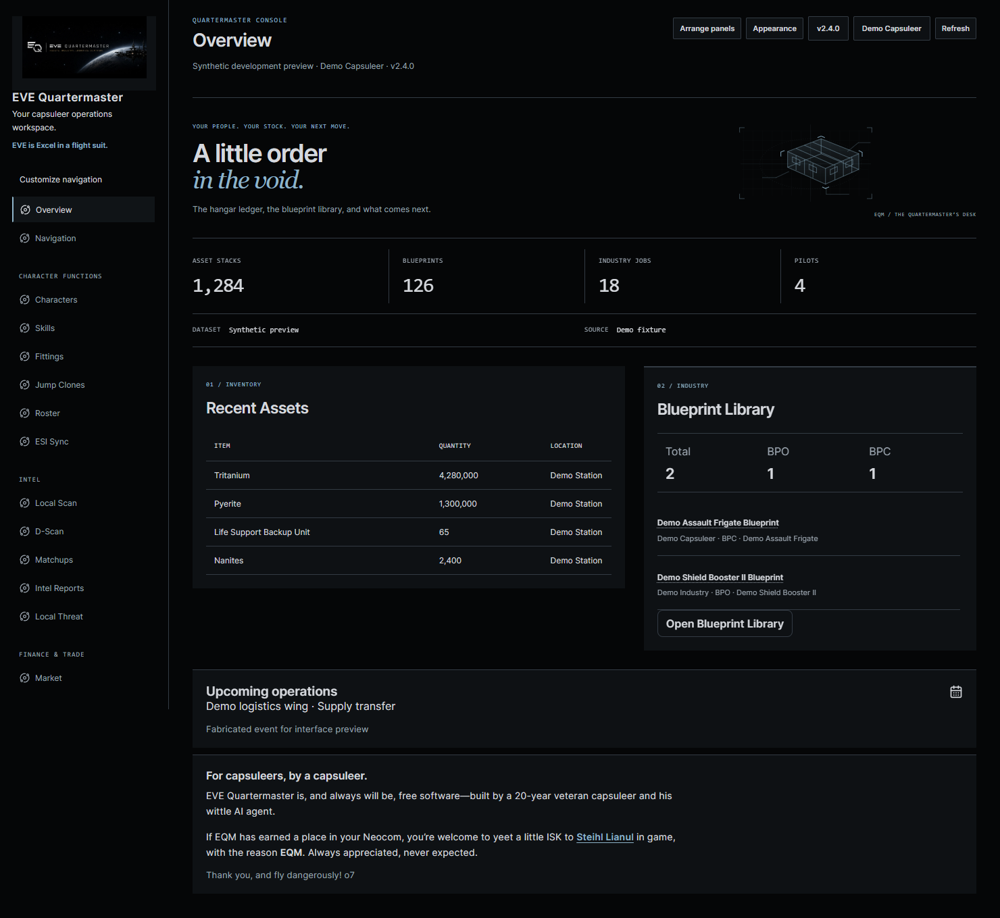
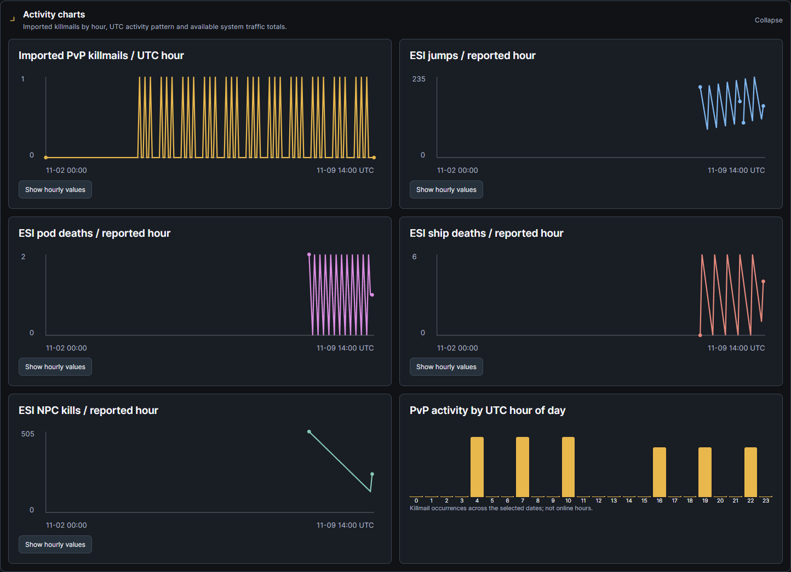
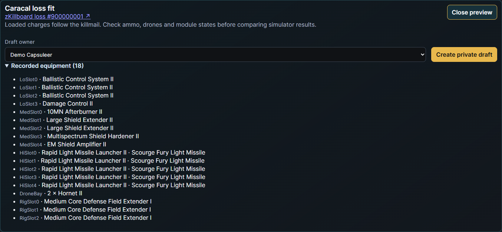
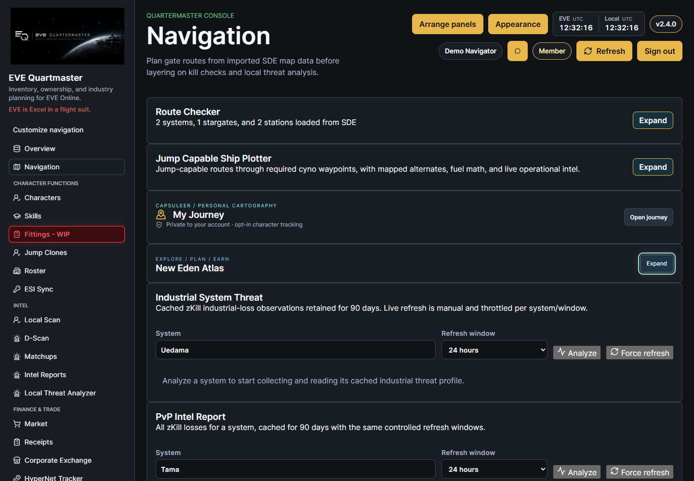
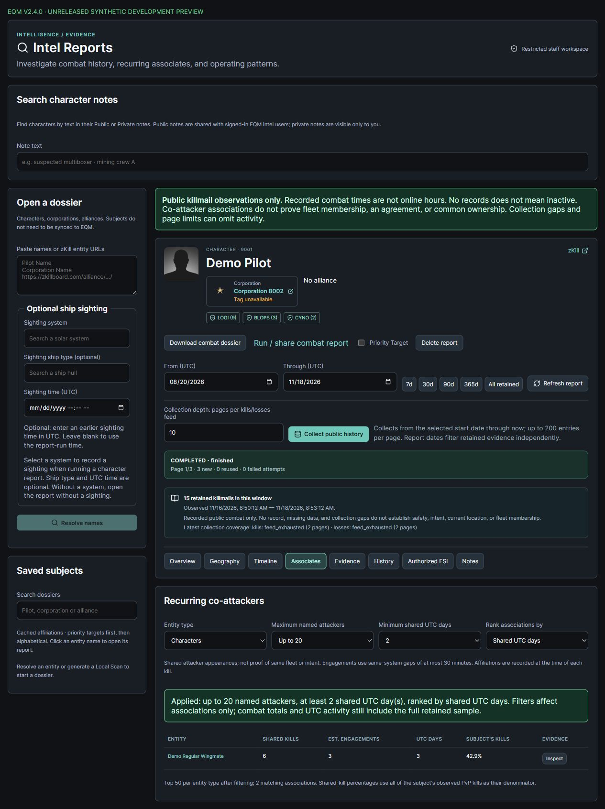

# EQM v2.4.0

**Unreleased release draft.** Screenshots show the development build with synthetic data.

## Appearance and layouts

Choose **Orbital Ring**, **Imperial Archive**, **Void Cartography**, **Frontier Terminal** or **Dark Mode** under **Appearance → Interface**. Frontier Terminal has a hamburger menu with expandable groups and dedicated Profile and Administration sections. Dark Mode uses the Command Desk layout with near-black surfaces, soft gray text and muted blue links. Apply a layout with its palette, or keep your current colors. Blueprint, skill, character, implant and event popovers, in-game link dialogs and inline table labels now follow the selected palette. [Theme gallery](https://github.com/n00bgames/eve-quartermaster/blob/main/docs/screenshots.md#theme-gallery-for-v240)

## Intel and Local Scan

- Build **Intel Reports** for a system, character, corporation or alliance over a UTC date range. Explore combat hulls, systems, activity hours and recent killmails. Pull up to **10 pages** of recent zKillboard evidence with deduplication and coverage counts. System reports show internal sightings separately from combat, alongside available hourly ESI jumps and ship, pod and NPC kills. Save a private report or share a revocable, expiring public snapshot of the public evidence. [Intel Reports guide](https://github.com/n00bgames/eve-quartermaster/blob/main/docs/intel-report-builder.md)
- Browse dossiers by **Alliance → Corporation → Pilots**, search across saved subjects and pin priorities with **Priority Target**. Local Scan creates missing pilot dossiers from public identities. Add a **Public Note** for signed-in Intel users or a **Private Note** for yourself to all resolved pilots in a scan, then find those pilots by searching the note. Notes survive scan expiry and dossier deletion. [Local Scan notes](https://github.com/n00bgames/eve-quartermaster/blob/main/docs/local-scan-character-notes.md)

### Loss fits in Fittings

Open a public zKillboard loss from **Intel → Matchups** in the Fittings tools. Review the recorded equipment and choose a linked character to create an editable private draft. Use the draft for pilot-specific simulation or copy it to Pyfa for a comparison. [Matchups guide](https://github.com/n00bgames/eve-quartermaster/blob/main/docs/matchups.md)

## Industry and Structures

- Filter **Industry → Blueprints** by **T2 or T3** and **Ships or Modules / subsystems**. CSV and JSON exports honor the filters. [Blueprint guide](https://github.com/n00bgames/eve-quartermaster/blob/main/docs/blueprint-tech-filters.md)
- Export installed **PI facilities** as CSV or JSON, scoped by character, system and planet type. See empty and unconfigured buildings, recipes, extractor programs, routes, and observed and projected contents. [PI facilities guide](https://github.com/n00bgames/eve-quartermaster/blob/main/docs/pi-facilities-export.md)
- Track owned Upwell structures and POS towers under **Inventory & Industry → Structures**. View authorized ESI services, fuel and timers, or log private manual POS fuel and strontium readings. Calendar managers can schedule reminders by recipient role for fuel depletion and reinforcement deadlines. Reminders appear in the inbox and a dismissible banner. [Structures guide](https://github.com/n00bgames/eve-quartermaster/blob/main/docs/structures.md)

## Route tools and maps

**Route Checker** and **Jump Capable Ship Plotter** appear above **My Journey** and **New Eden Atlas** in the default Navigation layout. Collapse each panel from its header. Planning a route from the Atlas opens Route Checker automatically.

## Journey and reliability

- Use **Zoom-and-Follow** to track your replay position or **Center** to recenter once. Journey and Analytics now show travel and combat rankings by pilot and date range. Combat hull rankings use imported kills and losses independently of the travel metric. Analytics panes start collapsed across EQM. [Journey guide](https://github.com/n00bgames/eve-quartermaster/blob/main/docs/journey-map.md#journey-analytics)
- EQM serializes overlapping ESI token refreshes for the same account connection. Application Update checks checkout ownership and permissions before applying changes, and reports how to fix a blocked update. [Update guide](https://github.com/n00bgames/eve-quartermaster/blob/main/docs/application-updates.md#checkout-permissions)

## Upgrading

Deploy matching backend, frontend and worker builds and apply migrations through `0110_structure_timers`. Rebuild the Android wrapper for **versionName 2.4.0 / versionCode 32**. Restart the optional host update helper after upgrading it so it loads the new checkout checks. [Full changelog](https://github.com/n00bgames/eve-quartermaster/blob/main/CHANGELOG.md) · [Changes since v2.3](https://github.com/n00bgames/eve-quartermaster/compare/v2.3...11cb429)

## Pilot dossier association controls

In **Saved dossiers and notes**, filter recurring co-attackers by fight size and shared UTC days, rank repeated-day associations, and download a combat-only Markdown dossier. Totals and UTC activity retain the full selected sample. A clear notice identifies the limits of public killmail evidence in dossiers, reports, shares and downloads. Unreleased development feature; matching backend/frontend required, with no new migration or ESI scope.

