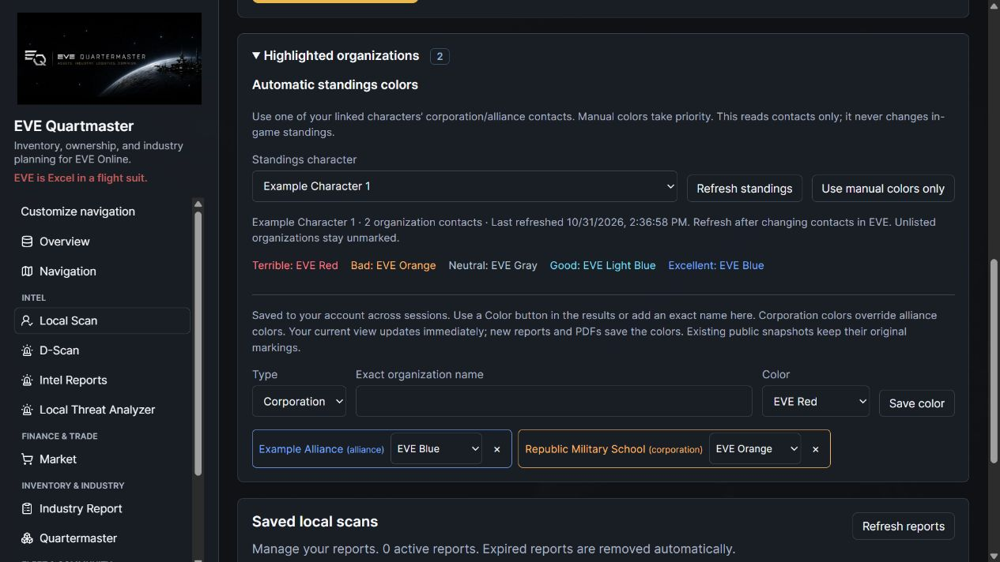
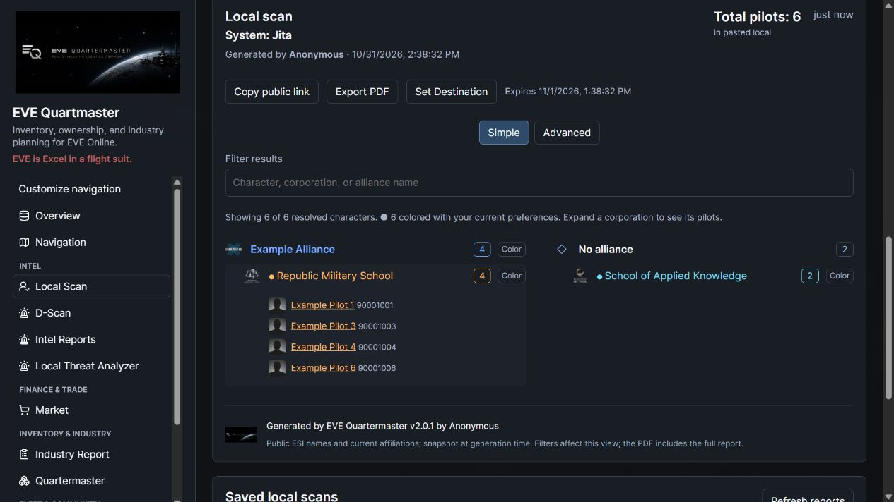
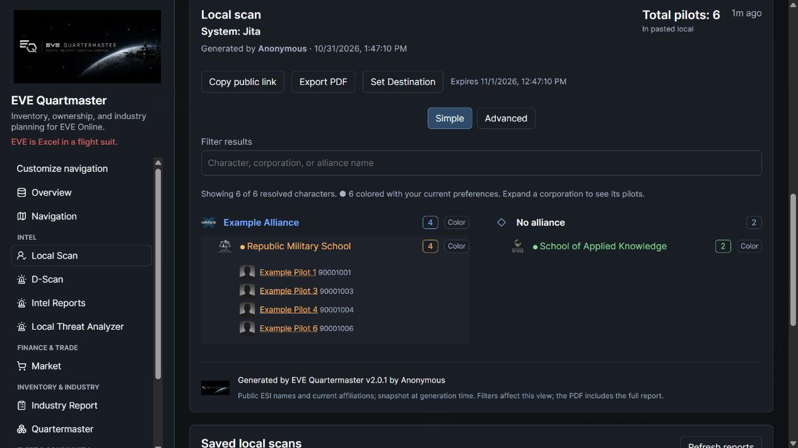
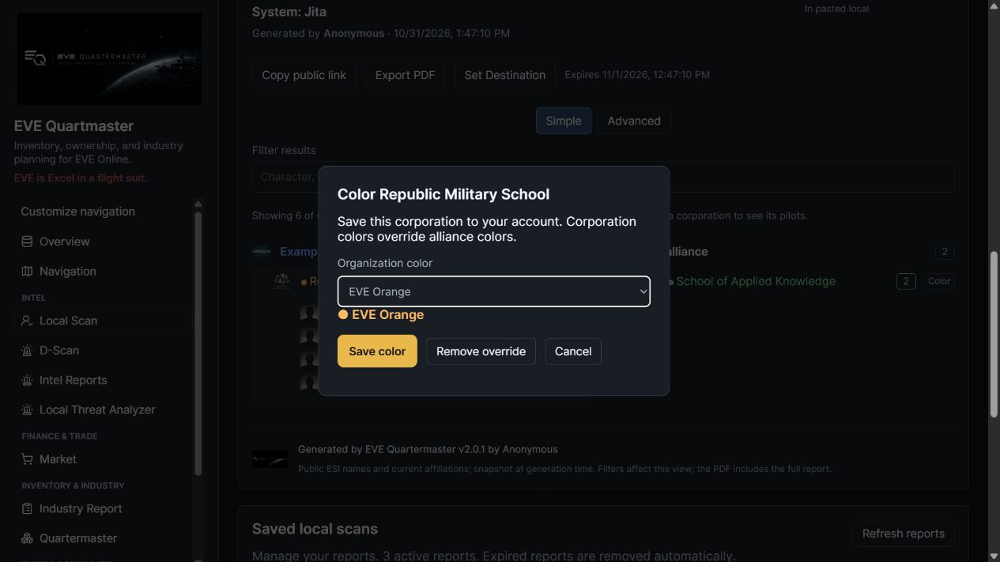

# Persistent organization colors in scans

Unreleased follow-up on the 2.0.1 working tree. Deploy matching backend, worker and frontend with migration **0101_scan_highlight_colors** after 0100. Existing saved organizations migrate to red; report snapshots are not rewritten.

In Local Scan, generate or open a saved report, then click **Color** beside an alliance or corporation. Choose EVE Red, Orange, Blue, Light Blue, Green, Purple or Gray and save. The rule belongs to your account and persists across sessions. **Highlighted organizations** also lets you add an exact organization name, change a saved rule's color or remove it quickly. This persistent list is the account's default scheme; named preset switching is not part of this change.

A corporation rule overrides its alliance's rule for that corporation and its pilots. The alliance heading retains its own color. Removing a corporation override restores the inherited alliance color; removing the last applicable rule leaves the corporation unmarked. Account views apply the current scheme immediately, including older saved scans opened from history. A notice identifies when current view markings differ from the stored report.

New Local Scan reports and linked-local D-Scan reports snapshot these colors. Their public views and PDF exports preserve that snapshot even if the creator later changes their preferences. Existing reports with legacy boolean markings render red. PDFs print palette color names as well as colored text. D-Scan colors apply only to linked local organizations and pilots: scan object names do not establish ship ownership.

Only the signed-in account can list or modify its color rules. PATCH and DELETE are owner-scoped; existing section permissions and utility-role restrictions remain enforced. The seven-key palette is validated by the API and database, and arbitrary CSS/HTML values are not accepted. At most 200 organizations can be saved; existing rules remain editable at that limit. Manual rules need no ESI scope. The optional standings source uses explicitly authorized read-only character contacts as described below.

## Selected-character standings source

Open **Highlighted organizations → Automatic standings colors**, select one of your own linked characters, and click **Use this character**. If needed, **Enable read-only contacts** starts EVE SSO for that exact linked character. It adds `esi-characters.read_contacts.v1`, preserving existing permitted grants without adding asset/skill or contact-write scopes. Intel utility accounts still register with identity-only scopes by default and remain excluded from private collection. The registered CCP application must support the contact-read scope. SSO returns to the originating scan module; it does not load contacts until you select/use the source.

The selected character and last successful refresh persist to your account. Automatic colors use the most recently refreshed **corporation/alliance contacts**, not NPC standings or personal character contacts. Use **Refresh standings** after changing contacts in EVE. A failed/partial refresh keeps the previous source and colors; the UI shows their last refresh time. Unlisted organizations stay unmarked. **Use manual colors only** disables the source and clears its cached organization mapping.

| Standing | Color |
| --- | --- |
| Below -5 (including -10) | EVE Red |
| -5 up to, but excluding, 0 | EVE Orange |
| Explicitly 0 | EVE Gray |
| Above 0 through +5 | EVE Light Blue |
| Above +5 (including +10) | EVE Blue |

Priority is **manual corporation → manual alliance → contact corporation → contact alliance**. The alliance heading retains its own applicable color. Manual presets are not inferred from standings; named preset switching is still outside this change.

Only the owning account can select/read a source, even for administrators. Contact reads are bounded and paginated with no DB transaction held during contact paging. The cache stores organization IDs and palette keys only, discarding personal contacts, labels and raw standing values. Revoked tokens, unlinked/reassigned characters and lost scope stop supplying automatic colors. A revision check prevents an in-flight refresh from overwriting a newer selection or disabled source. Public scan/PDF snapshots contain only the resulting pilot/organization colors, never the source character's identity or full contact list.

Migration **0101_scan_highlight_colors** also creates the private source-settings table; this migration has not been deployed independently of the earlier manual-color work.

## Verification and captures

Scan API/PDF regressions cover ownership, persistence, legacy colors, all palette values, corporation precedence, removal inheritance, immutable public snapshots, D-Scan integration, the rule limit and migration upgrade/downgrade. Frontend tests cover precedence, snapshot immutability and palette sanitization. Run `npm --prefix frontend run test:scans` and the production build. Standings regressions add own-source isolation (including staff), explicit utility-safe consent, cache preservation, revocation, concurrent disable, pagination/type filtering and standing boundaries. Browser checks use synthetic fixtures, never live preferences.

[Mobile dialog](../static/ss/v2.0.1/local-scan-colors-mobile.jpg) · [Capture receipt](../static/ss/v2.0.1/capture-receipt.json)
