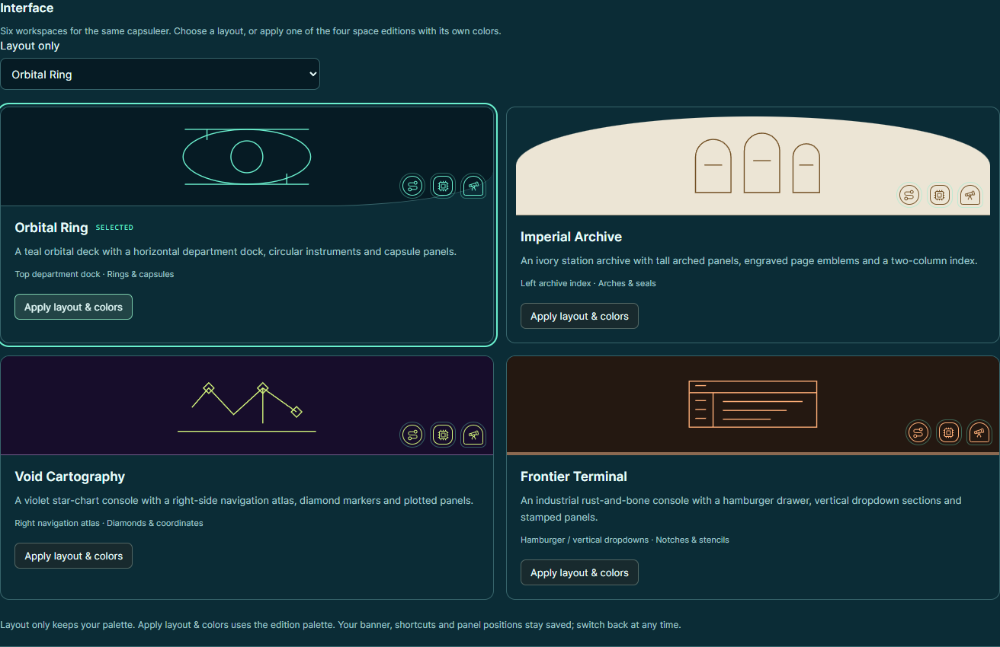
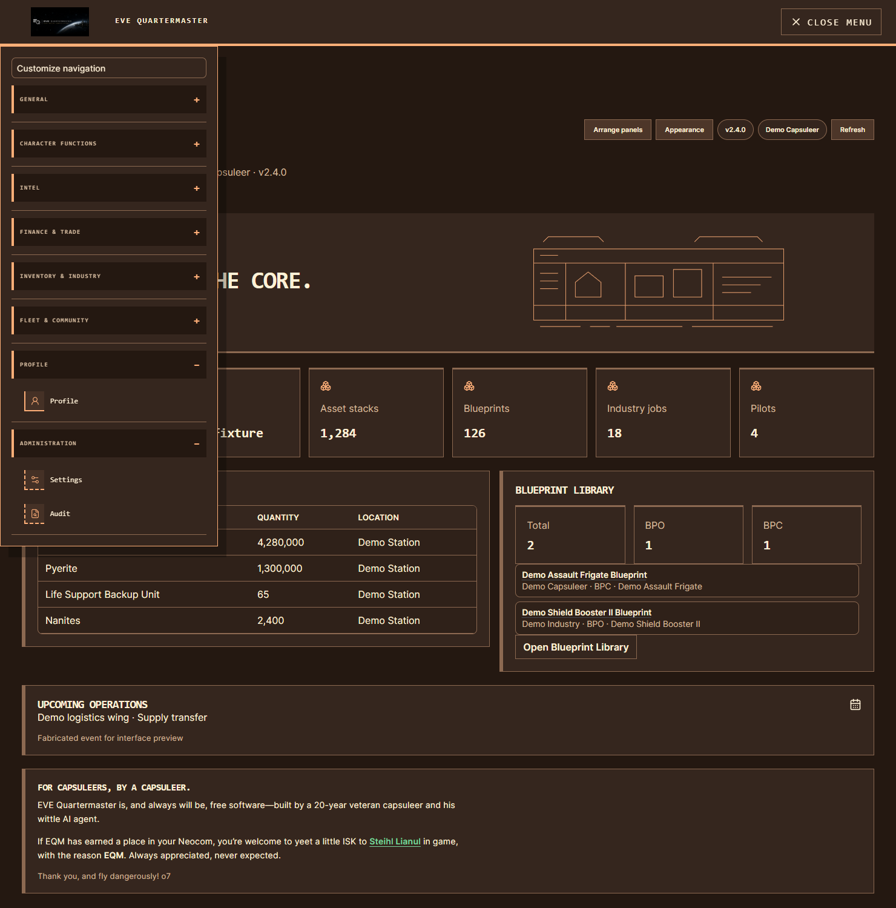

# Space interfaces and Dark Mode

Unreleased v2.4.0 additions. Open **Appearance → Interface** to choose from seven layouts: the existing EQM-Classic and Command Desk, four space editions, and the near-black **Dark Mode**. [Dark Mode and palette consistency](dark-mode-and-palette.md).

| Edition | Navigation | Geometry and palette |
|---|---|---|
| Orbital Ring | Top department dock with dropdown sections | Teal capsules, circular instruments, orbit artwork |
| Imperial Archive | Left two-column navigation index | Ivory/bronze arches, engraved seals, serif headings |
| Void Cartography | Right-side navigation atlas | Violet/lime diamonds, plotted lines and coordinate corners |
| Frontier Terminal | Hamburger drawer with vertical dropdown sections | Rust/bone industrial plates, stencil corners, monospaced headings |
| Dark Mode | Command Desk left navigation and mobile menu | Near-black surfaces, soft gray text and muted blue links |

The four space editions give each page its own pictogram in the navigation and page heading. Dark Mode retains Command Desk’s existing icon treatment. Frames vary by sector: flight, crew, intelligence, trade, industry and systems. Each edition gives those frames a distinct treatment. Original vector artwork introduces the Overview; no decorative diagram represents live telemetry.

## Choose layout and colors

**Apply layout & colors** on an edition card saves that interface and its matching six-color palette together. **Layout only** keeps your current palette. Selecting a new edition with no saved palette uses its default colors. Existing palette presets, custom colors, previews and cancellation remain available; Reset colors restores the selected edition's default (or EQM dark for Classic/Command Desk).

Your choice is saved to your account. Uploaded banners, navigation shortcuts and panel positions remain saved when changing editions. Classic remains the fallback for missing or unknown interface values.

## Frontier hamburger and mobile menus

Frontier Terminal has a **Menu** hamburger on desktop and mobile. Open it for vertical expandable department sections. **Profile** and **Administration** appear as dedicated sections at the end. Administration contains the permitted Settings and Audit links; Settings retains its ordinary personal/admin permission checks. Sections with no permitted links are omitted.

Select a destination to close the drawer. Escape closes it and returns focus to the hamburger. Department dropdown summaries support native keyboard activation. The other space editions also use an expandable hamburger at narrow widths, retaining their own icon and panel designs.

Frontier gathers Profile, Settings and Audit into those dedicated sections for presentation, including saved shortcuts. The saved navigation is unchanged; other editions show its original placement. **Customize navigation** still edits the saved groups and supports Quicklaunch, arrows, drag handles and shortcuts. Panel arrangement uses the existing region/panel IDs and saved ordering.

## Scope and rollout

The new shell, page emblems and shared panel styling extend across signed-in modules. Existing module content, workflows, permission checks and data sources remain in place; they have not all been rebuilt as separate page implementations. Public/login layouts keep their existing structure. No new ESI scope, data collection or migration is required. Deploy matching frontend/API builds so the API accepts the new interface IDs, including dark_mode. Existing appearance storage migration 0095 remains a prerequisite.

## Validation and previews

69 appearance API tests pass, including account isolation, atomic interface/palette saves, revisions, resets, permissions, image handling and the existing migration round trip. 14 frontend appearance/navigation tests, TypeScript and production build pass. Actual headless Edge checks use the real appearance API with disposable SQLite and the real appearance/navigation/Overview/blueprint components in a synthetic shell. They cover all four desktop geometries, distinct page pictograms, saved choices/reloads, actual Industry filter controls, 390/768/1024px containment, keyboard close, Frontier Profile/Administration navigation, Quicklaunch save/reload, panel ordering, account isolation and returning to Classic/Command Desk. No page errors were observed. The production build retains its existing large-chunk advisory.

The previews use fabricated holdings, pilots, station labels, metrics and events. The shell harness is not the full authenticated production application; permission-filtered menu fixtures supplement the real API authorization tests. No live accounts, SSO, ESI, production database or remote deployment were used. [Complete screenshot gallery](screenshots.md#four-space-interfaces) and [additive capture receipt](../static/ss/v2.4.0/capture-receipt.json).

