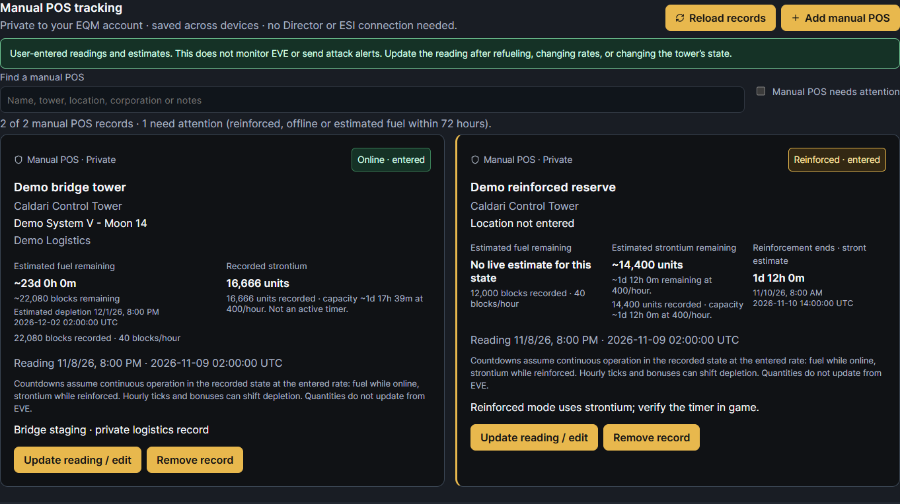

# Structures

Open **Inventory & Industry → Structures** for private manual POS tracking and ESI corporation structures. This is an unreleased development feature for EQM 2.3.0. Manual records require migration `0107_manual_pos` and matching backend/frontend rollout. The existing ESI dashboard does not require an additional ESI scope for this follow-up.

For **ESI corporation structures**, select one of your linked corporation characters. The module reads that character's **current** corporation, checking ESI rather than relying on an old corporation link. Choose another linked character to view another corporation. Each viewer uses their own character authorization; this module does not borrow another account's tokens or share private structure data through public reports or the navigation catalog.

## Manual POS tracking

Manual records need EQM **Structures** section access, but no linked character, ESI token or EVE Director role. They are saved on the server for your EQM account and are available across your devices. Other accounts, including other Hosts/Admins, cannot list, update or remove your records. Manual records stay out of the public navigation catalog and shared reports.

1. Choose **Add manual POS**. Enter a name and optionally the corporation, system/moon and notes.
2. Pick a standard tower preset, or choose **Faction / custom tower** and enter the tower type. Standard large/medium/small presets use 40/20/10 fuel blocks per hour and 400/200/100 strontium units per hour. Both rates are editable for your actual tower and bonuses; selecting a new preset replaces both rates.
3. Enter the quantities observed in game and the **Reading time (UTC)**. Blank quantities mean unknown; `0` means empty. The current-time button uses EVE UTC, regardless of your display timezone.
4. Leave **Reinforced mode** unchecked for normal online fuel tracking. The fuel estimate is `recorded blocks ÷ blocks per hour`, counted from the reading time. Offline and Unknown states retain the reading without assuming consumption.
5. Check **Reinforced mode** to count down the recorded strontium instead. The estimated reinforcement end is `reading time + strontium ÷ strontium per hour`. Switching modes sets the reading time to now: verify the quantities, or set the time to the actual observation/reinforcement start. An optional **Exact reinforcement end (UTC)** overrides the calculated end; the strontium balance remains an independent estimate.
6. Save. Use **Update reading / edit** after refueling or changing state/rates. **Reload records** fetches readings saved on another device. Removing a record requires confirmation and only removes the EQM record.

Cards show the recorded state, reading time, recorded quantities, estimated remaining consumable and UTC/local end times. While online, recorded strontium capacity is potential reinforcement duration rather than an active timer. Reinforced mode uses strontium for its active countdown and does not estimate ordinary fuel depletion. Countdown text updates every 30 seconds while the page is mounted. Elapsed estimates stay marked **verify in game** and do not automatically switch the recorded state.

Search manual records by name, tower, corporation, location or notes. The separate **Manual POS needs attention** filter includes reinforced/offline records and estimated online fuel within 72 hours. The ESI list retains its existing seven-day fuel threshold and independent counts/filters. Manual records remain usable when ESI POS access is denied or there are no linked characters.

All estimates assume continuous operation in the recorded state at the entered rate. Hourly fuel ticks, bonuses, state changes and missed refuels can shift the actual result. Recorded values do not update from EVE. This feature does not detect attacks, poll in the background, or send alerts. Refresh the reading in game to establish a new baseline. Repeated create requests are idempotent; conflicting edits/removals from another tab are rejected so newer readings are not overwritten.

## ESI authorization

The new **Structures** section defaults to host/admin, director and officer accounts. Existing section permissions and global module disabling apply. EQM permission does not grant EVE corporation roles.

Enable these scopes on the EVE developer application, then choose **Authorize Structures** and approve the selected character through EVE SSO:

| Source | Scope | EVE corporation role in the current schema |
| --- | --- | --- |
| Upwell structures | `esi-corporations.read_structures.v1` | Station Manager (or Director) |
| POS list and fuel/settings | `esi-corporations.read_starbases.v1` | Director |

The dedicated authorization action preserves the token's existing, currently allowed scopes. Its callback checks that the approved character matches the selected linked character and returns to Structures. No EVE write scopes are added.

## What appears

- Corporation, structure ID, type, solar system, security status and POS moon where available. SDE supplies type/system/moon names; unresolved names retain explicit IDs. POS names identify their moon because the starbase list does not supply a custom tower name.
- Upwell state and online/offline/cleanup service states, ESI fuel expiry with remaining time, current state timer start/end, and scheduled unanchoring completion.
- Configured reinforcement hour in UTC and a requested change/apply date. These settings are separate from an active state timer.
- POS online/offline/onlining/reinforced/unanchoring state, online-since time and reinforcement end time. `unanchor_at` is the **start** of POS unanchoring; completion is not supplied and is not inferred.
- Expand **View fuel & settings** on a POS for reported fuel quantities, including fuel blocks, strontium and other consumables when present, plus the access and defense settings ESI supplies. Detail requests derive the POS's system from its authorized corporation list. An omitted fuel array stays “not reported”; an empty array stays “no fuel entries reported.”

Search by name, type, system or ID, filter Upwell/POS, or select **Needs attention**. Attention covers reported fuel expiry within seven days (including elapsed dates), reinforcement, offline, deployment/onlining/anchoring/unanchoring, and armor/hull vulnerable states. The normal Upwell `shield_vulnerable` state alone does not imply an attack. The app does not derive live hit points, an attack in progress, or an abandoned/low-power state from absent fields or service states.

## Freshness and limits

These three ESI routes are cached for up to **3,600 seconds**. The list shows the ESI response date for each successful source and the time EQM checked it. Refresh uses the existing shared ESI transport/cache and honors its rate and error limits; it cannot force CCP to publish a new reading. The visible module checks every five minutes; countdown text updates every 30 seconds. Closing the module stops its polling. POS detail is requested when expanded.

Expired timestamps read **Elapsed · awaiting ESI update**. The module does not change a structure's displayed state merely because its timer has elapsed. All timer dates include UTC; local dates follow the viewer's configured timezone.

Both lists are paginated fully, with duplicated IDs removed. A failed page makes that source unavailable instead of presenting a partial list as complete. Missing scopes, denied roles, authorization failures and upstream errors are distinct from successful empty lists. The other source can still display; coverage is labelled partial. Failed refreshes retain prior results with an explicit warning. A successful empty list is valid before you deploy your first tower.

This first implementation reads ESI on demand and uses its transport cache; it does not retain a structure history or poll offline in the worker. It does not currently enumerate POCOs/skyhooks or create attack notifications. Upwell fuel block quantities would require separate corporation asset access; the module uses ESI's reported expiry instead. ESI POS fuel duration is not guessed from tower size; estimates belong to the separate user-entered manual records. Manual tracking requires migration `0107_manual_pos` (after `0106_scan_character_notes`); the existing ESI path needs no additional schema change. Migration downgrade refuses to discard saved manual records until they are explicitly exported/removed. No version bump or live EVE operation is part of this follow-up.

## Source and verification

Fields, role requirements and caching were checked against CCP's [current ESI OpenAPI specification](https://esi.evetech.net/meta/openapi.json), specifically `GET /corporations/{corporation_id}/structures`, `GET /corporations/{corporation_id}/starbases`, and `GET /corporations/{corporation_id}/starbases/{starbase_id}`. Existing EQM `EsiClient` compatibility-date and routing behavior are retained.

Regression checks cover section/token/character isolation (including staff), revoked tokens and transferred characters, current corporation membership, scope consent, partial failures, empty and missing fuel, pagination, and persisted-navigation acceptance. UI checks use actual React components/styles with synthetic responses produced by the real FastAPI serializers in an isolated SQLite database. No live SSO, ESI collection, private structures or game data appear in the screenshots.
