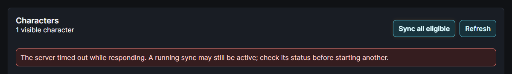
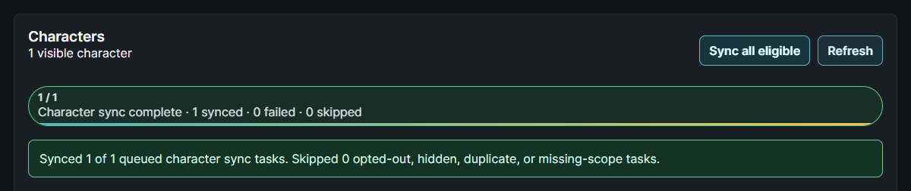

# Sync All reliability and gateway errors

This v2.3 fix was tested locally and in disposable PostgreSQL regression containers.

## The captured failure

A live Sync All status request returned nginx 504 while a PostgreSQL transaction was idle with uncommitted work. Another API transaction was waiting on a token-rotation UPDATE of `esi_tokens`. Even direct `/api/health`, login bootstrap and branding requests stalled. Containers had no restarts/OOM events, and memory, database connections and server disk had ample capacity. Earlier idle-transaction timeout logs and later spontaneous recovery support an intermittent lock stall, rather than a failed Git update. Not every possible 504 has this cause.

The old OAuth helper assigned the rotated credential to the caller's ORM token. A later flush could write that row while the sync continued awaiting ESI, name/location resolution or rate admission. Another coroutine's synchronous token UPDATE could then wait on the same row and block the API event loop, preventing the first coroutine from resuming and committing. A PostgreSQL idle transaction timeout could eventually break the cycle.

## Credential persistence

The shared ESI refresh helper now reads authorization state in a short independent session, closes it before OAuth, then persists a successful rotation in another short independent session. Database phases run in worker threads; the request's original session and pending sync/job/contact edits are not shared with those threads or committed by the helper. The caller's token attributes are synchronized without marking the saved credential dirty again. Credential maintenance survives a later inventory-sync rollback.

Persistence checks the original credential, token owner/character IDs, revocation, user deletion, character ownership and current permitted scopes before saving. Changed authorizations return 409/403 instead of overwriting a newer credential or reviving a link. The token row uses `FOR NO KEY UPDATE NOWAIT`, which remains compatible with the key-share lock taken by an unfinished sync-job foreign key. Contention returns a safe 503 with Retry-After rather than waiting on the API loop. SQL parameters and OAuth response bodies are not included in that error.

See PostgreSQL's [row-level lock compatibility](https://www.postgresql.org/docs/16/explicit-locking.html#LOCKING-ROWS) and SQLAlchemy's [locking options](https://docs.sqlalchemy.org/en/20/core/selectable.html#sqlalchemy.sql.expression.GenerativeSelect.with_for_update), [session concurrency model](https://docs.sqlalchemy.org/en/20/orm/session_basics.html#is-the-session-thread-safe-is-asyncsession-safe-to-share-in-concurrent-tasks) and [committed attribute assignment](https://docs.sqlalchemy.org/en/20/orm/session_api.html#sqlalchemy.orm.attributes.set_committed_value).

## Browser behavior

The shared API client retains HTTP status information and displays a readable gateway/busy notice instead of raw nginx HTML. Character Sync All status polling retries 502, 503, 504 and transient network/request-timeout failures against the **same existing job ID**. Backoff grows to ten seconds and remains inside the existing 30-minute polling deadline. Authorization/missing-job failures are not retried; leaving the page stops polling. Status requests have a 15-second per-request budget, independent of a long-running sync-start operation.

The POST that starts a sync is never automatically retried. If starting a sync times out, the browser explains that it may still be active; check its status before starting another. This change does not make in-memory jobs persistent across backend restarts, serialize all possible OAuth clients across multiple API replicas, or promise to eliminate every database lock. Proxy timeout limits and database pool sizes are unchanged.

## Verification and rollout

- Broad backend regression run: **187 passed**, with three optional PostgreSQL cases skipped locally. Covers collection/consent permissions, utility downscoping, account SSO, ESI transport, sync selection, Journey and Quartermaster paths. After the final ownership guard, **12 focused OAuth tests passed**, including character transfer, token owner change, revocation, credential race, role changes, caller rollback and event-loop responsiveness.
- The three optional tests also ran against **real PostgreSQL** in a disposable isolated database and **all passed**: reproduce the legacy lock, release the token while a caller's sync job stays uncommitted, and return a prompt safe 503 while the API loop remains responsive. No production credentials, volumes or published ports were used; test containers were removed.
- **Eight frontend error/polling tests**, TypeScript and the production build passed. Three browser cases use the real CharactersPage and API client with synthetic local HTTP responses: readable HTML gateway failure without POST retries, the same job recovering after a 504 status poll, and 390px mobile layout. Screenshots crop complete controls/notices; supporting demo components and dossier data are synthetic/minimal.

Deploy matching backend/frontend builds to apply both parts; no migration, dependency change or new ESI scope is needed. A Git pull without rebuilding the running images does not activate the fix. Restarting the API can interrupt existing in-memory jobs. [Capture provenance/checksums](../static/ss/v2.2.1/capture-receipt.json).

The optional PostgreSQL test requires `EQM_REFRESH_TEST_DATABASE_URL` pointing to a deliberately disposable `eqm_refresh_test` database on localhost. It creates/drops its test tables and refuses other database names/hosts. Do not point it at an application database.
